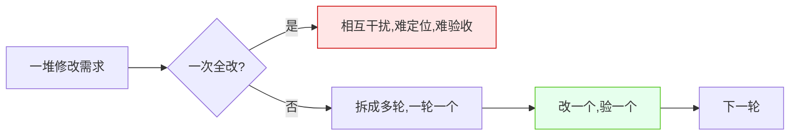
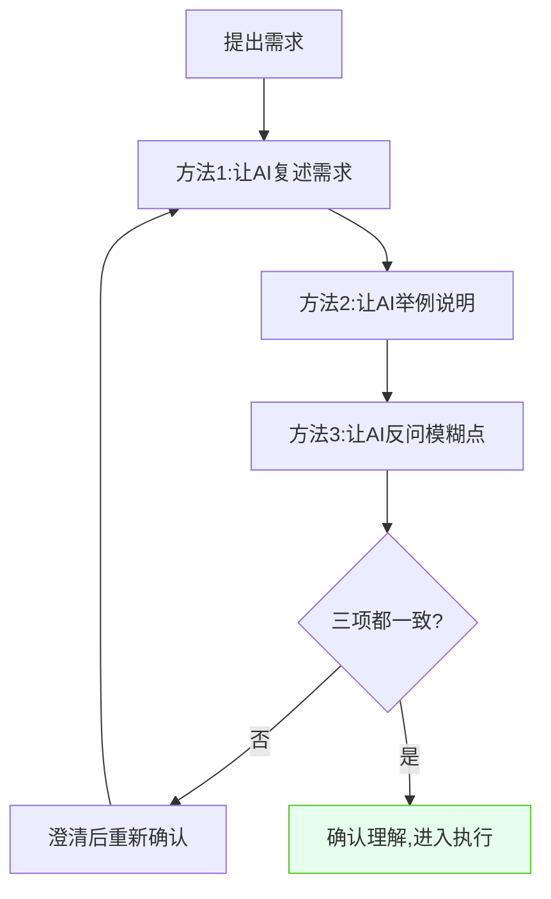
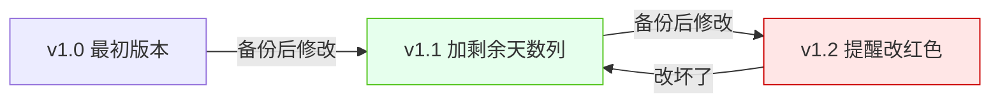

# 第17章 如何让 AI 逐步修改，而不是一次改完

> 这是第四篇的收官章，也是把前面所有方法"串起来"的一章。核心就一句话：别把一堆修改一口气丢给 AI，而是**一次一个、先分析后动手、每步验收、全程记录**。慢，就是快。

## 本章你会学到

- 为什么一次改多个问题必然乱
- "先分析、再计划、后执行"的三步工作法
- 怎么确认 AI 真的听懂了你的意思
- 怎么分阶段验收、怎么避免过度修改
- 怎么建立修改记录和版本备份

### 引子：一口气提五个修改，结果五个都没改对

林小满攒了一堆想改的地方，这天她一股脑发给 AI：

**你：** 帮我把软件改一下：1）列表加个"剩余天数"列；2）提醒改红色；3）按钮变大；4）加个按客户查询；5）把统计页的数字修一修，好像不太对。都改好告诉我。

**AI：** 好的，已完成全部五项修改。

林小满一看：第 1 项加的列位置不对，第 2 项红色改到了别的页面，第 3 项按钮大得离谱，第 4 项查询功能查出来的结果不对，第 5 项统计数字——还是不对。

她又急又气："五项全改了，五项都不对，我还得一项项重新说。"

问题就出在"一口气五项"。AI 同时处理太多任务，容易顾此失彼；而且五项全改完才一起看，你根本分不清哪项是哪次改坏的、哪项之间互相影响了。

正确的做法，是**把五个问题拆成五轮，一轮一个，改完一个验一个**。这样每一轮都清清楚楚，出了问题立刻知道是哪里。

这一章，就教你这套"逐步修改"的工作流。它是第四篇所有方法的总装配。

## 17.1 一次修改一个问题

第一条铁律：**一次只让 AI 改一个问题。**

为什么？三个原因：

1. **好定位**。一次只改一个，出问题必定是这一处，不用大海捞针。
2. **好验收**。一次一个，你可以立刻确认"这个改对了没"，不会攒成一团糊涂账。
3. **少冲突**。多个修改同时做，可能互相影响（改了 A 又动了 B），拆开就不容易打架。

**❌ 错误的改法**

**你：** 把列表改一改：加"剩余天数"列、提醒改红色、按钮变大，都弄好。

**AI：** 好的，全部完成。（结果：三个改动纠缠在一起，红色跑到别的页，按钮大得难看，你无法确定是哪个改动引起的问题。）

**✅ 正确的改法**

**你：** 这次只做一件事：在订花列表页增加一列"剩余天数"，显示每个订单距离送达还有几天。只加这一列，其他什么都不改。做完告诉我，我确认后再说下一件事。

**AI：** 好的，只在订花列表页增加"剩余天数"列，其他不变。请验收。

（你确认后，再发第二件事——提醒改红色；再确认，再发第三件——按钮变大。）

一次一个，看起来慢，实际上最快——因为你不用返工。



## 17.2 先分析，再修改

第二条铁律：**任何修改，先让 AI 分析，分析完你确认，再动手。**（这一点第13、16章都提过，这里把它变成固定流程。）

分析阶段，让 AI 回答三个问题：

1. **现状是什么**？（它打算改的东西，现在是怎么实现的）
2. **会影响什么**？（有没有其他功能、数据会被连累）
3. **打算怎么改**？（它准备采取什么方案）

**你：** 我想在订花列表加"剩余天数"列。先别急着改，请先分析：
1. 现在列表的数据是怎么来的？
2. 加这一列会不会影响其他页面（比如统计页、详情页）？
3. 你打算怎么实现？只说方案，不要改代码。
我确认后再动手。

**AI：** 分析如下：1）列表数据来自订单表，含送达日期字段；2）新增一列只是显示计算，不改数据，不影响统计页和详情页；3）方案：在列表渲染时根据送达日期算出剩余天数，显示为新增列，不改动数据结构。等你确认。

这一步的价值：**让你在"还没改坏之前"就叫停。** 如果 AI 的方案里出现"我会顺便改一下订单表"，你就能立刻拦住它。

## 17.3 先给修改计划，再执行

分析之后，再进一步：**让 AI 给出明确的"修改计划"，你照着审核，再放行。**

计划和分析的区别：分析回答"会怎样"，计划回答"具体分几步、每步改什么"。计划要细到你能判断"它会不会越界"。

**你：** 分析结果我认可。现在请给出具体的修改计划，分步骤列出：
1. 每一步要改什么（哪个页面、哪个元素）；
2. 哪些地方明确不动；
3. 改完后怎么验证。
只给计划，先不要执行。我看了计划确认后再动手。

**AI：** 修改计划：
步骤1：在订花列表页的数据显示逻辑中，增加"剩余天数"的计算（用送达日期减今天）。
步骤2：在列表表格增加一列，表头写"剩余天数"，放在"送达日期"之后。
步骤3：不动其他列、其他页面、数据结构和订单数据。
验证：打开列表页，核对每笔订单的剩余天数是否正确。
等你确认计划后执行。

审核计划时，重点看两处：**有没有越界**（动了不该动的），**有没有遗漏**（漏了该做的）。觉得不对，就直接说"第 2 步的表头位置改成……"让它改计划。

## 17.4 如何确认 AI 理解了你的意思

有时候，你觉得自己说清楚了，AI 也回了"好的"，结果做出来还是不对。问题往往在于：**它"听懂了字面"，没"理解意图"。**

怎么提前发现？三个验证方法：

**方法一：复述法**——让 AI 用自己的话把你的需求复述一遍。它复述对了，才算真懂。

**你：** 先别动手。请你用你自己的话，把我的需求复述一遍：我要在什么页面、加什么、改成什么样、哪些不能动。复述完等我确认。

**AI：** 我的理解是：你要在订花列表页增加一列"剩余天数"，显示每笔订单还有几天送达；只加这一列，不改其他列、其他页面、数据结构和订单数据。对吗？

复述如果有偏差，你就能在动手前纠正。

**方法二：举例法**——让 AI 用具体例子说明它会怎么做。

**你：** 动手前，举个例子说明：假设一笔订单送达日期是 5 月 12 日，今天是 5 月 10 日，新增的"剩余天数"列会显示什么？

**AI：** 会显示"还有 2 天"。

**方法三：提问法**——让 AI 反问你，把模糊点问出来。

**你：** 关于这个需求，你觉得哪里还不清楚？如果有，先问我，问清楚再动手。

**AI：** 有一个问题：如果送达日期就是今天，"剩余天数"显示"还有 0 天"还是"今天送"？

（你看，AI 问出了你没想到的边界情况——这就是提问法的价值。）



## 17.5 如何分阶段验收

第五条：**不要等全部改完才一起看，而是每完成一小步就验收。**

验收，就是检查"这一步是不是达到了这一步的目标"。验收通过，才让 AI 进行下一步；不通过，当场修正。

**你：** 第一小步（加"剩余天数"的计算和列）做完了。我现在验收：请打开列表，核对三笔订单的剩余天数。核对完告诉我结果，先不要做下一步。

**AI：** 已核对：订单A送达5月12日显示"还有2天"，订单B送达5月10日显示"今天送"，订单C送达5月9日显示"已过期"。符合预期。等待你确认后做下一步。

（你确认后，再说"现在做第二件事：提醒改红色"。）

分阶段验收的好处：

- **早发现**。错误在产生当场就被抓到，不会积累。
- **好回滚**。这一步错了，只退这一步，前面的成果都在。
- **心里有数**。每一步都确认过，你对软件的掌控感越来越强。

把第15、16章的验收清单用在这里：**改界面按页面清单看，改功能按核心功能清单试。** 每一步都配上对应的检查。

## 17.6 如何避免过度修改

第六条：**明确要求"最小改动"，看到 AI 想多做，就砍掉。**

AI 有个坏习惯：改一个东西时，喜欢"顺手"把相关的也优化一下。你说"加一列"，它可能顺手调了列宽、改了颜色、加了排序。结果你只想加一列，它动了一堆。

怎么防？在指令里加上"最小改动"原则，并在计划阶段审核。

**你：** 请遵守最小改动原则：只做实现我需求所必需的改动，不要顺手优化、重构或"改进"任何没有被明确要求的东西。如果你的计划里有超出我需求的步骤，请单独列出来并说明原因，由我决定是否保留。

**AI：** 明白。我只做必需的改动。计划中有一项超出需求："我原打算顺便给列表加排序"，这项我会单独标注，等你决定——默认不做。

审核计划时，看到任何"顺便""优化""改进"的字眼，都要警惕，问一句："这是必需的吗？不是就删掉。"

**你：** "顺便加排序"不是我要的，删掉。只保留加"剩余天数"列。

**AI：** 好的，已删除排序步骤，计划只剩加"剩余天数"列。

## 17.7 如何建立修改记录

第七条：**每次修改都记一笔，建立"修改记录"。**

修改记录，就是一本账：什么时候、因为什么、改了什么、结果如何。它有三个大用：

1. **回溯**：出问题时，能查到"是哪次改坏的"。
2. **交班**：开新对话、换 AI 时，把记录一贴，新来的立刻知道前因后果——正好解决第13章"AI 会忘记"的问题。
3. **复盘**：回头看看软件是怎么一步步长成现在这样的。

记录不用复杂，一张表就够：

| 日期 | 需求 | 改了什么 | 验收结果 | 注意 |
|---|---|---|---|---|
| 5/1 | 加剩余天数列 | 列表页新增一列 | 通过 | 不改数据结构 |
| 5/2 | 提醒改红色 | 列表页提醒文字红色加粗 | 通过 | 仅这一页 |
| 5/3 | 加客户查询 | 新增查询按钮和结果区 | 通过 | 只读不改数据 |

让 AI 帮你维护这份记录，最省事：

**你：** 从现在起，请帮我维护一份"修改记录"，每完成一次修改就追加一行，包含：日期、这次的需求、改了什么、验收结果、需要特别注意的地方（比如禁区）。用表格形式。以后我开新对话时，会把这份记录贴上，你要据此了解软件的来龙去脉。先建好表格，等我做完第一次修改再填第一行。

**AI：** 好的，修改记录表格已建立。每次修改完成后我会追加一行，记录日期、需求、改动、验收结果和注意事项。你把记录贴给我时，我会先读它再工作。

这份记录，就是你的"软件日记"，也是对抗 AI 失忆的武器。

## 17.8 如何管理修改版本

第八条，也是最后一条：**改之前先备份，给每个稳定状态起个版本号。**

版本管理，听起来很技术，其实道理很简单——就像你写文章，改之前先"另存一份"，改坏了还能找回来。

最简单的做法：

1. **改之前备份**。在动手改之前，让 AI 帮你保存一份当前版本（比如"备份当前版本"）。
2. **起版本号**。每完成一次稳定修改，起个号：v1.0（最初能用的版本）、v1.1（加了剩余天数列）、v1.2（提醒改红色）……
3. **改坏了能回退**。新版本出问题，就退回到上一个好版本，再重新改。

**你：** 在动手修改之前，请先帮我备份当前版本，命名为 v1.1（已完成"剩余天数列"）。备份好再开始这次的修改（提醒改红色）。如果这次改完验收不通过，我要能退回到 v1.1。

**AI：** 好的，已备份当前版本为 v1.1。现在开始修改。如果验收不通过，我可以帮你恢复到 v1.1。



版本管理给了你**反悔的权利**。有了它，你改软件时就有底气：大不了退回上一个版本，不会一夜回到解放前。

把 17.7 的修改记录和 17.8 的版本号结合起来，你就有了完整的"修改档案"：每一次改动都有记录，每一个稳定点都有备份。这时，无论 AI 怎么"忘"，你都能靠这份档案把软件管得清清楚楚。

第四篇到这里就完整了。从第13章"为什么改比做难"，到第17章"怎么一步步改、记下来、可回退"，你已经掌握了一套**让软件被反复修改、却越改越好**的方法。这正是绝大多数初学者最缺、也最有价值的能力。

## 常见坑

- **坑：一次提一大堆修改。** 为什么：AI 顾此失彼，多个改动互相干扰，出了问题难定位、难验收。怎么做：拆成多轮，一次一个，改完验一个再下一个。
- **坑：不用确认就让 AI 直接动手。** 为什么：等改完才发现理解错了，白改还得返工。怎么做：先分析、再给计划、并让 AI 复述/举例确认理解，都通过了再执行。
- **坑：等全部改完才一起验收。** 为什么：错误积累，找不到是哪一步坏的，也难回滚。怎么做：每完成一小步就验收，通过了再继续。
- **坑：放任 AI"顺手优化"。** 为什么：它会把你没要求的东西也改了，越改越乱。怎么做：明确"最小改动"原则，计划里看到"顺便/优化"就问是不是必需，不是就删。
- **坑：改坏了没法退回。** 为什么：没备份，只能推倒重来或在错误的版本上越改越乱。怎么做：改前备份、稳定版本起号、改坏能回退；配合修改记录管全程。

## 本章小结

- 逐步修改的核心：一次一个、先分析后动手、每步验收、全程记录、改前备份。
- 一次只改一个问题：好定位、好验收、少冲突；看似慢，实则最快。
- 三步工作法：先分析（会怎样）→ 再给计划（怎么做）→ 后执行；每一步都由你确认放行。
- 用"复述、举例、反问"三招确认 AI 真懂了你的意思，把偏差挡在动手之前。
- 分阶段验收、最小改动、修改记录、版本备份，合起来就是一套完整的"修改档案"，让软件越改越好、随时可回退。

## 动手练习

1. 把你之前"一口气想改的多件事"列出来，拆成一次一个的修改队列，并写出第一件的"分析 + 计划 + 验收"三步指令。
2. 用"复述法"写一条指令，让 AI 在动手前复述你的需求；再用"举例法"给它一个具体日期，问它会显示什么。
3. 为你花店小助手的某次修改，填一行"修改记录"（日期、需求、改了什么、验收结果、注意事项）。
4. 给软件起版本号：说明当前是什么版本、这轮改完叫什么版本，并写一条"改前先备份、改坏可回退"的指令。

## 可复制的指令模板

**模板一：一次修改的三步工作法（分析 → 计划 → 执行）**

```text
我要做一次修改，请严格按三步来，不要跳步、不要一次改多个问题：

我这次只改一件事：[描述这一个问题]。

第一步（只分析，不改代码）：
1. 现状是什么？2. 会影响哪些其他功能和数据？3. 你打算怎么改？

第二步（只给计划，不执行）：
分步骤列出：每步改什么、哪些明确不动、改完怎么验证。

第三步（等我确认计划和理解后才执行）：
动手前先用你自己的话复述我的需求，并举一个具体例子说明改后效果，等我确认无误再改。

改完请按计划里的验证方法自查，并逐条告诉我结果。用大白话回复。
```

**模板二：备份 + 修改记录（贯穿全程）**

```text
在修改之前，请先帮我做两件事：

1. 备份：把当前版本完整备份，命名为 [版本号，例如 v1.1]，并告诉我备份完成。备份好之后才开始这次修改。

2. 维护修改记录：用表格帮我记录每一次修改，包含：日期、需求、改了什么、验收结果、注意事项。这次修改完成后，请追加一行。

另外要求：
- 遵守最小改动原则，只做我明确要求的事，不要顺手优化其他东西；
- 如果这次改完验收不通过，我要能退回到备份的 [版本号]。

请先确认备份和记录表格已就绪，再开始修改。用大白话回复。
```
