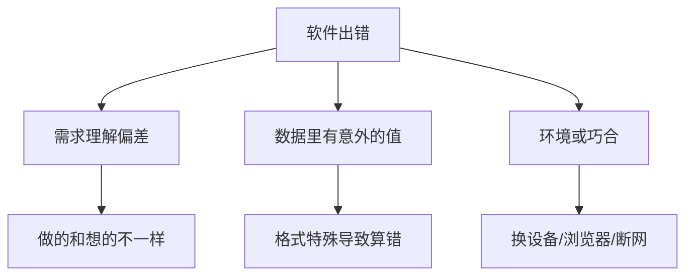

# 第18章 软件出现问题怎么办

> 软件出问题不可怕，可怕的是只说一句"它坏了"，让 AI 无从下手。这一章教你把一句模糊的"坏了"，变成 AI 能看懂、能动手的线索。

## 本章你会学到

- 软件为什么会出错——出错是常态，不是你的失败
- 不懂代码为什么照样能排错——你负责"描述症状"，AI 负责"诊断动手"
- 怎样把错误说清楚：期望是什么、实际是什么
- 怎样提供截图、操作步骤、错误日志这三样"证据"
- 怎样让 AI 先诊断、后修复，避免它胡乱改一通


*图：与 AI 一起排查问题*

### 引子：软件"坏了"，可 AI 不知道哪里坏了

林小满的花店小助手用了两周。这天店员小声说："姐，这个日期好像不对，明明填的是 5 月 10 日，列表里显示成 6 月 10 日了。还有那个保存按钮，我点了没反应。"

林小满一下子慌了。她打开对话框，第一句话就是：

**你：** 我的软件坏了，你快帮我修好！

**AI：** 好的，请问具体是什么问题？哪个页面？点了什么？出现了什么现象？

**你：** 就是……坏了，用不了，你帮我看看。

**AI：** 我这边看不到您的屏幕。方便描述一下是哪一页、做了什么操作、屏幕上显示了什么吗？最好能发一张截图。

这一来一回十几轮，AI 一直在追问，林小满越说越急，问题却一点没推进。

后来她换了种方式：把出错的那一页整屏截了图，写下自己点了哪几步，又把控制台里那行红色的报错原样复制过来。结果 AI 三句话就找到了原因——日期在转换时月份被多加了一，保存按钮是被那段报错卡住了没执行。

差别在哪？**不是 AI 变聪明了，而是林小满给对了线索。** 这一章，就手把手教你怎么给线索。

## 18.1 软件为什么会出错

先纠正一个观念：**软件会出错，是天经地义的事。**

再贵的软件、再厉害的团队做的软件，都有 bug（读"巴格"，就是毛病、错误的意思）。这不是你没做好，也不是 AI 不靠谱，而是软件本来就复杂。

把软件想象成一台机器，由成千上万个小零件（代码、数据、设置）拼成。只要有一个环节对不上，机器就可能出怪声。常见的出错原因有三类：

- **需求没说清，AI 理解偏了。** 你说"到日子提醒我"，你想要的是提前一天，AI 做成了当天提醒。软件没坏，只是和你想的不一样。
- **数据里出现了"意外的值"。** 比如你填日期时用了不同的格式，软件没预料到，就算错了。林小满那个"5 月变 6 月"，就属于这类。
- **环境或巧合。** 换了台电脑、换了个浏览器、网突然断了，原本好的功能就出问题了。



记住一句话：**出错不是意外，是软件开发的一部分。** 高手和新手的区别，不在于会不会出错，而在于出错了能不能快速找到、修好。下面几节就是这套找问题的本事。

## 18.2 不懂代码也能排错吗

能，而且你就是关键的那个人。

打个比方：你去看医生，需要懂医学吗？不需要。你只要告诉医生三件事——**哪里不舒服、什么时候开始的、当时在干什么**。医生靠这些信息诊断，再决定怎么治。

排错也是一模一样：

| 看医生 | 找 AI 排错 |
|---|---|
| 你说"哪里疼、什么时候开始" | 你说"哪个页面、做了什么、出现什么现象" |
| 医生做检查、看化验单 | AI 看截图、日志，分析原因 |
| 医生开药、治疗 | AI 修改代码、修复问题 |
| 你复查、反馈有没有好转 | 你再试一次，告诉 AI 修好没有 |

你会发现，**诊断和动手是 AI 的活，但"描述症状"只有你能做——因为 AI 看不到你的屏幕，也看不到你怎么操作的。**

所以别再说"我不懂代码，帮不上忙"。你能提供准确的现象，就已经帮了最大的忙。这一章剩下的内容，全是教你怎么做这件事。

## 18.3 如何描述软件的错误

第一步，把"坏了"换成"期望"和"实际"的对比。这是一个非常好用的公式：

> **我期望**……，**但实际**……，**区别在**……

对比一下两种说法：

**差的说法：**
> "日期功能坏了。"

**好的说法：**
> "我在新增订花页填的送达日期是 2024-05-10，保存后列表里这一行显示成了 2024-06-10，月份多了一。我期望显示 5 月 10 日。"

第二种说法，AI 立刻知道了：哪个页面（新增订花页）、什么字段（送达日期）、输入什么（2024-05-10）、输出什么（2024-06-10）、差在哪（月份多 1）。线索齐全，它马上就能往"日期转换"这个方向查。

看一段真实的来回：

**你：** 保存客户订花信息的时候报错了。

**AI：** 好的。请告诉我：1）在哪个页面点保存？2）屏幕上具体显示了什么文字？3）是所有订单都报错，还是只有这一条？

**你：** 在"新增订花"页，点保存后弹出一行红字，写着 "invalid date"。我试了三条，两条能存，只有填了 2 月 30 日那条存不了。

**AI：** 明白了，这很关键。"2 月 30 日"本身是不存在的日期，软件没处理好这种输入。我先不动代码——我的判断是日期校验缺失，理由是你只有这条特殊输入会报错。确认后我再动手，可以吗？

看到没？**你只是在如实描述，AI 就一步步逼近了真相。** 描述越具体，来回越少。

## 18.4 如何提供错误截图

有句话叫"一图胜千言"。给 AI 发截图，等于给它一双能看你屏幕的眼睛。但截图也有讲究。

**怎么截一张有用的图：**

1. **截整个窗口，不要只截一个角落。** AI 需要看到上下文——是哪个页面、周围有什么、报错误在哪个按钮旁边。
2. **一定要包含报错文字和出问题的地方。** 红字提示、按钮状态、显示错的数据，都必须在图里。
3. **把关键处标出来。** 如果你的工具能画图，用红圈圈住出错的地方，AI 一眼就能看到重点。
4. **注意隐私。** 客户手机号、真实姓名这些，能打码就打码——把敏感信息遮住再发。

| 不好的截图 | 好的截图 |
|---|---|
| 只截了一个数字"06-10" | 整个列表页，能看到是哪一行、哪一列 |
| 截了一半，报错文字被切掉 | 完整包含红色报错和保存按钮 |
| (client 手机号清晰可见) | 手机号打码，只留日期和报错 |

一个小提醒：截图能发就发，**但不要只发图不说字**。图让 AI 看到现象，文字让 AI 知道你期望什么，两者搭配最好。

## 18.5 如何提供操作步骤

光给一张"出事的照片"还不够，AI 需要知道**这件事是怎么发生的**，这样它才能自己重现一遍、验证有没有修好。这就是操作步骤。

写操作步骤，就当在写一份菜谱，按先后顺序写清楚：

1. 我打开了【哪个页面】
2. 我点击了【哪个按钮】
3. 我在【哪个输入框】填了【什么内容】
4. 然后屏幕上出现了【什么现象】

比如林小满那次：

> 1. 打开"新增订花"页面；
> 2. 在"客户姓名"填"王阿姨"，"电话"填 138****0000；
> 3. 在"送达日期"选 2024-05-10；
> 4. 点击"保存"按钮；
> 5. 页面跳到列表，这一行日期显示成 2024-06-10（每次都这样）。

最后那句"**每次都这样**"很重要。因为有的错误是"偶尔发生"，有的是"每次必现"。告诉 AI 频率，能帮它判断难度：每次必现的问题最好查；偶尔才出的，往往是设备、网络或特定数据导致的。

如果你能说出"我从第 3 步开始就能稳定重现"，AI 就能顺着这条路径去查，效率高得多。

## 18.6 如何提供错误日志

日志是什么？别被这个词吓到。

**日志就是软件自动写下的"行车记录仪"。** 它默默记着软件运行时发生了什么，一旦出错，里面往往会有一行精确的报错。你不需要看懂它，只要会拿、会原样交给 AI。

最常见的日志，藏在浏览器的"控制台"里。拿它的步骤，我手把手带你走一遍：

1. 在出错的那个页面，按键盘上的 **F12** 键（有的笔记本要按 Fn + F12）。会弹出一个面板。
2. 在面板顶部找到 **Console**（中文叫"控制台"）这一栏，点它。
3. 回到页面，把你刚才的操作重做一遍（比如再点一次保存）。
4. 控制台里可能会冒出**红色的字**——那就是报错。
5. **把红色那段（连同它下面几行）原样复制**，发给 AI。

两个关键提醒：

- **不要自己删减或翻译。** 你可能觉得那些英文乱码没用，其实里面藏着出错的行号、文件名，是 AI 定位的宝藏。整段复制最保险。
- **日志可能含隐私或内部信息**，发给 AI 前扫一眼，必要时把手机号之类遮住。

如果软件本身弹出了报错窗口，那窗口里的文字也是日志——照样原样复制给它。

## 18.7 如何让 AI 分析问题

现在，把前面几节的东西打包成一份"排错报告"。一个好用的清单是：

- **一句话概括**：期望什么、实际什么
- **操作步骤**：1、2、3、4
- **截图**：出问题的整屏
- **日志**：控制台原样复制的报错
- **环境**：用什么设备、什么浏览器、是不是第一次出现

来看一段完整的高质量对话：

**你：** 帮我排错，我按"现象—步骤—截图—日志"给你信息。

现象：在"新增订花"页保存订单，期望列表显示 2024-05-10，实际显示 2024-06-10，每次都这样。

步骤：1）打开"新增订花"页；2）填好姓名电话；3）送达日期选 2024-05-10；4）点保存；5）列表日期错。

截图：[附图，整屏，日期列已用红圈标出]

日志：Console 里报错 `Uncaught RangeError: month out of range at formatDate.js:12`

环境：Windows 电脑，Chrome 浏览器，之前正常，今天第一次发现。

**AI：** 收到，信息很全。日志已经指出问题在 `formatDate.js` 第 12 行，报的是"月份超出范围"。结合你"5 月变 6 月"的现象，我高度怀疑是日期格式化时把月份当成从 0 开始计数了（0 代表 1 月），所以 5 月被算成了 6 月。

这样一条信息完整的问题，AI 基本可以直接定位。你给的线索越规整，它少猜多少，就少犯多少错。

## 18.8 如何让 AI 先诊断后修复

最后这一节，是一个能帮你省很多事的习惯：**先让 AI 说原因，再让它动手改。**

很多人一着急就说"你赶紧给我修好"，AI 上来就改。改完要么没修好，要么修好了 A 却弄坏了 B——因为你从头到尾没机会判断它改得对不对。

正确的说法是加一句"**先别改代码**"：

**你：** 先不要修改任何代码。请你根据我给的信息，告诉我：1）你认为问题的原因是什么？2）你的依据是什么？3）你打算怎么改？我确认之后，你再动手。

**AI：** 诊断如下：1）原因——日期格式化函数把月份按 0 起始处理了，导致显示月份比实际大 1；2）依据——报错在 formatDate.js:12，且你所有日期都"大一个月"；3）修改方案——在格式化时给月份加回 1 即可，只改这一个函数，不碰其他页面。请确认。

**你：** 听起来对，就按这个改，改完告诉我改了哪里。

**AI：** 已修改 formatDate.js 的月份处理，仅此一处。请按原来的步骤再试一次，看日期是否恢复为 2024-05-10。

为什么要这么麻烦？三个好处：

1. **你能把关。** 万一 AI 判断错了，你在它动手前就拦住了，避免越改越乱。
2. **你能学到。** 看几次它的诊断思路，你自己也会慢慢懂软件是怎么想的。
3. **改得更准。** AI 把"想清楚"和"动手"分开做，比闷头就改出错更少。

这正是第四篇"先分析、后执行"思路在排错场景里的延续（第17章讲过）。

## 常见坑

- **坑：只说"坏了""用不了"。** 为什么：AI 看不到你的屏幕，"坏了"两个字没有任何可用信息，它只能反复追问。怎么做：用"期望 vs 实际"公式说清现象，再配截图和步骤。
- **坑：只说第一次看到的现象，不说怎么重现。** 为什么：AI 无法自己走到出错那一步，就不能验证修复效果。怎么做：写出 1、2、3、4 的操作步骤，并说明"每次都这样"还是"偶尔发生"。
- **坑：自己删减或翻译报错日志。** 为什么：报错里的行号、文件名是关键线索，你觉得没用的乱码恰恰最有用。怎么做：整段原样复制给 AI，只在涉及隐私时打码。
- **坑：一着急就让 AI"快修好"，不让它先说原因。** 为什么：AI 可能改错地方，改坏别处你还不知道。怎么做：先说"不要改代码，先告诉我原因和依据"，确认后再动手。
- **坑：一次报好几个问题混在一起。** 为什么：多个问题纠缠，分不清哪个改好了、哪个是新冒出来的。怎么做：一次只报一个问题，修好验一个再说下一个。

## 本章小结

- 软件出错是常态，不是你的失败；排错是软件开发的一部分。
- 你不需要懂代码——你负责准确描述症状，AI 负责诊断和动手，就像看病一样。
- 描述错误用"期望 vs 实际"公式，越具体，来回越少。
- 三样证据很关键：整屏截图（含报错）、可重现的操作步骤、原样复制的日志。
- 养成"先诊断、后修复"的习惯：先让 AI 说原因和依据，你确认后它再改，避免越改越乱。

## 动手练习

1. 找一个你最近遇到的软件小问题（不一定是自己的软件），用"我期望……但实际……区别在……"的公式写成一句话。看是不是比原来的描述清楚多了。
2. 打开你的浏览器，按 F12 找到 Console 控制台，随便点一个网页，看看有没有红色报错。练习把它原样复制下来——先熟悉这个动作，真出事时不慌。
3. 把你正在做的软件里一个已知的小毛病，按"现象—步骤—截图—日志—环境"整理成一份排错报告，发给 AI，看它能不能一次就定位。
4. 对比两种指令的效果：对同一个问题，一次说"快修好"，一次说"先诊断别动手"，体会 AI 两次回答的差别。

## 可复制的指令模板

**模板一：完整报障（把线索一次性给齐）**

```text
帮我排查一个问题。我按"现象—步骤—截图—日志—环境"给你信息：

【现象】我期望……，但实际……，区别在……
【步骤】1）……2）……3）……4）……（每次都这样 / 偶尔发生）
【截图】（见附图，整屏，关键处已圈出）
【日志】（Console 里原样复制的报错，未删减）
【环境】（设备、浏览器、是否第一次出现）

请先不要改代码。根据你的判断告诉我：
1）最可能的原因是什么？2）依据是什么？3）你打算怎么改？
我确认后，你再动手。
```

**模板二：让 AI 诊断后只做最小修改**

```text
针对刚才的问题，请按以下方式处理：
1. 先用通俗的话解释问题出在哪里，为什么；
2. 给出最小修改方案——只改必要的那一处，不许顺带改别的地方；
3. 改之前先列出你准备改的文件和位置，等我确认；
4. 改完后告诉我改了什么，并给我一套"重试步骤"，我自己验证是否修好。
```
