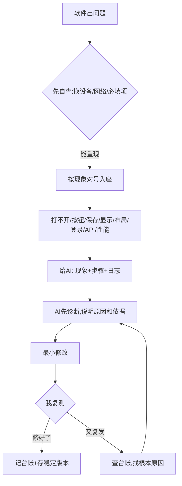

# 第19章 常见软件问题的解决方法

> 软件出的毛病看着千奇百怪，其实来来回回就那么几类。这一章给你一张"分诊表"：先认出是哪一类病，再照着对应的套路查，最后用一句话把 AI 指挥到位。

## 本章你会学到

- 页面打不开、按钮没反应、数据存不上……常见问题分成哪几类
- 每一类问题的排查思路，以及可以直接复制给 AI 的说法
- 怎么区分"软件坏了"和"我用错了"
- 为什么 AI 会把同一个问题反复修、越修越乱
- 怎么用问题台账、复测和稳定版本打断"反复修"的死循环

### 引子：一周之内，什么毛病都冒出来了

花店小助手正式用起来后，林小满建了个小本子，专门记"今天又出什么幺蛾子了"。短短一周，她记了满满一页：

- 周一：店员说页面打开是一片空白；
- 周二：点"新增订花"按钮，一点反应没有；
- 周三：填好的订单保存不了；
- 周四：列表里金额显示成了别的值；
- 周五：手机上看着页面挤成一团；
- 周六：新来的店员登不进去；
- 周日：软件越用越卡。

"我这软件是不是买了个病秧子？"她哭笑不得。

她把这些一股脑发给 AI，AI 也被绕晕了，修了这个坏了那个。后来她学聪明了：**一次只处理一个问题，而且先判断它属于哪一类。** 她发现，不同类型的问题，排查的方向完全不同——空白页要先看有没有报错，按钮没反应要先看是不是被挡住了，数据存不上要先看是不是必填项没填。

这一章，就把这些"分类套路"一条条教给你。你不用记代码，只要会对号入座、会照着套路问 AI。

先记住这张"分诊图"——遇到问题，从左上角开始往下走：



## 19.1 页面打不开

**现象**：打开软件，页面一片空白、一直转圈，或者显示"无法访问""404""服务器错误"。

生活化比喻：页面打不开，就像你按了门铃却没人开门。原因无非几种：你走错门了（网址错了）、屋里没人（服务器没启动）、门铃坏了（网络问题），或者屋里在装修（程序出错）。

排查三步：

1. **先确认是不是"门外"的问题**：换台设备、换个网络（比如从 Wi-Fi 切到手机热点）试试。如果别的电脑能打开，说明是你的设备或网络的问题，不是软件坏了。
2. **看地址对不对**：网址是不是复制漏了字符。
3. **按 F12 看 Console 有没有红色报错**（第18章教过）。空白页几乎总能在控制台找到线索。

给 AI 的说法：

**你：** 打开软件是空白页。我换了手机热点还是打不开，地址确认没错。F12 的 Console 里报错是 `[把报错原样粘贴]`。请判断是前端还是服务器的问题。

## 19.2 按钮没有反应

**现象**：按钮点了没动静，像按了个坏掉的开关。

生活化比喻：按钮就像一个电灯开关。灯不亮，可能是开关没接上电（按钮没绑定功能），也可能是前面有个东西挡住了你按不到（有透明层盖在按钮上），还可能是按下去要等一会儿才亮（在处理中）。

排查三步：

1. **看按钮是不是"灰的"（禁用状态）**。很多按钮在必填项没填好时会变灰、点不动——这不是坏了，是它在等你填完。
2. **看点了之后有没有任何变化**：控制台报错？转圈？弹提示？
3. **换个浏览器或刷新页面再试**，排除临时卡住。

| 现象 | 可能原因 | 怎么问 AI |
|---|---|---|
| 按钮是灰的 | 必填项没填 / 条件不满足 | "为什么保存按钮是灰的？怎样才会亮？" |
| 点了有红色报错 | 按钮绑定的功能出错 | "点保存按钮报这个错 [日志]，请定位。" |
| 点了完全没动静 | 按钮没接上功能 / 被遮挡 | "点按钮没有任何反应，Console 也没有报错，请排查。" |

## 19.3 数据无法保存

**现象**：填好表单点保存，提示失败，或者保存后数据不见了。

生活化比喻：保存数据就像往档案柜里放文件。放不进去，要么是表格没填全（必填项缺失），要么是档案柜锁了（没权限），要么是柜子满了或格式不对（数据校验、字段长度限制）。

排查三步：

1. **检查必填项**：是不是有带星号（*）的栏位空着。
2. **检查输入格式**：日期、手机号、金额有没有按要求的格式填。林小满那次"2 月 30 日存不了"，就是填了个不存在的日期。
3. **看保存时的报错或提示**：软件往往会告诉你"哪一栏不对"，只是字很小容易忽略。

给 AI 的说法：

**你：** 保存订单失败。我填了姓名、电话、日期 2024-02-30，点保存提示 [原文]。Console 报错 [日志]。请判断是哪一项的问题。

**AI：** 问题在于 2024-02-30 这个日期不存在（2 月没有 30 号），软件收到后校验失败。这不是保存功能坏了，而是缺少友好的提示。我可以：1）加一个日期校验，填了不存在的日期就提示用户；2）把报错翻译成人话。你要哪个？

## 19.4 数据显示错误

**现象**：数据存进去了，但显示得不对——金额变成别的数、日期差一天、名字少个字、中文变乱码。

生活化比喻：这就像你把信投进了邮筒，但收信人读出来是错的。信没丢（数据存对了），问题出在"念信"这个环节——从数据库取出来、转成能显示的样子时出了岔子。

排查三步：

1. **先确认数据本身对不对**：重新打开这一条，看原始输入是不是对的。如果重新打开是对的，只是显示错，那就是"显示环节"的毛病。
2. **找规律**：是所有数据都错，还是只有特定的错？比如所有日期都"大一个月"，就是转换规则的问题；只有某一条错，可能是那条数据本身特殊。
3. **看金额、日期这类"会被计算"的字段**，它们最容易在单位换算、时区、格式转换时出错。

这类问题用第18章的"期望 vs 实际"描述最有效：**"我存的是 X，显示的是 Y，其他都正常"**——规律越清楚，AI 越好查。

## 19.5 页面显示错乱

**现象**：文字重叠、按钮跑到屏幕外、手机上挤成一团、图片撑破版面。

生活化比喻：这就像你照着一张设计图摆家具，结果沙发压在了茶几上。东西都在，只是**位置和大小**乱了——这在软件里叫"布局"（页面元素的摆放）问题，大多和屏幕尺寸有关。

排查三步：

1. **确认在哪些设备上乱**：只在手机乱，还是电脑也乱？只在某个浏览器乱吗？
2. **试试缩放**：浏览器按 Ctrl + 减号 / 加号改变缩放，看会不会好转——这能提示是不是尺寸适配的问题。
3. **说清楚"哪里乱、乱成什么样"**：比如"手机上，订花列表的文字和价格重叠了"。

给 AI 的说法：

**你：** 页面显示错乱。电脑上看正常，手机上看订花列表的文字和价格重叠，按钮被挤到屏幕外面。请帮我做移动端适配，只改列表页的布局。

**AI：** 明白。我会给列表加响应式布局：窄屏时把价格和文字分两行、按钮换行显示。只调整列表页样式，不动数据和功能。

## 19.6 登录和权限异常

**现象**：登不进去、密码对了也进不去、新用户注册不了、店员能看到不该看的东西。

生活化比喻：登录就像刷门禁卡进门。"卡对了进不去"可能是卡消磁了（账号状态异常），也可能是读卡器坏了（登录功能出错）。权限则是"不同级别的卡能进不同的房间"——店员卡不该能进老板的账本房。

排查三步：

1. **区分"登不上"和"权限不对"**：这是两个完全不同的问题，一次只说一个。
2. **说清具体提示**：是"密码错误""账号不存在"，还是直接没反应。
3. **权限问题要说清"谁、不该看到什么"**：比如"店员账号不该看到成本价，但现在能看到"——这涉及安全，要优先修。

安全提醒：如果发现权限漏洞（普通用户看到了管理员内容），**别拖，立刻让 AI 修**，并暂时停用有问题的入口。

## 19.7 API 调用失败

**现象**：软件某个功能要用"网上的数据"时失败，比如地图加载不出、短信发不出、支付调不起来。

先解释 API。**API（读作"接口"）就像软件之间的"传菜员"**：你的软件想用别家服务的数据（比如天气、地图、支付），就通过 API 去要。传菜员没送到，这个功能就用不了。

生活化比喻：API 失败，就像外卖没送到。要么是地址写错了（接口地址错了），要么是钥匙过期了（密钥、令牌过期），要么是店家打烊了（对方服务临时不可用），要么是你点的太多被限流了（调用次数超了）。

排查三步：

1. **看报错的状态码**：404 是"地址找不到"，401/403 是"没权限/密钥不对"，500 是"对方服务器出错"，429 是"调用太频繁"。让 AI 解释它。
2. **检查密钥**：很多 API 需要一个密钥（一串密码），过期或写错都会失败。
3. **确认是不是对方服务的问题**：换个时间再试，或看服务商的公告。

给 AI 的说法：**"调用 [某某] API 失败，报错 [状态码和原文]，我的密钥是最近申请/配置的。请判断原因并给出排查步骤。"**

## 19.8 软件运行速度慢

**现象**：打开要等半天，点一下转很久，数据一多就卡死。

生活化比喻：软件变慢，就像房间堆了太多东西，找一样东西要翻半天。原因通常有几个：东西太多（数据量大、没分页一次全加载）、反复跑冤枉路（重复请求）、东西没归位（缺少索引、重复计算）。

排查三步：

1. **说清"慢在哪一步"**：是打开慢、某个操作慢，还是数据多了才慢。"一打开就慢"和"填了 100 条以后才慢"，原因完全不同。
2. **数据量因素**：试着少放点数据，看是不是数据量大了才慢。
3. **让 AI 找瓶颈**：不要上来就说"优化一下"，要它先找出"最慢的那一处"再动手。

给 AI 的说法：

**你：** 软件变慢了。数据少的时候正常，超过 100 条订单后，打开列表要等 5 秒。请先不要改代码，帮我找出最可能慢在哪里、依据是什么，再给优化方案。

**AI：** 初步判断：列表页一次性加载了全部订单，没有分页，数据一多就慢。依据是"数据少正常、数据多才慢"。建议先加分页（每页 20 条），改动小、见效快。确认后我再动手。

## 19.9 如何避免 AI 反复修复同一个问题

这是很多人最头疼的："明明修过了，怎么又坏了？" AI 有时像记性不好的修理工，同一个漏水点修三遍。原因有几个：

- **只治标没治本**：把出错的现象盖住了，根源还在。
- **改了 A 坏了 B**：这次的修改把上次修好的地方又弄坏了。
- **上下文丢了**：聊久了 AI"忘了"之前修过什么，又按老办法改一遍。

打断这个死循环，靠四招：

1. **建问题台账。** 用一张表记下：问题、症状、原因、修法、日期。下次再现，先查台账，不再从零开始。这也是给 AI 的"记忆"。

| 日期 | 问题 | 根本原因 | 修法 | 是否已复测 |
|---|---|---|---|---|
| 3/3 | 日期大一月 | 月份 0 起始 | formatDate 加 1 | 是 |
| 3/5 | 保存失败 | 2/30 不存在 | 加日期校验 | 是 |

2. **每次修复都要求 AI 写"根本原因"。** 不许它只说"已修好"。没有根因，就等于没诊断（第18.8 节）。

3. **修完必复测。** 让 AI 给出"重试步骤"，你自己按第20章的方法重做一遍，确认真的好了、且没带出新问题。

4. **保存稳定版本 + 定规矩。** 每次修好一个稳定状态就存个备份（第21章会详细讲），并给 AI 一份"开发规则"清单，要求它每次修改前先看规则。这样即使它"忘了"，也有规矩约束。

给 AI 的话：

**你：** 这个问题我们修过一次（见台账 3/3），但又复发了。请先读台账，确认上次的修法为什么没根治；找出真正的根本原因后，再给方案。并且告诉我这次修改会不会影响之前已经修好的功能。

**AI：** 查了台账，上次只改了显示时的格式化，没改数据入口。根本原因应是数据写入时就存错了一个月。这次我会改写入端，并列出受影响的页面，改完给你复测清单。

## 常见坑

- **坑：好几个问题一起报、一起修。** 为什么：修了这个坏了那个，分不清因果。怎么做：一次只处理一个，修好验一个。
- **坑：把"我用错了"当成"软件坏了"。** 为什么：必填项没填、网址输错这类问题，改软件也解决不了。怎么做：先按本节前三步自查，再决定要不要让 AI 改。
- **坑：说"优化一下""修一下"这种模糊指令。** 为什么：AI 不知道慢在哪、坏在哪，只能瞎改。怎么做：说清"哪一步、什么条件下、什么现象"，并要求它先诊断。
- **坑：API 报错只看一眼"失败了"。** 为什么：状态码和原文才是定位关键。怎么做：把状态码和报错原文完整复制给 AI 解释。
- **坑：修完不复测、不记录，导致反复修。** 为什么：没有台账，AI 和你都"失忆"。怎么做：建问题台账，每次写根因、复测、存稳定版本。

## 本章小结

- 常见问题可归为几类：页面打不开、按钮没反应、数据存不上、显示错误、布局错乱、登录权限、API 失败、速度慢——每类有各自的排查套路。
- 排查的通用心法是"先分门外门内、再看现象和报错、最后找规律"，并用第18章的"期望 vs 实际"描述。
- 先用生活化方式自查（换设备、看必填项、看数据规律），再让 AI 动手，能省很多冤枉路。
- API 是软件之间的"传菜员"，失败时重点看状态码、密钥和对方服务状态。
- 避免反复修的四个法宝：问题台账、要求写根本原因、修完复测、保存稳定版本并给 AI 定规矩。

## 动手练习

1. 从这一章列的八类问题里，挑三类，各写一句话说明"它像生活中的什么事"——用你自己的话，讲给一个不懂电脑的朋友听。
2. 打开你的软件，故意填一个不存在或格式错误的日期（比如 2 月 30 日），看看会发生什么。把现象和报错记下来，发给 AI，看它怎么诊断。
3. 照着 19.9 的表格，建一个属于你的"问题台账"，把你遇到过的三个问题填进去，每一行都写出"根本原因"那一栏（不清楚的就写"待查"）。
4. 找一个你曾经反复修过的问题，按"先诊断、写根因、给复测步骤"的流程，重新让 AI 处理一次，对比和"直接让它修"有什么不同。

## 可复制的指令模板

**模板一：按问题类型分诊**

```text
我遇到一个问题，请你按分类帮我排查：

【现象】我期望……，实际……，每次都这样 / 偶尔发生
【环境】设备、浏览器、数据量
【我已经自查过】换过设备/网络：[结果]；必填项：[结果]；Console 报错：[原样粘贴]

请按以下步骤：
1. 判断它属于哪一类（打不开/按钮/保存/显示/布局/登录权限/API/性能）；
2. 先不要改代码，列出最可能的原因和依据；
3. 我确认后，再给最小修改方案，并给出一套复测步骤。
```

**模板二：问题复发时，要求找根本原因（打破反复修）**

```text
这个问题我们修过，但又复发了。请按以下方式处理，避免再犯：

1. 先读我们的【问题台账】，找到上次对这个问题的记录和修法；
2. 分析上次为什么没根治——是只改了表面，还是改错了地方；
3. 找出真正的根本原因（不要只给临时补丁）；
4. 给出修改方案，并明确说明：这次会不会影响之前已经修好的其他功能；
5. 改完后给我一份复测清单，我要亲自验证。

【台账记录】（把相关几行粘贴过来）
【本次现象】（期望 vs 实际 + 报错原文）
```
