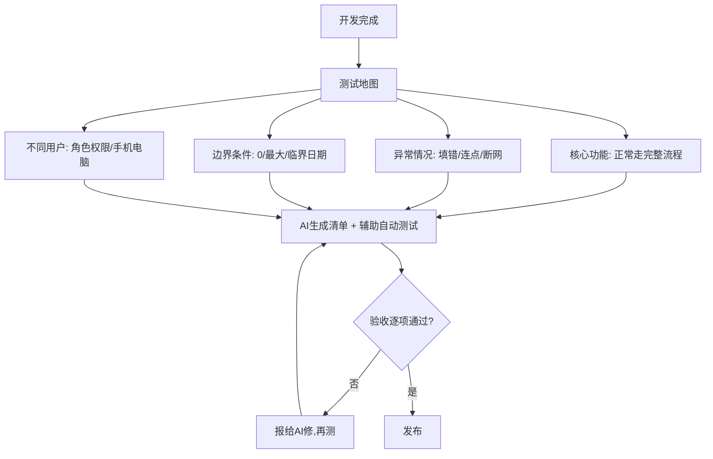

# 第20章 如何测试你的软件

> AI 说"做好了"，不等于真能用了。这一章教你像验房一样验收软件：先测最常用的功能，再故意找茬、试边界、换人换设备，最后让 AI 帮你列清单、跑测试，把问题挡在发布之前。

## 本章你会学到

- 为什么"开发完成"只是半成品，"测试通过"才算完成
- 测试到底是什么——它不是找茬，是替用户提前踩坑
- 四类必测场景：核心功能、异常情况、边界条件、不同用户
- 怎么让 AI 生成一份测试清单、甚至自动跑测试
- 怎么给软件做一次正式"验收"，合格了才发布

### 引子：AI 说"做好了"，店员一用就傻眼

林小满盯着屏幕，AI 刚刚发来一句："所有功能已完成。"

她高兴地把软件交给店员试用。结果十分钟不到，店员跑回来：

- "姐，我想删一条订单，找不到在哪删。"
- "我一次选了十个客户发提醒，只发出去一个。"
- "我把数量填成 0，它居然让我保存了。"
- "我手机上打开，按钮全挤在一起。"

林小满愣住了："AI 不是说做完了吗？"

这就是几乎所有新手都会踩的坑：**把"开发完成"当成了"软件完成"。** AI 通常只保证"它写的代码能跑起来"，却不保证"你要用它时顺不顺手、会不会出错"。中间差的那一步，就叫**测试**。

这一章，我们就手把手把测试这件事讲清楚。你不需要懂技术，只要会"像用户一样用"，再加上让 AI 帮忙列清单、跑测试，就能把绝大多数问题挡在发布之前。

## 20.1 为什么开发完成不等于软件完成

打个比方：厨师把菜端上桌，算不算做完？不算——还得看客人吃着合不合口味、咸淡对不对。盖房子封了顶，算不算完工？不算——还得验房，看水电通不通、门关得严不严。

软件开发也是一样：

- **开发完成**＝代码写好了，功能"名义上"都在。
- **测试完成**＝你亲手用过、故意折磨过、确认它在各种情况下都好用。

AI 擅长的是前者。它会自信地说"已完成"，但它没有真的用你的软件去下一个真实的订单。所以，**AI 说"做好了"，你要回一句"那我们来测测看"**，而不是直接发布。

一个残酷但有用的事实：**问题越晚发现，修起来越贵。** 在你自己测试时发现，改一句话就好；等客户用了才发现，不光要改，还得道歉。测试，就是把"客户替你发现"变成"你替客户发现"。

## 20.2 什么是软件测试

别被"测试"这个正式词吓到。它其实就是一句话：**在用之前，先自己当一回用户，把它从头到尾试一遍。**

你每天都在做类似的事：买衣服要试穿，买水果要尝一口，新手机要按一按。软件测试就是这些动作的合集，只不过对象是软件。

测试不是"找茬"，更不是"证明软件有毛病"。它的目的很正面：**提前发现问题，让真正用的人少遇到麻烦。** 好的测试心态是"我想把它用坏"，因为你现在把它用坏了，用户以后就用不坏了。

测试大致分两类思路：

| 类型 | 心态 | 例子 |
|---|---|---|
| 顺着用（正常场景） | 按设计好的路走一遍，看功能对不对 | 正常新增一条订单，看能不能存、能不能显示 |
| 反着用（找茬场景） | 故意不按套路，看会不会崩 | 必填项空着、数量填 0、连点十次保存 |

两类都要测。只测"顺着用"，会漏掉大量真实世界里的问题。

把这一章要测的东西画成一张"测试地图"，你照着走就不会漏：



## 20.3 如何测试核心功能

核心功能，就是一个软件"存在的理由"。花店小助手的核心功能就两件事：**记订单**和**到日子提醒**。别的都是锦上添花。

测试永远先从核心功能开始，因为这是用户最常用、最不能出错的部分。这里有个 80/20 的规律：**用户 80% 的时间，只用你 20% 的功能。** 先把那 20% 测扎实，收益最大。

怎么测核心功能？走一条"标准路线"：

1. **打开软件**，进入新增订单页。
2. **填一条真实数据**（就像真的有客户订花）。
3. **保存**，看有没有成功提示。
4. **回到列表**，看数据是不是正确显示。
5. **重新打开**这一条，看数据有没有真的存住。
6. **走一遍完整流程**：从新增 → 保存 → 查看 → 提醒（如果今天是提醒日）。

每一步都对，核心功能才算过关。只要一个环节卡住，就停下来按第18、19章的方法报给 AI 修。

一个实用建议：**用真实数据测，不要用"测试123"这种假数据。** 真实的姓名、日期、金额，更容易暴露格式、显示这类问题——林小满那个"日期大一个月"，就是用真实日期才发现的。

## 20.4 如何测试异常情况

正常路线走通了，接下来要"故意找茬"。真实用户可不总按你想的来，异常情况测试就是模拟这些"不按套路"。

常见的找茬动作：

- **必填项故意空着**：姓名不填就点保存，会怎样？
- **填错格式**：电话填成字母，日期填成"2月30日"，金额填成负数。
- **重复操作**：保存按钮连点五下，会不会存出五条一样的订单？
- **中途打断**：填到一半刷新页面、关掉浏览器，数据会丢吗？
- **没有网络**：断网后操作，会不会卡死或报一堆看不懂的错？

生活化比喻：这就像试行李箱，不光要装正常衣物，还得故意塞得满满的、使劲压一压、摔一摔，看拉链会不会爆开。软件也一样，得"折腾"过才算靠谱。

好的软件在异常情况下，应该**给出清楚的提示**（"请填写客户姓名"），而不是崩溃或默默出错。如果发现它崩溃了，就把"我做了什么 + 出现什么"记下来交给 AI。

## 20.5 如何测试边界条件

边界，就是"刚好在临界点"的那些值。 bugs 最爱藏在边界上。

生活化比喻：电梯写着"限载 13 人"。要测的不是 7 人（中间值肯定没事），而是 12 人、13 人、14 人——**刚好在限制线上和线外**，这才是容易出问题的地方。

软件里常见的边界值：

| 场景 | 要测的边界值 |
|---|---|
| 数量 | 0、1、最大值、最大值 +1 |
| 日期 | 2 月 28 日、闰年 2 月 29 日、2 月 30 日（不存在）、年末 12 月 31 日 |
| 文字长度 | 空、1 个字、刚好达到上限、超过上限 |
| 列表 | 0 条数据、只有 1 条、满满一页、跨页 |

林小满的教训就在边界上：她填了"2 月 30 日"这个不存在的日期，软件没拦住，结果存不进去。这就是一个典型的边界 bug。

怎么测？针对每个有"数字、日期、长度"的地方，问自己："最小能填多少？最大能填多少？刚好超过一点会怎样？"把这几个值各试一遍。让 AI 生成边界用例也很高效（见 20.7）。

## 20.6 如何测试不同用户

同一个软件，不同人用，结果可能天差地别。生活化比喻：同一件衣服，高矮胖瘦穿起来效果完全不同。所以要找不同的人来"试穿"。

要考虑两种"不同"：

**一是角色不同。** 花店里有老板（管理员）和店员（普通用户）：

- 老板能看成本价、能改所有订单；
- 店员只能录订单，不该看到成本价，也不该删别人的订单。

测试时分别用这两种账号登录，确认"该看的看得到、不该看的看不到"。这关系到安全，尤其重要（第19.6 节讲过）。

**二是设备环境不同。** 同一页面在：

- 电脑和手机；
- Chrome 和 Safari 浏览器；
- 大屏幕和小屏幕。

都可能表现不同。至少要在你和用户实际会用的设备上各测一遍。林小满"手机上按钮挤成一团"，就是只测了电脑没测手机漏掉的。

## 20.7 如何让 AI 生成测试清单

靠自己想容易漏，让 AI 帮你列一份清单最省事。关键是**把功能说清楚，并明确要求四类场景都覆盖**。

看一段真实对话：

**你：** 我的花店小助手有一个"新增订花订单"功能：填客户姓名、电话、订什么花、数量、送达日期，点保存。请帮我列一份测试清单，覆盖：核心功能、异常情况、边界条件、不同用户/设备。用表格给出，每行写"测什么、怎么操作、期望结果"。

**AI：** 好的，"新增订单"功能测试清单如下：

| 编号 | 场景类型 | 测什么 | 怎么操作 | 期望结果 |
|---|---|---|---|---|
| 1 | 核心 | 正常保存 | 填全信息点保存 | 提示成功，列表出现该订单 |
| 2 | 核心 | 数据留存 | 重开这条订单 | 信息完整一致 |
| 3 | 异常 | 必填项空 | 姓名空着点保存 | 提示"请填写姓名"，不保存 |
| 4 | 异常 | 格式错误 | 日期填 2/30 | 提示日期无效 |
| 5 | 边界 | 数量为 0 | 数量填 0 | 提示数量需大于 0 |
| 6 | 边界 | 超长文字 | 姓名填 200 字 | 截断或提示超长 |
| 7 | 用户 | 店员权限 | 店员账号操作 | 只能新增，不能删改 |

**你：** 很好。第 5 条我没想到——数量 0 确实是个漏洞。请把这份清单存成一份"测试清单.md"，以后每次改完功能都照着测一遍。

看到没？AI 一下子就想到了你没想到的边界情况。**你的活是看清单、补上你们业务的特殊情况，然后照着一条条测。**

## 20.8 如何让 AI 自动测试

每次改完都手动点一遍很累。好消息是，有些测试可以让 AI 帮你自动化。

先说清楚"自动测试"是什么。生活化比喻：就像洗衣机的"自动洗"——你按一下，它自己完成一整套动作，你不用一直盯着。自动测试就是：写好一组"测试动作"，让电脑自己去点、去填、去核对结果，并告诉你哪一步没通过。

零基础怎么用？三条路，由易到难：

1. **让 AI 给你"人工测试清单"，你自己照着点。** 这是最轻量的自动化——清单本身把"测什么、点哪里、期望什么"都写好了，你照做就行（20.7 已讲）。
2. **让 AI 写自动测试脚本，你运行它。** 你可以说"请写一个能自动测试'新增订单'功能的脚本，跑完告诉我每项通过没有"。你不需要看懂脚本，只要会按 AI 说的步骤运行，把结果（通过/失败）反馈给它。
3. **用带自动测试功能的 AI 开发工具。** 有些工具能直接模拟点击、自动截图对比，你说一句"测试一下登录功能"，它就跑给你看。

不管哪条路，核心思路不变：**你定义"期望结果"，AI 负责"执行和对比"。** 自动测试特别擅长守着那些"以前修好的 bug 别再复发"（回归测试）——每次改代码，自动跑一遍老清单，立刻知道有没有改坏。

## 20.9 如何进行软件验收

验收，就是软件正式发布前的"最后一道关"。生活化比喻：装修完交房，你要拿着验收单一项项核对——水电、墙面、门窗，都合格了才签字收房。软件验收也一样：**对照一份清单逐项确认，全过了才发布。**

一份简单的验收清单：

- [ ] 核心功能全部能用（新增、保存、查看、提醒）
- [ ] 常见异常情况有清楚提示，不会崩溃
- [ ] 关键边界值（0、超长、不存在的日期）处理正确
- [ ] 老板和店员账号权限正确
- [ ] 手机和电脑上都显示正常
- [ ] 数据保存后重新打开还在
- [ ] 之前修过的 bug 都复测过、没复发
- [ ] 你知道出问题了去哪里找日志、怎么报障（第18章）

验收时最好**换一个"没参与开发的人"来试用**——比如真的让店员用半天。因为你自己太熟了，反而发现不了"新用户找不到按钮"这类问题。

验收通过，就可以发布了（第六篇会讲怎么发布）。但记住：**验收不是一次性的。** 每次大改之后，都要重新验收相关部分。让 AI 把这份验收清单也存进项目里，以后每次发布前照着走。

## 常见坑

- **坑：AI 说"做好了"就直接发布。** 为什么：AI 只保证代码能跑，没保证好用、没崩。怎么做：把"测试通过"当成新的完成标准，发布前一定亲手用一遍。
- **坑：只测正常流程，不故意找茬。** 为什么：真实用户会填错、会连点、会断网，这些才是 bug 高发区。怎么做：按 20.4、20.5 专门测异常和边界。
- **坑：只用一种数据、一台设备测。** 为什么：假数据、单一设备掩盖很多问题。怎么做：用真实数据，在手机和电脑、不同账号下各测一遍。
- **坑：让 AI"测一下"，但不说期望结果。** 为什么：没有"期望"，就没法判断"通过还是失败"。怎么做：每条测试都写清"我期望看到什么"。
- **坑：改完不复测老功能。** 为什么：新改动常常改坏旧功能。怎么做：每次改完跑一遍旧清单（回归测试），确认没复发。

## 本章小结

- 开发完成只是半成品；测试通过才算完成，因为 AI 只保证代码能跑，不保证好用。
- 测试就是"用之前先自己当用户试一遍"，分顺着用（正常）和反着用（找茬）两种心态。
- 先测核心功能（用真实数据走完整流程），再测异常情况、边界条件、不同用户和设备。
- 边界 bugs 最爱藏在 0、最大值、临界日期这些地方；权限和跨设备尤其容易漏。
- 让 AI 生成测试清单并辅助自动测试，能大幅提高效率；发布前对照验收清单逐项签字，才算真的完成。

## 动手练习

1. 写出你软件最核心的一个功能，按 20.3 的六步"标准路线"，亲手走一遍，记录每一步是否顺利。
2. 针对这个功能，列出五个"故意找茬"的动作（比如必填项空着、连点五次），逐个试，把出问题的记下来。
3. 找出你软件里一个带数字或日期的输入框，列出它的边界值（最小、最大、刚超过、不存在的），各试一遍。
4. 让 AI 按 20.7 的方式，为你的软件生成一份完整测试清单，存成文件。以后每次改完功能，都照着测一遍。
5. 照着 20.9 做一份验收清单，找一个没用过你软件的人，请他按清单试用半天，记录他卡住的地方。

## 可复制的指令模板

**模板一：让 AI 生成四类测试清单**

```text
请为我的软件功能生成一份测试清单。

【功能描述】[用大白话说清这个功能：用户填什么、点什么、期望什么]
【覆盖四类】1) 核心功能（正常流程）；2) 异常情况（填错、空着、连点、断网）；3) 边界条件（0、最大值、临界日期、超长）；4) 不同用户和设备（不同角色权限、手机/电脑/浏览器）。

请用表格输出，每行包含：编号、场景类型、测什么、怎么操作、期望结果。
最后请把清单存成"测试清单.md"文件，方便以后每次改完复用。
```

**模板二：让 AI 辅助自动测试并守住房 bug**

```text
请帮我给"[功能名]"做自动测试。

1. 先列出一份针对这个功能的测试用例（含期望结果）；
2. 写一个能自动执行这些用例的测试脚本，跑完后逐项报告"通过/失败"，失败时给出实际结果和报错；
3. 告诉我怎么运行它（用大白话写步骤，我需要照着点）；
4. 这份脚本的重点是回归测试——确保以前修好的 bug 不再复发。以后我每次改完代码都会跑它。
```
