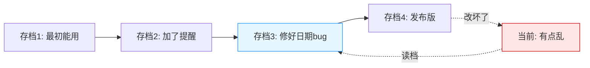

# 第21章 如何防止 AI 把软件越改越乱

> 软件是"长"出来的，不是一次做好的。可每次修改都可能埋下新问题，日子久了就成了一团乱麻。这一章教你给项目存档、备份、回退，再给 AI 立下规矩，让软件越改越好，而不是越改越乱。

## 本章你会学到

- 为什么软件会"越改越乱"——改动是会累积的
- 版本管理是什么——它就像游戏的"存档"
- 怎么保存稳定版本、怎么在动手前备份
- 怎么比较版本、怎么在改坏时"读档"回去
- 怎么给 AI 立规矩，并建立一套长期维护机制

### 引子：想回到上周那个好用的版本，却回不去了

花店小助手改了三个月。林小满的功能越加越多，可她也渐渐觉得软件"不对劲"了：有时候列表莫名变慢，有时候提醒发重了，还有个页面偶尔空白。

更糟的是，她清晰地记得——**上周四那版特别好用**。可她找不到那版了。每次让 AI 改东西，都是在上一版的基础上继续改，旧的早被覆盖掉了。她试图让 AI"恢复到上周四"，AI 也只能凭记忆猜，越猜越乱。

"早知道就给每个好版本都留个底了。"她懊恼地说。

这句话，就是这一章的核心。**软件开发不是一条只在往前跑的单行道，而应该像写文章——随时可以保存、可以回看、可以撤销。** 这一章就教你这套"让软件可控"的功夫。它是第五篇的收官，也是你以后长期用 AI 做软件的底子。

## 21.1 软件开发中的累积性问题

软件越改越乱，不是因为 AI 笨，而是因为**改动天然会累积**。

生活化比喻：这就像一间不收拾的房间。今天扔个盒子，明天堆摞书，后天塞个纸箱——每一件单看都没问题，几个月后你连门都推不开了。软件的每次修改，就是往房间里扔的东西。

累积性问题主要有三种：

- **补丁摞补丁。** 为了解决 A 加了一段代码，这段代码又引发了 B，为了修 B 再加一段……层层叠加，谁也理不清。
- **改了这里坏了那里（回归）。** AI 改了列表页，结果把提醒功能弄坏了——因为两处共用了同一段东西，它没注意到。
- **没有"回到过去"的路。** 改动直接覆盖在原文件上，一旦发现新版不如旧版，却找不到旧版了——就像林小满那样。

对付累积性的根本办法，就是**给每一次改动留下可追溯、可回退的痕迹**。这就是下面几节要讲的。

## 21.2 什么是版本管理

版本管理，听着很专业，其实就是一件事：**给软件在不同时间点的状态"拍快照"，存起来，随时能翻出来看或退回去。**

最好的比喻是**游戏存档**。你打到一个好位置，存个档；后面打 boss 失败了，读档回到那个好位置，重新来。没有存档，失败了只能从头打；有存档，你就能大胆尝试，反正随时能回来。

软件也是一样：

- **存档**＝保存一个稳定版本；
- **读档**＝回退到一个之前的版本；
- **存档点**＝每次一个重要的、可回到的状态。

你可能听过一个叫 **Git** 的工具，还有 GitHub、Gitee 这些网站——它们是专门做版本管理的。但你完全不用先去学它。具体的存档、回退动作，你可以让 AI 来做；你要懂的只是"什么时候该存档、回到了哪个存档点"这些判断。



有了版本管理，你就再也不会说"找不到上周四那版"了——因为它好好地存在那里。

## 21.3 如何保存稳定版本

不是每次改动都值得存档，否则存档多到分不清哪个是哪个。要存的是**稳定版本**。

什么叫"稳定"？就三条：

1. 功能测过，能用；
2. 没有已知的严重 bug；
3. 你现在觉得"这版挺好，可以放心用"。

什么时候该存一个稳定版本？记住这几个时机：

- 一个功能**刚做完并测过**的时候；
- 一个 bug**刚修好并复测过**的时候（第19.9 强调过）；
- 每次**发布之前**；
- 一次**大改动之前**——先把当前好的状态存下来，再去动刀。

怎么存？对零基础的人，最简单的方式是让 AI 帮你做：

**你：** 现在这一版我测过了，功能都正常，帮我把当前状态保存为一个稳定版本，起名叫"v3-加提醒功能完成"，并记录今天的日期。

**AI：** 已保存当前版本快照，命名为"v3-加提醒功能完成"。我会把它记进版本记录表，方便以后查找和回退。

你也可以让 AI 把版本记录写进一个表格文件，长这样：

| 版本名 | 日期 | 状态 | 说明 |
|---|---|---|---|
| v1-最初版 | 3/1 | 稳定 | 能记录订单 |
| v2-加提醒 | 3/3 | 稳定 | 增加节日提醒 |
| v3-修日期bug | 3/5 | 稳定 | 修复月份大一月 |

## 21.4 如何创建修改前的备份

存档是"完成一个好状态后保存"，而备份是"动手改之前先留个底"。两个动作像一对双胞胎，目的都是"留后路"。

生活化比喻：**改文件前先复印一份。** 你要在一份重要合同上修改，聪明的做法是先复印一份原件，改坏了还能拿原件重来。软件同理——**每次让 AI 大改之前，先备份当前能用的状态。**

什么时候尤其要备份？

- 要做一个**大改动**（加新功能、重构页面）之前；
- 要尝试一个**没把握的方案**之前；
- AI 说"这个改动可能影响到别处"的时候。

怎么做？同样交给 AI：

**你：** 我接下来想做一个比较大的修改。动手之前，请先把当前整个项目复制一份作为备份，命名为"备份-改统计功能前-3月10日"。确认备份完成后，我们再开始改。

**AI：** 已复制当前项目到"备份-改统计功能前-3月10日"，备份完成。现在可以开始修改了。万一改坏，我们可以随时从这个备份恢复。

一个关键提醒：**备份要在改之前做，不是改完之后。** 改完再备份，万一改坏了，你备份的就是坏版本，白搭。养成"先备份、后动手"的肌肉记忆。

## 21.5 如何比较不同版本

存了这么多版本，怎么知道两个版本之间改了什么？这就需要"比较版本"（也叫 diff，读"迪夫"）。

生活化比喻：这就像玩"找不同"——把两版并排放，哪里多了一行、哪里少了一处、哪里字变了，一目了然。工具会把改动的地方标出来（通常新增是绿色、删除是红色）。

比较版本有什么用？最实用的一个：**搞清楚"是哪次改坏的"。** 林小满那个"提醒发重了"的问题，就可以对比"出问题的版本"和"上一个好版本"，看看改动里有没有多出来一段发提醒的代码。

让 AI 帮你比较：

**你：** 请比较"v3-修日期bug"和现在的版本，告诉我：1）改动了哪些文件；2）每个文件具体改了什么；3）有没有新增或删除功能；4）哪处改动最可能导致"提醒发重了"这个问题。

**AI：** 对比结果：改动集中在 `remind.js`。这次给提醒功能加了"节日批量发送"，但新代码和原来的"单条提醒"共用了发送函数，导致一次触发发了两遍。最可能的原因就是这里。

比较版本让你从"凭感觉猜"变成"看着证据查"，效率高得多。

## 21.6 如何回退错误修改

终于到了最解气的一招：改坏了，就退回去。

生活化比喻：这就是游戏的**"读档"**。你现在这关打崩了，不要硬撑，直接读回上一个存档点，从头再来。在软件里，就是把当前状态退回到某个之前保存的好版本。

回退有两种：

1. **撤销最近一次改动。** 刚改的就发现问题，退回上一步——像 Word 的"撤销"（Ctrl+Z）。适合"刚刚改坏、立刻发现"。
2. **回退到某个存档点。** 改了好几轮才发现不对，退回指定的稳定版本——适合"改了一阵才发现"。

让 AI 来操作，你说清楚退到哪：

**你：** 最近这一版越改越乱，我不想在这基础上继续了。请帮我回退到"v3-修日期bug"这个版本，那版我测过是好的。回退前先备份当前这版（万一我后来又想要），然后执行回退，完成后告诉我现在的状态。

**AI：** 已备份当前版本为"备份-乱版-3月12日"。已回退到"v3-修日期bug"，当前项目状态与该版本一致。你可以重新测试确认。

两个重要提醒：

- **回退前先备份当前版本。** 万一你反悔，或者乱版里其实有你想留的东西，还能找回来。
- **回退后要复测。** 确认退回的这版真的好用，别退到一个"以为好其实也有问题"的版本。

## 21.7 如何让 AI 遵守开发规则

前面讲的都是"出事之后怎么救"。更高明的做法，是**从一开始就让 AI 少犯这类错**——给它立规矩。

生活化比喻：给 AI 一份"员工手册"。新员工上岗前要读手册，知道"什么能做、什么必须先请示、做完要汇报"。AI 也一样，你把要求写成一份规则文件，让它每次动手前先读。

一份好用的规则文件（可以叫 `RULES.md` 或"开发规则.md"），写这些：

1. **一次只改一个问题**，不许顺带改别的地方。
2. **改之前先诊断**，说明原因和依据，等我确认。
3. **大改之前先备份**当前版本。
4. **改完给出复测步骤**，并说明改了哪些文件。
5. **每次开始工作前，先读这份规则并遵守。**
6. **不确定就问我**，不要自己猜着改。

怎么用？关键是**每个新对话、每次重要修改前，都让 AI 先读一遍规则**：

**你：** 我要开始改软件了。请先读取项目里的"开发规则.md"，确认你会遵守里面的每一条，然后再开始。这次要改的是：[具体改动]。

**AI：** 已读取"开发规则.md"。我将遵守：一次只改一处、改前先诊断并等你确认、大改前先备份、改后给复测步骤。针对这次的改动，我的诊断是……请你确认后再动手。

为什么要每次都强调？因为 AI 在长对话里会"忘事"（第19.9 讲过）。规则文件是写在项目里的白纸黑字，不会丢；每次让它读一遍，就等于不断提醒它。这样即使换了新对话，规矩也还在。

## 21.8 建立软件项目的长期维护机制

把前面所有习惯串起来，就形成了一套"长期维护机制"。生活化比喻：养花不是浇一次水就完事，而是有固定的养护日程——什么时候浇水、什么时候施肥、什么时候修剪。软件也需要这样的"养护日程"。

一套完整的维护机制，就是几样东西各司其职：

| 工具 | 作用 | 对应章节 |
|---|---|---|
| 问题台账 | 记录每个问题、原因、修法、是否复测 | 19.9 |
| 测试清单 | 每次改完照着测，防止回归 | 20.7 |
| 验收清单 | 发布前逐项签字 | 20.9 |
| 版本记录 + 存档 | 保存稳定版本，随时回退 | 21.3–21.6 |
| 开发规则 | 约束 AI 的修改行为 | 21.7 |
| 变更日志 | 每次改了什么、为什么改 | 本章 |

日常怎么运转？一个简单的节奏：

- **改东西前**：读规则 → 备份 → 让 AI 诊断；
- **改东西后**：复测 → 更新变更日志 → 测过没问题就存一个稳定版本；
- **出问题时**：查台账 → 诊断 → 修 → 复测 → 记录；
- **发布前**：对照验收清单逐项确认 → 存档 → 发布；
- **每隔一段时间**：整理一下台账和版本记录，清理过时信息。

这些听起来多，但做起来会越来越顺手，因为大部分动作都是"让 AI 记一笔、存一下"。真正需要你判断的只有几件事：**这版稳不稳定？该不该存档？改好了没有？**

做到这些，你的软件就再也不会"越改越乱"了。它像一棵被好好照料的花，稳稳地、一茬一茬地长。到这里，第五篇"与 AI 一起排错"就完整了——你已经有能力让软件**越来越可靠**。

## 常见坑

- **坑：从不存档，一路覆盖着改。** 为什么：一旦改坏就回不去，像林小满找不到"上周四那版"。怎么做：每到一个稳定状态就存版本，大改前必备份。
- **坑：备份在改完之后才做。** 为什么：改坏了再备份，存的是坏版本，等于没备份。怎么做：养成"先备份、后动手"的习惯，备份完再让 AI 开始改。
- **坑：存档太多太乱，分不清哪版是哪版。** 为什么：名字随便起、不记说明，时间一长全是"最终版2""真的最终版"。怎么做：存档时起清楚的名字并写说明（改了什么、哪天），维护一张版本记录表。
- **坑：回退后不复测。** 为什么：以为退回去就一定好，其实可能退到一个也有问题的版本。怎么做：回退后按测试清单重新测一遍确认。
- **坑：以为给 AI 立一次规矩就一劳永逸。** 为什么：AI 在长对话里会"忘事"。怎么做：写成项目里的规则文件，每次重要修改前都让它先读一遍。

## 本章小结

- 软件越改越乱，是因为改动会累积（补丁摞补丁、改这坏那、无法回到过去）。
- 版本管理就像游戏存档：给每个稳定状态拍快照，随时能查看或"读档"回去。
- 在功能做完、bug 修好、发布前、大改前存一个稳定版本；大改之前一定先备份。
- 比较版本能帮你"找不同"、定位是哪次改坏的；回退能让你大胆尝试，反正退得回来。
- 把问题台账、测试清单、验收清单、版本存档、开发规则、变更日志串成维护机制，并让 AI 每次动手前先读规则，软件就能越改越好。

## 动手练习

1. 想一个你曾经"改坏又回不去"的经历（不一定是软件，写作、手工都算）。如果当时有"存档"，你会怎么做？
2. 现在就给你的软件保存第一个稳定版本，起名叫"v1-当前可用版"，并让 AI 建一张版本记录表，填上版本名、日期、说明。
3. 写一份属于你的"开发规则.md"，至少包含本章 21.7 列的六条。下次让 AI 改东西时，先让它读这份规则，看看它是否照做。
4. 故意做一次"改坏再回退"的演练：先备份，再让 AI 改一个小地方，然后练习回退到备份，确认能恢复。
5. 把你这一篇学到的东西整合成一张"维护机制"清单贴在项目里，每次改软件照着走一遍。

## 可复制的指令模板

**模板一：改之前备份 + 让 AI 读规则**

```text
我接下来要做一次修改。动手之前，请按顺序做三件事：

1. 读取项目里的"开发规则.md"，确认你会遵守其中每一条（一次只改一处、改前先诊断并等我确认、大改前先备份、改后给复测步骤）；
2. 把当前项目完整复制一份作为备份，命名为"[备份名+日期]"，并确认备份成功；
3. 做完上面两步后，先不要改代码，针对我下面要做的改动，说明你的诊断和依据，等我确认。

这次要做的改动是：[描述你想改什么]
```

**模板二：出问题时回退到稳定版本**

```text
当前版本改乱了，请帮我安全地回退。

1. 先把当前这一版备份下来，命名为"[乱版备份名+日期]"，以防我以后还想找里面的东西；
2. 然后回退到"[稳定版本名]"，那版我测过是好的；
3. 回退完成后，告诉我当前状态是否与那个稳定版本完全一致；
4. 给我一份简短复测清单，我要确认退回来的版本真的能用。

（如果不确定该退到哪个版本，请先列出所有可用的版本和它们的说明，让我选。）
```
