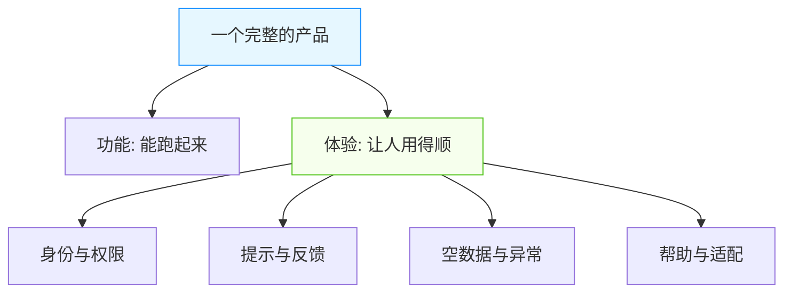
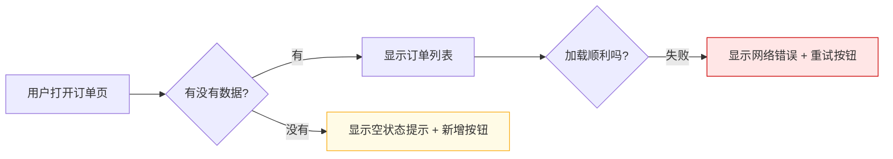

# 第22章 如何让软件具备完整的用户体验

> 前面我们让软件"能跑起来""能改对""能排查"。可一个自己用着顺手的东西，给别人用时常常处处碰壁。这一章要解决：怎么把"能运行的程序"，变成"别人也愿意用、用得明白的产品"。

## 本章你会学到

- 什么叫"完整的用户体验"——为什么功能对了还不够
- 登录、注册、用户身份是怎么回事，怎么让 AI 帮你加
- 用户权限：谁能看、谁能改
- 操作提示、空数据、出错状态这些"边角"怎么处理
- 帮助说明和手机适配，怎么一步步交给 AI

### 引子：小满把软件分享给店员，却翻了车

花店小助手林小满自己用得好好的。她想让店员阿杰也用，就把网址发了过去。

阿杰打开，第一眼就懵了："这是啥？我点哪？"——界面上没有任何说明。他试着点"新增订花"，填到一半不知道"客户等级"是干嘛的，胡乱选了一个。更糟的是，他一不小心看到了别的客户的电话——原来小满的软件没做身份区分，谁打开都能看到全部数据。

"这软件给你一个人用挺好，"阿杰说，"可给我用，我怕删错东西，也怕看到不该看的。"

小满这才明白：**功能跑通，只是"能用"；要让别人也能放心用、看得懂地用，还差一整套"体验"的功夫。** 登录、权限、提示、空页面、手机上看……这些看起来不起眼的"边角"，恰恰是"个人玩具"和"正式产品"的分界线。这一章，我们就把这些边角一块块补齐。

## 22.1 什么是完整的软件体验

先分清两件事：**功能**是软件"能做什么"，**体验**是人在用的时候"顺不顺、懂不懂、放不放心"。

打个比方。功能像一道菜的味道，体验则像餐厅的环境、菜单是否看得懂、服务员会不会解释菜怎么吃。菜再好吃，菜单全是看不懂的字、没人招呼，客人也会浑身不自在。

完整的软件体验，就是"功能"加上那些让人用得明白、用得放心、用得顺手的细节。它通常包括：

| Dimension 维度 | 要解决的用户疑问 |
|---|---|
| 身份 | "我是谁？这是我的数据吗？" |
| 权限 | "我能做什么？会不会误删别人的？" |
| 反馈 | "我刚才那一下，成了没有？" |
| 异常 | "没数据时、断网时，显示什么？" |
| 帮助 | "不懂的地方上哪看说明？" |
| 适配 | "我在手机上能不能用？" |



记住一句话：**功能是给自己看的，体验是给别人用的。** 你一个人用时能忍的粗糙，别人未必能忍。

## 22.2 登录、注册与用户身份

**用户身份**，就是软件要知道"现在是谁在用"。生活里的比喻是**小区门卡**：你刷卡，门禁就知道是你，也只放你进你家那栋楼。

对软件来说，最常见的身份方式是"账号＋密码"：

- **注册**：第一次来，登记一个账号和密码，相当于办一张门卡。
- **登录**：下次来，报上账号密码，核对无误就放你进去。

你完全不用懂密码是怎么存的、会话是怎么保持的——这些让 AI 来做。你要做的是把"规则"说清楚。

**你：** 我的花店小助手现在谁打开都能看全部数据。我想加登录：只有一个管理员账号和几个店员账号，输入账号密码才能进。我不会编程，你一步一步带我加。

**AI：** 好的。我先确认几点：1）账号密码由谁来建，是你手动添，还是要让店员自己注册？2）忘记密码怎么办？3）加登录后，原来的数据要不要归到管理员名下？

**你：** 账号我来建就好，不用对外开放注册。忘记密码先不做，急用我来帮他们重置。原来的数据都算我的。

**AI：** 明白。那我先做最简单的版本：一个登录页，账号密码正确才进主界面；账号由你在"设置"里添加。只加登录，不动你现有的订花功能。

让 AI 加身份功能时，关键是把"谁能建账号""忘记密码怎么办"这些规则先想清楚，否则 AI 会替你猜，猜的往往不是你要的。

## 22.3 用户权限管理

登录解决了"你是谁"，权限解决的是"你能干什么"。还是用门卡比喻：有的门卡只能进大门，有的还能进后台机房。

权限就是把人分成不同**角色**，每个角色能做的事不一样。花店小助手可以这样分：

| 角色 | 看订单 | 新增/修改订单 | 删除订单 | 管理账号 |
|---|---|---|---|---|
| 管理员（小满） | 可以 | 可以 | 可以 | 可以 |
| 店员（阿杰） | 可以 | 可以 | 不可以 | 不可以 |
| 只读（临时帮忙） | 可以 | 不可以 | 不可以 | 不可以 |

做的时候，别一上来就设计得很复杂。先定两三个角色，让 AI 把"按角色显示或隐藏按钮、拦住没权限的操作"做出来就行。你可以这样说：

> "给软件加两种角色：管理员和店员。店员能看和新增订单，但不能删除，也看不到'管理账号'菜单。如果店员点了没权限的操作，弹一句提示'你没有这个权限'。"

权限的核心原则只有一条：**只给人刚刚够用的权限**，不然后果就是阿杰担心的"怕删错东西"。

## 22.4 操作提示与反馈

你按一个按钮，如果半天没反应，你会不会怀疑"到底点了没有"？软件也是一样——**每一次操作都要给用户一个回应**，这叫反馈。

生活比喻：电梯按钮按下去会亮灯，微波炉按"开始"会"叮"一声。这些声响和灯光，就是在告诉你"我收到指令了"。

软件里常见的反馈有三种：

- **进行中**：点"保存"后，按钮变成"保存中…"或转个小圈，表示正在处理。
- **成功**：保存完弹一句"保存成功"，让人安心。
- **失败**：出错了要说清楚原因，比如"手机号格式不对，请填 11 位数字"，而不是只甩一句"错误"。

让 AI 补反馈时，可以这样提要求：

> "给'新增订花'表单加反馈：点保存时按钮显示'保存中…'；保存成功弹绿色提示'已记下这单'并清空表单；如果必填项没填，在对应输入框下标红字提示，不要只弹一个笼统的报错。"

把"成功、失败、进行中"三种情况都说清楚，AI 才不会漏。

## 22.5 空数据与异常状态

新手最容易忽略的，是那些"非正常"的画面。平时看不见，一旦出现，软件就露怯了。

- **空数据**：刚装上、还没有任何订单时，列表页面显示什么？如果是一片空白，用户会以为坏了。正确做法是显示一句友好的话，比如"还没有订单，点右上角'新增订花'记下第一单吧"。
- **加载中**：数据要缓缓才出来时，显示"正在加载…"，别让人对着空白发呆。
- **出错状态**：断网了、服务器开小差了，要显示"网络好像断了，请检查后重试"，并给一个"重试"按钮，而不是白屏或一堆英文报错。



你可以让 AI 一次性把这些"状态"补齐："请给订单列表补上三种状态：没数据时显示友好提示和新增按钮；加载时显示'加载中'；加载失败时显示原因和'重试'按钮。"

## 22.6 软件帮助与说明

再简单的软件，用户也会有看不懂的地方。与其让人猜，不如就地给说明。

Help 不一定要做成厚厚的使用手册。小软件里，这几种最实用：

- **按钮旁的提示文字**：鼠标放上去或点一下"？"，弹出一句解释。比如"客户等级：老客户会优先提醒"。
- **第一次使用的新手引导**：首次打开时，用两三步箭头告诉你"这里是订单、这里能新增"。
- **一个"帮助"页面**：把常见问题列成问答，比如"怎么改密码""怎么导出订单"。

让 AI 加帮助时，关键是告诉它"哪些地方最让人困惑"。比如：

> "在'客户等级'旁边加一个问号图标，点击后显示：'老客户会在节日前优先提醒；普通客户按订单日期提醒。'再做一个'帮助'页面，列出三条常见问题。"

## 22.7 移动端适配

林小满说过"我偶尔手机看看"。同一个软件，在电脑上是宽屏，在手机上就窄得挤成一团——如果没做适配，按钮可能小到点不中，表格要左右滑半天。

**移动端适配**，就是让页面能根据屏幕大小自动调整：宽的屏幕上多列并排，窄的手机上改成上下排列，字和按钮也放大到手指点得中。

好消息是，这件事几乎不用你操心技术细节。你只要提一句，现代的开发方式通常会让页面"响应式"变化：

> "让所有页面适配手机：在窄屏上把表格改成卡片式一条条显示，按钮字号放大到手指容易点，导航栏收成一个菜单按钮。"

做完一定要**真的用手机打开看一眼**——适配有没有做好，眼睛一看便知，不用懂代码。电脑浏览器里也有"模拟手机"的调试模式，可以让 AI 教你打开。

## 22.8 如何让 AI 进行体验优化

前面都是"发现问题就补"。其实你也可以主动让 AI 帮你做一次**体验体检**，把没注意到的问题一次找出来。

关键是别问得太笼统。"帮我优化一下体验"太虚，AI 只能泛泛而谈。要给它一个具体的检查清单：

**你：** 花店小助手要给店员用了。请你站在第一次使用的店员角度，检查这个软件有哪些让人困惑、容易误操作、或手机上不好用的地方，按严重程度列出来，每条说清楚在哪个页面、什么问题、怎么改。先只检查，不要动手改。

**AI：** 我按新用户视角过了一遍，发现 5 点：1）订单列表无数据时是空白，建议加空状态提示；2）"客户等级"没有说明，建议加问号提示；3）删除没有二次确认，店员可能误删，建议弹确认框；4）表格在手机上要横向滑动，建议改卡片式；5）保存成功没有任何提示，建议加"已保存"提示。要我从第 1 条开始逐条改吗？

**你：** 好，先改第 1、3、5 条，第 2、4 条我之后再定。

**AI：** 收到，这轮只改空状态、删除二次确认、保存成功提示三处，改完你确认后再说。

这种"先体检、后点名修改"的方式，比一口气让 AI 全改要稳得多——**你始终握着决定权**。

## 常见坑

- **坑：只顾功能，忽略"边角"。** 为什么：一个人用时能忍的粗糙，给别人用就是灾难。怎么做：发布前用 22.1 的清单逐项过一遍身份、权限、反馈、异常、帮助、适配。
- **坑：让 AI 一次性"把所有体验都优化好"。** 为什么：范围太大，AI 容易改错地方或漏项。怎么做：像 22.8 那样先列出问题清单，再点名一条条改。
- **坑：权限设计得太复杂。** 为什么：角色一多，规则互相打架，自己也理不清。怎么做：从"管理员／普通用户"两种角色起步，够用就好。
- **坑：以为"加个登录页"就万事大吉。** 为什么：只挡了门，没分权限，店员照样能看能删。怎么做：登录和权限要一起考虑，先定清楚"谁能干什么"再让 AI 做。

## 本章小结

- 完整的产品 = 功能 + 体验；体验决定别人愿不愿意、能不能放心用。
- 用户身份像门卡，登录注册解决"你是谁"；权限像门禁等级，解决"你能干什么"，只给刚好够用的权限。
- 每次操作都要有反馈：进行中、成功、失败三种情况都要说清楚。
- 空数据、加载中、出错这些"非正常画面"要专门设计，别让用户对着白屏发呆。
- 帮助说明就地给（问号提示、新手引导、帮助页），手机适配让 AI 做完后一定亲眼验证。
- 让 AI 做体验体检时，给具体检查清单，先列问题、再点名修改，决定权留在自己手里。

## 动手练习

1. 想想你最常使用的手机 App：它有哪些"体验细节"让你觉得舒服？（提示：从登录、提示、出错、空页面、帮助几个角度找）至少列出三个。
2. 用你自己的小软件，让 AI 按 22.8 的方式做一次"新用户视角体验体检"，先只看它列出的问题清单，不要动手改。
3. 给软件定两个角色（如管理员、访客），写清楚每个角色"能看什么、能改什么"，把这张表发给 AI，让它照表实现权限。

## 可复制的指令模板

**模板一：给软件加登录和权限**

```text
我想给软件加用户登录和权限控制，我不会编程，请你一步一步带我做。

现在的情况：[简单描述软件现在谁都能打开、有哪些功能和数据]

我想要：
1. 加登录页，输入账号密码正确才能进入；账号由我手动添加，不开放注册；
2. 分两种角色：管理员（我）能做全部操作，普通用户只能查看和新增，不能删除、不能管理账号；
3. 普通用户点了没权限的操作，弹提示"你没有这个权限"。

请先问我几个关键问题，确认后再动手，一次只做一步，做完让我确认。
```

**模板二：让 AI 做体验体检并逐条修改**

```text
请你站在第一次使用这个软件的普通用户角度，做一次体验检查。

重点检查这几方面：
1. 有没有让人困惑、不知道怎么用的地方；
2. 有没有容易误操作、删错东西的地方；
3. 没有数据、加载中、出错时分别显示什么；
4. 在手机上好不好用。

要求：按严重程度列出问题，每条说清楚【在哪个页面】【什么问题】【建议怎么改】。
先只列清单，不要动手改；等我点名要改哪几条，你再逐条修改。
```
