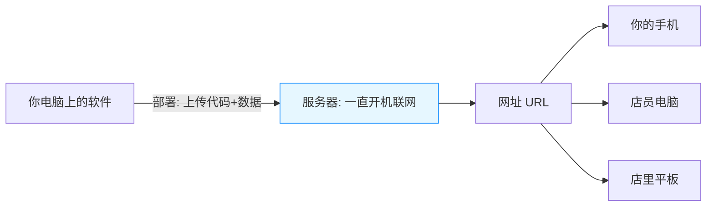

# 第23章 如何让 AI 帮你发布软件

> 到这一章，你的软件已经功能完整、体验不错。可它还只待在你自己的电脑里。这一章要解决：怎么把它"搬"到网上，让任何人打开一个网址就能用——而且不用你去学运维。

## 本章你会学到

- 什么是"部署"——软件从你电脑到别人手机，中间发生了什么
- 本地运行和在线运行到底差在哪
- 怎么按自己的情况挑一个发布平台
- 怎么让 AI 准备部署环境、发布网站、绑定域名
- 部署出问题怎么排查，上线后又该怎么维护


*图：发布软件并让它持续成长*

### 引子：软件只在我电脑里，别人怎么用？

花店小助手做好的这几个月，林小满都是在自己的电脑上打开使用的。她想在店里放一台平板给客户查订单，也想自己在家里用手机看看——可她一离开那台电脑，软件就"打不开"了。

"它明明就在我电脑里好好的，怎么换个地方就没了？"她很困惑。

她试着把文件夹拷给店员阿杰，阿杰在自己的电脑双击，也打不开——因为软件需要一堆"环境"才能跑起来，光拷文件没用。

问题出在她一直把软件当成"自己电脑里的一个文件"。要让别人随时随地在浏览器里打开它，得把它放到一台**一直开着、连着网、谁都能访问的电脑**上——也就是**服务器**。把这个搬上去的过程，叫**发布（部署）**。

听起来很专业，但好消息是：这一步几乎可以全程让 AI 带你做。这一章我们就走一遍完整流程。

## 23.1 什么是软件部署

**部署**，就是把你在自己电脑上做好的软件，安装到一台服务器上，让它通过网址（URL）对外提供服务。

生活比喻：你在自家厨房做了一道菜（开发好的软件），只有你和家人能吃到（本地运行）。现在你要把它端上餐厅的桌子，让所有客人都能点这道菜——餐厅有店面、有厨师、一直营业（服务器），这个过程就是部署。

部署之后，会发生这些变化：

- 软件从"你双击才能打开"变成"别人打开网址就能用"。
- 数据从"存在你电脑"变成"存在服务器"，因此换设备也能看到同一份。
- 你的电脑关机了，软件照样在跑——因为它在服务器上。

部署不等于卖给别人。你也可以部署一个只有自己和店员能用的内部工具，只是把"访问入口"从本地文件换成了网址。



## 23.2 本地运行与在线运行的区别

很多人会问："我在自己电脑上用得好好的，干嘛非得放网上？"关键区别看这张表：

| 对比项 | 本地运行 | 在线运行（部署后） |
|---|---|---|
| 谁能用 | 只有这台电脑前的你 | 任何能上网、知道网址的人 |
| 设备关机后 | 软件就停了 | 照常运行 |
| 数据存在哪 | 你的电脑里 | 服务器上，换设备也能看 |
| 手机能用吗 | 通常不行 | 可以，浏览器打开即可 |
| 维护责任 | 你自己 | 平台/服务器 + 你（内容更新） |

一句话总结：**本地运行是"自己的玩具"，在线运行才是"给别人用的产品"。** 想让软件真正服务别人，就得部署。

不过要注意，部署后"任何人打开网址"也意味着要更注意安全和权限——这正是下一章的主题。如果软件里有客户电话这类隐私数据，发布前请务必先看第24章。

## 23.3 如何选择发布平台

发布平台，就是帮你托管软件的那台"一直开机的电脑"。对零基础的人，不用自己买机器、装系统，选一个平台按步骤操作即可。常见有三类：

| 平台类型 | 适合什么软件 | 特点 |
|---|---|---|
| 静态网站托管 | 纯展示页面（不能存数据） | 最简单、常免费，拖拽即可发布 |
| 一体化应用平台 | 带数据库的小工具（如花店小助手） | 帮你把前后端和数据库一起搞定，对新手最省心 |
| 云主机 / 云服务器 | 复杂系统、要完全自己掌控 | 最灵活，但要懂运维，零基础暂不推荐 |

怎么选？按你的软件类型对号入座：

- 只是做一个介绍花店的展示网页 → 静态托管。
- 像花店小助手这样要存订单、有登录 → 一体化应用平台（推荐新手）。
- 以后要做一个大系统、很多用户 → 再考虑云主机。

你不用记住这些平台叫什么名字。把你的软件情况描述给 AI，让它推荐并说明理由即可。关键是**让 AI 说人话**："用大白话告诉我推荐哪个、为什么、大概多少钱、要不要我掏钱。"

## 23.4 如何让 AI 准备部署环境

代码搬到服务器前，常需要先准备一些"环境"——就像搬家前要打包、要写好新家的地址。对零基础的你，这些概念不用全懂，但要让 AI 替你准备好：

- **依赖清单**：软件运行时需要哪些"零件"，服务器上要先装好。
- **配置 / 环境变量**：比如数据库地址、密钥这些"不能写死在代码里"的设置。
- **启动命令**：告诉服务器"该怎么把我的软件跑起来"。

让 AI 准备时，最好让它**先列清单、你确认后再动手**：

**你：** 我要把花店小助手发布到网上。我不懂部署，请你先帮我列一个清单：发布前需要准备什么？哪些是要我提供信息的（比如数据库、账号）？哪些你来做？先只列清单，不要动手。

**AI：** 好的，我先梳理清单。你需要准备/确认的有：1）一个数据库（存订单和客户）；2）软件的登录管理员账号；3）是否已有域名。我来做的是：生成依赖清单、写启动配置、把代码整理成可部署的形式。另外有几个问题：数据库你打算用平台自带的，还是单独的？你希望免费起步，还是可以接受少量费用换取更省心？

**你：** 用平台自带的数据库吧，先免费起步。域名我暂时没有，以后再说。

**AI：** 明白。那我推荐一体化应用平台的免费档，自带数据库，正好适合你这个规模。我先把部署清单和配置写好给你过目。

这一步的价值在于：**AI 把"要你决策的事"和"它来做的事"分开列清楚**，你只需要回答几个问题。

## 23.5 如何发布网站

准备工作完成后，真正的发布通常是一串固定动作。让 AI 带着你一步步走：


每一步都可以让 AI 给你"傻瓜式"指引。比如：

> "我现在要在这个平台上发布我的软件。请你一步一步告诉我：1）我该点哪里创建项目；2）代码怎么传上去；3）数据库怎么配；4）哪个按钮是发布。每一步都写清楚'点什么、填什么'，用大白话，不要用术语。"

发布完成后，**一定要亲自验证**：把 AI 给你的网址复制到浏览器，用电脑打开一次，再用手机打开一次，亲自点几个按钮、存一条测试数据。看见它真的能跑，这一步才算完成。

## 23.6 如何配置域名

发布成功后，你会得到一个平台给的网址，通常是一串不太好记的字符，比如 `xhxs-helper-12345.app.com`。**域名**就是你给它换一个好记的门牌号，比如 `huadian.example.com`。

生活比喻：服务器像一栋房子，网址是它现在的位置描述（"XX路XX号后面第三栋"），域名则是你挂上的招牌（"小满花店"）。招牌更好记、更专业。

配置域名一般两步：

1. **买域名**：到域名服务商那里注册一个你喜欢的名字（每年要付一点费用）。
2. **指向服务器**：在域名设置里做一条"解析"，把这个名字指向平台给你的那个网址；再在平台里绑定这个域名。

这一步细节多、容易填错，强烈建议让 AI 手把手带你："我买了一个域名 xxx，想绑定到我刚发布的软件上。请你告诉我 step by step 该在哪里填什么，怎么确认生效。"

如果暂时不想花钱买域名，完全可以先用平台送的网址——它一样能用，只是不好记。等软件用顺了再配也不迟。

## 23.7 如何处理部署问题

部署很少一次就顺顺当当成，出点小状况很正常。新手最常见的几类问题：

| 现象 | 可能原因 | 怎么做 |
|---|---|---|
| 打开网址一片空白 / 报错 | 代码上传不全、配置漏填 | 复制报错给 AI，让它看日志诊断 |
| 本地能用，线上不能用 | 环境不同、数据库没连上 | 让 AI 对比本地和线上配置 |
| 发布后改了没反应 | 没重新部署，或有缓存 | 重新发布，并强刷浏览器 |
| 网站很慢 | 资源太大、平台档位不够 | 让 AI 检查并给优化建议 |

排查的关键武器是**日志**——服务器记录"软件出了什么问题"的本子。你不用读懂日志，把它复制给 AI 就行：

> "我发布后打开网址是空白页。这是平台日志里最近几行报错：[粘贴日志]。请用人话告诉我：出了什么问题？哪一步导致的？具体该怎么改？改完我要不要重新发布？"

记住：部署出问题不是你笨，而是环境复杂。把现象和日志交给你 AI 搭档，它擅长这个。

## 23.8 发布后的维护

上线不是终点，而是"日常照顾"的开始。发布后有几件事要养成习惯：

- **改了要重新发布**：本地改好代码，不会自动出现在网上；每次修改后要重新部署一次。把这条记牢，能省掉大量"我明明改了怎么没变"的困惑。
- **定期看是否还正常**：偶尔打开网址点一点，确认没坏。
- **留意数据备份**：数据存在服务器上，要确认平台有备份，或定期导出一份（详见第24章）。
- **记录版本**：每次发布记一下"这版改了什么"（详见第25章），出问题时才知道退回到哪一版。

你可以把这些交给 AI 打理："请帮我在每次发布后生成一份简单的发布说明，记下日期和这次改了什么，方便我以后回看。"

## 常见坑

- **坑：以为拷文件给别人就能用。** 为什么：软件需要运行环境，不只是文件。怎么做：用部署，把它放到服务器上，别人通过网址访问。
- **坑：一上来就选最复杂的云主机。** 为什么：零基础要懂装系统、配环境，很容易卡死。怎么做：带数据库的小工具先用一体化应用平台，免费档起步。
- **坑：发布后以为万事大吉，再也不看。** 为什么：改了代码不重新发布，线上就不会更新；时间久了也可能出问题。怎么做：把"改完→重新发布→打开验证"变成固定动作。
- **坑：不花钱买域名就觉得不算"正式"。** 为什么：平台送的网址一样能用。怎么做：先用免费网址跑起来，用顺了、要给别人用了再买域名。

## 本章小结

- 部署＝把软件从你的电脑搬到一直开机联网的服务器，让别人通过网址使用。
- 本地运行只服务你自己，在线运行才是给别人用的产品；但在线后要更注意安全。
- 选平台看软件类型：展示页用静态托管，带数据库的小工具用一体化平台，新手从免费档起步。
- 部署前让 AI 列清单、分清楚"你决策的事"和"AI 来做的事"；发布时让它给傻瓜式步骤。
- 发布后必须亲自用电脑和手机验证；域名是可选的好记门牌，不着急。
- 出问题别慌，把现象和日志交给 AI 诊断；上线后记得"改了要重新发布"并留意备份和版本。

## 动手练习

1. 用一句话向一个不懂技术的朋友解释"部署是什么"（用你自己的比喻，不要抄书里的）。
2. 把你的软件情况（有没有数据库、要不要登录、几个人用）描述给 AI，让它推荐一个发布平台，并要求它用大白话说明理由和是否收费。
3. 如果你想练手：让 AI 带你把一个最简单的页面发布出去，拿到网址后分别用电脑和手机打开，记下你遇到的第一个问题以及怎么解决的。

## 可复制的指令模板

**模板一：让 AI 规划并带你完成发布**

```text
我想把做好的软件发布到网上，让别人通过网址就能用。我不懂部署，请你全程带我做。

我的软件情况：[描述它是展示网页还是要存数据的小工具，有没有登录，大概几个人用]

请你：
1. 用大白话解释我需要做什么、有哪些步骤；
2. 推荐一个适合我这个情况的发布平台，说清楚为什么、是否收费、要不要买域名；
3. 先列一份准备清单，分清哪些需要我提供信息、哪些你来做；
4. 等我确认后，一步一步告诉我每一步点哪里、填什么，做完一步让我确认再继续。
```

**模板二：部署出错时请 AI 诊断**

```text
我的软件发布后出问题了：[描述现象，比如"打开是空白页""本地能用线上不能用"]。

这是相关的报错或平台日志：[粘贴日志内容]

请用人话告诉我：
1. 最可能是什么原因？
2. 具体该怎么改（一步一步）？
3. 改完需不需要重新发布？
4. 怎么确认已经修好了？
先只诊断和给方案，不要直接动手改。
```
