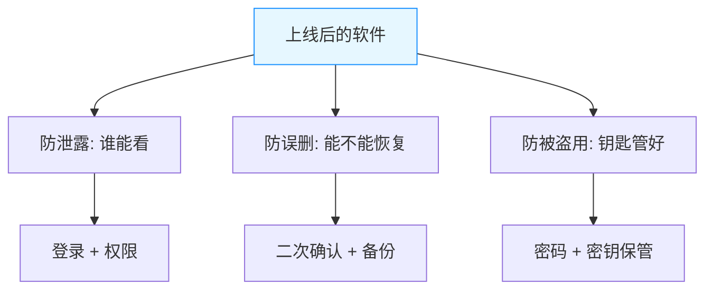

# 第24章 软件安全与数据保护

> 软件发布到网上后，就像把店开到了街上：方便别人，也引来了风险。这一章不讲吓人的黑客技术，只讲普通人也能做到的几件事——把门看好、把数据护住、把后路留好。

## 本章你会学到

- 为什么安全对一个小软件也不能忽视
- 怎么保护客户数据：少收、藏好、传得安全
- 密码和 API 密钥该怎么管，千万别犯的错
- 权限、防误删、备份这三道"保险"
- 怎么让 AI 做一次安全体检

### 引子：一条陌生短信，把小满吓出一身冷汗

花店小助手上线后，林小满收到了客户王阿姨的短信："小满，怎么有人给我发消息，说知道我订了什么花、我家住哪？"

小满一头雾水——她的软件里确实存着客户的电话、订花记录和地址。她赶紧打开网址，用浏览器的"无痕模式"（不登录的状态）试了试，发现**居然不用登录就能看到所有客户的资料**！

她后背发凉。她从没往"安全"上想过——脑子里只有"功能能不能跑、好不好用"。可软件一旦放到网上，别人就能从各个角度戳一戳它。幸好这次只是有人误打误撞看到，没造成大损失。

"我以为把软件做出来就完事了，"她心有余悸，"原来还得给它上锁。"

这一章，我们就给软件上锁。你会看到，所谓"安全"并不神秘，大部分是常识：别把钥匙挂门上、贵重东西别放门口、重要的东西多留一份。

## 24.1 为什么安全不能忽视

一提"安全"，很多人觉得那是大公司、银行才操心的事。其实不然。哪怕只有你和几个客户用的小工具，也可能出三类事：

- **数据泄露**：客户的电话、地址被不相干的人看到——就像王阿姨遇到的。轻则尴尬，重则违法（个人信息是受法律保护的）。
- **数据被误删或搞乱**：自己或店员手一滑删掉重要订单，又没备份，找不回来。
- **被人盗用**：如果软件连着付费服务（比如发短信的接口），密钥被人拿走，会产生你没预料到的费用。

生活比喻：开店要装门锁、贵重物品放进柜子、再买份保险——不是因为你一定会遭贼，而是因为代价太大，防一手很值得。

对零基础的你，好消息是：**你不需要成为安全专家，只要守住几条基本常识，并让 AI 帮你检查。** 记住一个总原则：

> **默认不要相信任何人、任何输入；只给必要的权限；重要的东西永远多留一份。**



## 24.2 如何保护用户数据

保护数据，第一原则是**"够用就好"**——这不是小气，是负责任。具体三招：

- **少收**：只存真正需要的信息。能用名字就不用身份证号；能不存地址，就不存。客户没义务把隐私全交给你。
- **藏好**：别把客户数据直接显示在公开页面上。登录前看不到、没权限的人看不到。列表里电话可以打码（如 `138****5678`），点开有权限才看全号。
- **传得安全**：网址要用 `https://` 开头（浏览器地址栏有小锁图标），表示数据在传输途中被加密。现在大多数平台默认就提供 HTTPS，发布后确认一下即可。

让 AI 帮你检查数据时，可以这样问：

> "请检查我的软件：1）是不是有页面不登录就能看到客户数据？2）客户电话在列表里有没有打码？3）网址是不是 https？把发现的问题列出来，先不要改。"

## 24.3 如何管理密码

密码就像门锁的钥匙——你不能把钥匙挂在门把手上，也不能所有门都用同一把。

这里要分两种密码，别搞混：

| 密码类型 | 是谁的 | 管理要点 |
|---|---|---|
| 用户密码 | 客户/店员登录用 | 软件里**绝不能明文保存**，要变成一串看不懂的"指纹"（这叫哈希，AI 会自动处理） |
| 管理员密码 | 你自己进后台用 | 足够长、不和其他网站重复、妥善记在密码管理器里 |

最容易踩的坑：把密码**直接写在代码里**（比如代码里写 `password = "123456"`）。这等于把钥匙用胶带贴在门上——谁拿到代码谁就能进。

让 AI 处理时，你可以明确要求：

> "我这个软件的用户密码，是不是安全地保存的？有没有任何地方把密码明文写死在代码里？如果有，请指出来并告诉我怎么改成安全的方式。"

另外提醒：别用 `123456`、`password` 这种弱密码，也别在多个网站用同一个密码——这是常识，但值得反复说。

## 24.4 如何管理 API 密钥

**API 密钥**是什么？你可以把它理解成"开通某个服务的万能钥匙"。比如你的软件要自动发提醒短信，就得拿一个短信服务商给的密钥，凭它去用服务。

这种钥匙一旦泄露（比如被人从代码里看到），别人就能拿着它花你的钱、用你的服务。所以铁律只有一条：

> **密钥永远不要写在代码里、不要传到公开的网盘或聊天记录里、不要出现在网页上。**

正确做法是放在一个叫"环境变量"的安全地方——你可以理解成"服务器上一个上锁的小盒子"，软件运行时自己去取，盒子的内容不会显示在网页上。

**你：** 我的软件用了一个发短信的服务，有个 API 密钥。我不懂安全，怕泄露。我该怎么放才安全？

**AI：** 千万不能写死在代码里。正确做法是放进"环境变量"：我帮你把代码里的密钥挪到一个配置文件，并告诉你怎么在平台上设置这个变量。另外请你确认：这个密钥之前有没有被你发到聊天群、网盘或截图里过？如果有，最好去服务商那里吊销它、重新生成一个——因为一旦泄露过，就当作它已经不安全。

**你：** 我之前好像把它贴在一个文档里过。那我重新生成一个吧。

**AI：** 对，重新生成是最稳妥的。新的密钥只放进环境变量，任何聊天、文档、截图里都不要再出现。

记住这个好习惯：**密钥泄露过一次，就换一把新的**，别心存侥幸。

## 24.5 如何设置权限

上一章我们讲了给用户分角色（谁能看、谁能改）。从安全角度，还要记住一个更重要的原则——**最小权限**：任何人、任何程序，都只给它完成工作所必需的最少权限，多一点都不给。

这条原则用在几个地方：

- **数据库账号**：软件连数据库用的账号，只给它"读写订单"的权限，不要给它"删除整个数据库"的权限。
- **管理员账号**：尽量少给管理员权限，能只给一个就别给三个。
- **第三方授权**：软件连外部服务时，只申请它真正需要的权限（比如只要"发短信"，别要"读你所有资料"）。

让 AI 配置时，直接把原则说清楚：

> "请按最小权限原则检查我的软件：连接数据库的账号是不是权限过大？有没有哪里申请了用不到的权限？只保留必需的，把多余权限去掉，并告诉我改了什么。"

权限这块，宁可麻烦一点，也别图省事全开。全开的代价，往往在出事那天才显现。

## 24.6 如何防止数据被误删

安全问题里，最常见的其实不是黑客，而是**手滑**。所以防误删是性价比极高的保护。三招：

- **二次确认**：点"删除"时弹一句"确定要删除吗？"，让人有机会反悔。
- **软删除 / 回收站**："删除"只是把订单标记成"已删除"，先放进回收站，过一阵再真正清掉。就像你把东西扔进垃圾桶，还能捡回来。
- **删除要限权 + 留痕**：只有管理员能彻底删除；谁删了什么，记一笔操作日志，方便追查。

让 AI 一次配齐：

> "给订单删除功能加三层保护：1）点删除先弹确认框；2）删除后先进'回收站'，30 天后才真正清除，期间可以恢复；3）只有管理员能清空回收站，并记录每次删除的操作日志。"

做完自己试一遍：删一条测试订单，看是否真的能弹出确认、能否从回收站恢复。

## 24.7 如何备份软件数据

备份就是给重要数据**多留一份副本**，放在另一个地方。比喻：你把贵重东西的照片存在另一个手机里，万一原件丢了，还能找回来。

为什么必须备份？因为误删、系统故障、平台问题都可能让数据消失，而这些不是你能控制的。你能控制的，是"留没留后手"。

备份要做好三点：

- **自动 + 定期**：让平台自动每天备份，或你定期（比如每周）手动导出一份数据文件。别靠"想起来才备份"。
- **存到另一个地方**：备份存在和原数据不同的地方，免得"一锅端"。
- **真的恢复测试过**：备份了却从没试过恢复，等于没备份。偶尔试一次"从备份恢复"，确认它真能用。

让 AI 帮你安排：

> "我的软件数据存在平台上。请帮我确认：1）平台有没有自动备份、多久一次、能保留多久？2）教我怎么手动导出一份完整数据。3）告诉我怎么定期做一次恢复测试，确保备份真的能用。"

## 24.8 如何让 AI 进行安全检查

像体验体检一样，你也可以让 AI 做一次**安全体检**——给自己列一张清单，逐项排查，而不是凭感觉。

清单可以包含 24.2～24.7 的面积：

**你：** 我的软件存了客户的电话和地址，已经发布上线。请你做一次安全检查，重点看：1）有没有不登录就能看到客户数据的地方；2）密码是不是明文保存；3）有没有密钥写死在代码里；4）连接数据库的权限是不是过大；5）删除有没有确认和恢复机制；6）有没有备份。请按严重程度列出问题，每条说明在哪、什么风险、怎么改。先只检查，不要动手改。

**AI：** 我检查完列六点：1）订单列表在未登录状态可访问——高风险，需加登录拦截；2）密码已用哈希保存——没问题；3）发短信的密钥写在了配置文件里但没进环境变量——中风险，需挪到环境变量并换成新密钥；4）数据库账号有全部权限——中风险，建议只留读写；5）删除无确认、无恢复——中风险，建议加确认框和回收站；6）平台有每日备份——没问题。要我从第 1 条开始改吗？

**你：** 好，先改 1 和 3，其余的我排期慢慢来。

**AI：** 收到，这轮只加登录拦截、把密钥挪进环境变量并更换。其余问题我先记录，等你点名再改。

这种"先体检、按严重程度排序、你点名再改"的流程，让你既看清风险，又不至于一次改动太多而出乱子。

## 常见坑

- **坑：觉得"小软件没人盯"，不做安全。** 为什么：网上有自动扫描的工具，风险和数据大小无关；隐私数据受法律保护。怎么做：至少守住本章的常识，并让 AI 做一次体检。
- **坑：把密码或 API 密钥直接写进代码、发在聊天里。** 为什么：等于把钥匙公开挂出去了。怎么做：密钥放环境变量，泄露过就立即吊销重生成。
- **坑：只做登录，不设权限。** 为什么：挡住了外人，却挡不住店员看到或删掉不该碰的数据。怎么做：按最小权限原则分角色，只给必需的权限。
- **坑：备份了却从没恢复过。** 为什么：没验证过的备份可能根本用不了。怎么做：定期做一次恢复测试，确认备份真的能还原。

## 本章小结

- 安全不是大公司的专利：防泄露、防误删、防被盗用，是小软件的必备常识。
- 保护数据三招：少收（够用就好）、藏好（登录和权限、列表打码）、传得安全（HTTPS）。
- 密码绝不明文保存；管理员密码要长且不重复。API 密钥放环境变量，泄露过就换新的。
- 按最小权限原则配置数据库、管理员账号和第三方授权。
- 防误删靠三招：二次确认、回收站、限权加操作日志。
- 备份要自动定期、异地存放、并真的恢复测试过。
- 让 AI 按清单做安全体检，先列问题、按严重程度排序，你点名再逐条改。

## 动手练习

1. 用无痕/隐私模式（不登录）打开你的软件网址，看看哪些数据是不登录就能看到的。把结果记下来。
2. 检查一下你的代码或配置里，有没有直接写死的密码或密钥。如果有，让 AI 教你挪到环境变量，并更换已经暴露的密钥。
3. 给你的软件做一次"删除演练"：删一条测试数据，看有没有确认框、能不能恢复。如果没有，让 AI 按 24.6 补上。

## 可复制的指令模板

**模板一：让 AI 做安全体检**

```text
我的软件存了用户的隐私数据（如电话、地址），已经发布上线。请你做一次安全体检。

重点检查：
1. 有没有不登录就能看到用户数据的页面；
2. 用户密码是不是明文保存；
3. 有没有密码或 API 密钥写死在代码里；
4. 连接数据库的账号权限是不是过大；
5. 删除有没有二次确认和恢复机制；
6. 有没有数据备份。

请按严重程度列出问题，每条说明【在哪个地方】【有什么风险】【建议怎么改】。
先只列清单，不要动手改；等我点名要改哪几条，你再逐条修改。
```

**模板二：把密钥安全地挪到环境变量**

```text
我有个 API 密钥之前可能泄露过，担心被别人盗用。请帮我处理：

1. 找出代码里所有写死密钥的地方；
2. 教我怎么把密钥挪到环境变量（用大白话，一步一步）；
3. 告诉我怎么在发布平台上设置这个环境变量；
4. 提醒我去服务商那里吊销旧密钥、生成新密钥。

改完请确认：网页上、代码里、聊天记录里都不再出现明文密钥。先给方案，我确认后再动手。
```
