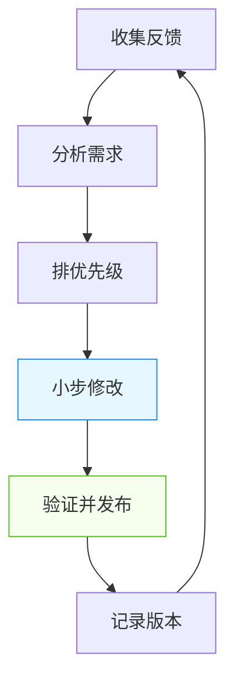

# 第25章 如何持续迭代你的软件

> 软件上线那天，不是终点，而是它真正开始成长的第一天。这一章教你一套"让软件越用越好"的循环：听反馈、辨需求、排优先级、小步修改、记版本——让一个小工具陪着你的生活慢慢长大。

## 本章你会学到

- 为什么"开发完"只是软件生命的开始
- 从哪几个渠道收集用户反馈
- 怎么分辨"用户说要的"和"用户真正需要的"
- 怎么决定下一次改什么，怎么建一张迭代清单
- 怎么让 AI 长期陪着你迭代，并管好版本

### 引子：半年后，小满回头看

花店小助手上线半年了。林小满某个晚上打开它，忽然有点感慨——它早已不是当初那个只能记订单的小页面。

现在的它：能自动在节日前提醒送花、能按客户查历史订单、店员用不同账号登录、手机打开也顺手、数据每天自动备份……而这些功能，没有一样是最初就想到的。它们都是这半年里，一点一点"长"出来的：

- 阿杰说"每次都要翻本子找老客户订过啥，太麻烦"，于是有了"历史订单查询"。
- 母亲节前忙得晕头转向，于是有了"节日批量提醒"。
- 有客户问"能不能自己在手机上看订单"，于是做了手机适配和登录。

"原来软件不是'做完'的，"小满心想，"是'用着用着，长成'的。"

这正是这一章要教你的事。你不需要一开始就想得面面俱到，只要掌握一套"持续变好"的方法，软件就会跟着你的需要不断成长。这也是全书的收官一章。

## 25.1 软件不是开发完就结束

很多人把做软件想象成"盖房子"：图纸画好、盖完封顶，就大功告成。其实软件更像**养一盆植物**，或者**开一家餐厅**——交付那天只是开始，之后要浇水、修剪、根据客人反馈调整菜单。

为什么软件"做完"了还要改？

- **你一开始想不全**。用起来才会发现真正需要什么。林小满当初绝想不到"节日批量提醒"。
- **用户会告诉你盲点**。你习以为常的地方，别人可能觉得别扭。
- **生活会变**。节日、季节、店铺规模都在变，软件也跟着变才跟得上。

所以，把心态从"做完收工"切换成"持续照料"。好消息是：有了 AI，每次"照料"（修改）的成本都很低——你不用重新学编程，只要继续用大白话提需求，就像前面几篇教的那样。



这个圈，就是"迭代"。你转得越熟练，软件成长得越稳。

## 25.2 如何收集用户反馈

迭代的原料是"反馈"。反馈不一定是一封正式的邮件，更多藏在日常里。常见渠道有四类：

| 渠道 | 怎么做 | 适合发现 |
|---|---|---|
| 直接聊天 | 随口问店员/客户"哪里不好用" | 最真实的痛点 |
| 软件内反馈入口 | 加一个"提意见"按钮，写了直接存下来 | 用户主动说的问题 |
| 观察使用 | 看别人怎么用，卡在哪、重复点哪 | 用户"说不出但确实有"的问题 |
| 看使用数据 | 哪些功能没人用、哪步总放弃 | 设计得不好用的地方 |

对林小满这样的小工具，最有效的是**前两种**。她会在店里随口问阿杰："最近用着有没有别扭的地方？"也在软件里加了个"提意见"的小按钮，客户填了就存进一张表。

一个小技巧：**主动问具体问题**，比"有什么建议"更有效。比如"你查一单历史订单要多久？""哪一步你觉得麻烦？"——问题越具体，答案越有用。

## 25.3 如何分析用户需求

收集到反馈后，别急着照做。用户说的，未必是他真正要的。

一个经典的故事：早期汽车出现前，如果你问人们想要什么，很多人会说"要一匹更快的马"。他们说的（更快的马）和真正需要的（更快地从 A 到 B）不是一回事。如果只照字面做，你只会去育种，而发明不了汽车。

所以分析需求时，多问一层"为什么"：

- 用户说："想要一个导出按钮。" 真正可能是：他要**把订单发给会计对账**——那也许自动发邮件更好。
- 用户说："提醒能提前更久吗？" 真正可能是：他**怕忘了备货**——那"备货清单"也许才是答案。

分析时可以用两个问题过滤：

1. **真需求还是伪需求？** 是很多人反复遇到的痛点，还是一个人随口一提？
2. **高频还是低频？** 天天要用的，优先于一年用一次的。

把"用户原话"和"背后的真实目的"分开记，你就不容易被表面说法带偏。遇到拿不准的，直接回去问一句"你是想用它来做什么？"，往往就清楚了。

## 25.4 如何确定下一次修改内容

反馈一堆，不可能全做。怎么决定"下一次改什么"？用一个简单的打分法：**影响面 × 紧迫度 ÷ 成本**。

- **影响面**：多少人、多频繁会遇到？
- **紧迫度**：不改会不会出错、误事？
- **成本**：做起来简单还是复杂？（对有 AI 帮忙的你，成本通常比想象中低）

把每条需求按这三点想一想，优先级就清楚了。给你一个实用的判断口诀：

> **先修"错"的（bug、误事），再做"很多人要的"，最后做"有趣但不急的"。**

还有一个关键纪律：**一次只做一件事**。别一口气让 AI 改五六个功能——改得越多，越容易互相影响、出问题（这是第21章讲过的道理）。改一个、验证一个、再改下一个，稳当得多。

## 25.5 如何建立功能迭代清单

随着想做的事变多，你需要一张"清单"来管住它们，免得东一榔头西一棒子。最简单的清单分三栏：**待办 / 在做 / 已完成**（这叫看板）。

| 待办（想做的） | 在做 | 已完成 |
|---|---|---|
| 加"节日批量提醒" | 优化手机表格显示 | 加登录和权限 |
| 订单导出 Excel |  | 加删除二次确认 |
| 客户生日提醒 |  | 加每日备份 |

这张清单可以用纸笔、备忘录，或让 AI 帮你维护。每条写清楚"要解决什么问题"，而不只是功能名字——这样以后回头看，还记得当初为什么加它。

每次做决策时，就从"待办"里按 25.4 的优先级挑一条，挪到"在做"，做完再挪到"已完成"。这个小小的仪式，会让你对软件的成长节奏一目了然。

## 25.6 如何让 AI 参与长期迭代

这是长期用 AI 迭代最关键的一招：**给 AI 留下"项目记忆"**。因为 AI 每次对话可能"忘记"之前的背景——它不像你一样记得软件一路怎么长起来的。

解决办法是维护一份简单的**项目说明文件**（可以叫 `README` 或"项目笔记"），写清楚：

- 这个软件是做什么的、给谁用；
- 已经有哪些功能、数据是怎么存的；
- 定下的规矩（比如"密码不明文存""按钮改红色"）；
- 当前的迭代清单。

然后每次开始新的一轮修改前，先让 AI 读一读它：

**你：** 我要继续改花店小助手。这是我们的项目笔记：[粘贴或让 AI 读取项目说明]。请先回顾一下：这个软件现在有哪些功能、我们定过哪些规矩。然后我再告诉你这次要改什么。

**AI：** 我看了笔记，回忆一下：这是给花店记订单、发提醒的工具，已有登录、权限、订单列表、节日提醒；规矩有"密码不明文存""提醒文字用红色加粗""一次只改一处"；当前待办有"订单导出 Excel"。这次你想改什么？

**你：** 这次只做"订单导出 Excel"，导出成能发给会计的表格。别动其他功能。

**AI：** 收到。只加导出 Excel 功能：在订单页加一个"导出"按钮，导出当前订单为表格文件。不动其他部分。我会先把改动做出来给你确认。

有了这份"记忆"，AI 就不会一次次地问重复问题，也不会不小心推翻你之前定下的规矩。每次项目有重要变化，记得更新它。

## 25.7 如何管理软件版本

还记得第21章讲的"存档"吗？长期迭代里，版本管理更重要了。每到一个稳定的、能用的状态，就"存个档"（保存一个版本），并简单记下这版改了什么。

两件事要养成习惯：

- **版本号**：给每次发布编号，最简单的就是 `v1.0`、`v1.1`、`v2.0`。小改动加一位（1.0→1.1），大改动跳一位（1.x→2.0）。
- **发布说明**：每版写两三行——日期、这版改了什么、有没有已知问题。

| 版本 | 日期 | 这版做了什么 |
|---|---|---|
| v1.0 | 3月1日 | 最初版：记订单、看列表 |
| v1.1 | 4月10日 | 加登录和权限、删除二次确认 |
| v1.2 | 5月20日 | 加节日批量提醒、手机适配 |
| v2.0 | 8月1日 | 加历史订单查询、导出 Excel |

这么做的好处：万一新版出问题，你能退回上一个好版本（第21章的"读档"）；回头看，也清楚软件是怎么一步步长成今天的样子的。让 AI 帮你记："每次发布后，帮我在项目笔记里追加一条版本记录。"

## 25.8 如何让一个小软件持续成长

走到这里，你已经走完了从"一个想法"到"一个持续成长的产品"的完整旅程。回头看林小满的路，其实也是这本书的路：

- **说出想法** → AI 帮你做出来（第二、三篇）
- **修改、排错** → 让软件更好、更稳（第四、五篇）
- **补体验、发布、保安全** → 变成别人能放心用的产品（第六篇）
- **持续迭代** → 用小步修改，让它一直跟着你的需要成长（本章）

让一个小软件持续成长的秘诀，不是"一开始就做得很宏大"，而是三句话：

1. **小步快跑**：一次改一点，改完就用、用了就验证。
2. **听真实的声音**：用户的一句抱怨，往往比你的十个猜想值钱。
3. **留下痕迹**：清单和版本记录，让成长有迹可循、可进可退。

记住，你不需要成为程序员。你需要的，是"把想法说清楚、把问题拆开、把结果判断好"的能力——而这些，你在这一章章里已经练过了。软件会长大，你指挥 AI 的本事也会长大。

## 常见坑

- **坑：上线后就撒手不管。** 为什么：软件会"用着用着"暴露问题，生活需要也在变。怎么做：养成定期看反馈、定期打开验证的习惯。
- **坑：用户说什么就照做什么。** 为什么：用户说的常是表象，不是真实目的。怎么做：多问一层"为什么"，区分真/伪需求、高频/低频。
- **坑：一口气改一大堆功能。** 为什么：改动多易互相影响、出错难查。怎么做：一次只改一件事，改完验证再继续。
- **坑：长期迭代却不做记录，AI 每轮都"失忆"。** 为什么：AI 不会天然记得历史背景和规矩。怎么做：维护一份项目说明文件和迭代清单，每轮开工先让 AI 读。

## 本章小结

- 上线不是终点而是起点：软件像养植物，要持续照料，而 AI 让每次修改成本都很低。
- 反馈来自聊天、软件内入口、观察和数据；主动问具体问题更有效。
- 分析需求要透过"用户说的"看到"真正要的"，用真/伪、高频/低频过滤。
- 定优先级用"影响面 × 紧迫度 ÷ 成本"，先修错、再做大家都想要的；一次只改一件事。
- 用"待办／在做／已完成"清单管住想做的事。
- 维护项目说明文件和版本记录，每轮先让 AI 读，版本用 v1.0 这样的编号并写发布说明。
- 持续成长的秘诀：小步快跑、听真实声音、留下痕迹。你不需要成为程序员。

## 动手练习

1. 想一个你软件"用着用着才发现的"需求（就像林小满的节日提醒），写下：它是谁、在什么情况下提出的、解决了什么真实痛点。
2. 给你的软件列一张三栏清单（待办／在做／已完成），至少写下三条待办，并按 25.4 的方法排出先做哪一条。
3. 写一份简短的"项目说明文件"，包含：软件做什么、已有哪些功能、定过哪些规矩。下次修改前先让 AI 读它，看看它能不能准确回忆起背景。

## 可复制的指令模板

**模板一：让 AI 每轮迭代前先"回忆"项目**

```text
我要继续迭代我的软件。这是我们的项目说明：[粘贴项目说明 / 让 AI 读取项目文件]。

请你先做两件事：
1. 用大白话回顾一下：这个软件是做什么的、现在有哪些功能、我们定过哪些规矩；
2. 列出当前迭代清单里还没做的事。

回顾完先别动手，等我告诉你这次要改哪一件事，你再开始，并且一次只改这一件。
```

**模板二：把一堆反馈整理成可执行的迭代清单**

```text
我收集到了一些用户反馈：[把反馈原话一条条列出来]

请你帮我整理：
1. 每条反馈，区分"用户说的表面要求"和"背后真正想解决的问题"；
2. 按【影响面 × 紧迫度 ÷ 成本】给它们排优先级，先修错误类，再做多数人要的；
3. 整理成三栏清单：待办 / 在做 / 已完成；
4. 告诉我你建议"下一次"只做哪一条，为什么。

先只整理和排序，不要动手改任何代码。
```
