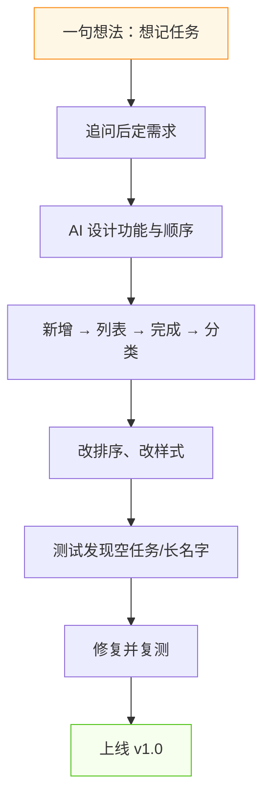

# 第26章 实战一——开发个人任务管理软件

> 从这一章开始，我们要真刀真枪地做出五个完整的软件。第一个，是一个能帮你记住"要做什么、什么时候做、做到哪了"的个人任务管理软件。你会完整走一遍：提出想法、定义需求、AI 设计、开发、修改、测试、发布——一个都不少。

## 本章你会学到

- 怎么把一个模糊的想法，一步步说成清楚的需求
- 怎么和 AI 一起设计功能和数据，再排好先后
- 怎么一次只做一个功能，边做边确认
- 怎么在真实对话里纠正 AI、让它改对地方
- 怎么测试、发布，把软件真正用起来


*图：本书的五个实战项目*

### 引子：阿哲的"便签灾难"

阿哲是个自由职业平面设计师，手上同时开着五六个项目：给这家做 logo、给那家写画册、还有两单海报要赶。他管任务的方式很"原始"——便利贴贴满显示器边框，重要的记在手机备忘录，客户临时加的需求塞进微信收藏。

结果可想而知。上周有个客户催稿他才想起来，那份文件三天前就该交；还有一单，他把"初稿"和"定稿"的日期记混了，白熬了一个通宵。他吐槽说："我不是记性差，我是东西太多、太散，脑子装不下。"

他不是没想过找个任务管理软件。可下载过两个，都太"重"了——要注册、要建团队、一堆他用不到的功能，研究半天就放弃了。"我就想有个地方，把事情记下来，标个日期，做完了打个勾，就这么简单。"

这一章，我们就陪阿哲（也陪你）把这个"就这么简单"的软件，亲手做出来。更重要的是，你会看到他和 AI 之间一句一句的真实对话——怎么提、怎么改、怎么让它听话。这套流程，后面四个项目都会用到。

## 26.1 提出软件需求

万事开头，都是一句大白话。阿哲的第一句话是这样的：

**你：** 我想做个记任务的小软件。就是我手头有很多活儿，想记下来，标上什么时候要做，做完了打个勾。我不懂编程，你带我做。

**AI：** 没问题。为了做得合你用，我想先问清楚几点：
1. 一条任务里，你想记哪些信息？（比如名字、日期，还有别的吗？）
2. "什么时候要做"是一个截止日期，还是也要提醒？
3. 你打算在电脑上用，还是手机也要用？

**你：** 记任务名字、截止日期，再加个"重要/普通"吧。提醒暂时不用。我主要电脑用，手机能看就行。

**AI：** 明白了，我复述一下确认：这是一个**个人用的任务清单**，每条任务有"名称、截止日期、重要程度"三项；能新增、能打勾完成；先不做提醒；电脑为主、手机能查看。对吗？

**你：** 对，就这样。先做个最简单的。

你看，这一来一回，模糊的"记任务的小软件"变成了清楚的需求。这就是提需求的关键：**别怕啰嗦，把你想得到的都说出来；AI 问的每一个问题，都是你该想的点。**

需求定了，整条路就清楚了：


这张图是这一章，也是后面四章的骨架。接下来我们一格一格往前走。

## 26.2 设计任务管理功能

需求有了，先别急着写代码。让 AI 把"要做成什么样"摊开给你看，你确认了再动手——这叫**设计**。

**你：** 那我们这个软件，具体要做哪些东西？先用大白话给我讲讲，别用术语。

**AI：** 好。它会有两个主要部分：
1. **任务列表页**：打开就看到所有任务，每条显示名称、截止日期、是否重要，旁边一个勾选框。已完成的任务划掉或变灰。
2. **新增任务**：一个表单，填名称、选日期、选重要程度，点"添加"就进列表。

数据方面，每条任务我们存四样东西：名称、截止日期、重要程度、是否完成。

**你：** 列表里我还想一眼看出"哪些快到期了"。另外"重要"能不能用红色标出来？

**AI：** 可以。我在列表里加一列"剩余天数"，到期当天和逾期的用红色显示；重要的任务名称前加一个红色小标记。这两点都只在列表页做，不影响新增功能。

**AI：** 顺便帮你排个开发顺序：先做"能显示任务的列表"，但一开始列表是空的——所以要先做"新增任务"，才有东西显示。我建议这样：①新增任务 → ②列表显示 → ③打勾完成 → ④分类/重要标记 → ⑤界面美化。一次做一个，做完给你看。

**你：** 行，就按这个来。

这里有个小门道：**先做"能产生数据的功能"（新增），再做"展示数据的功能"（列表）**。很多新手一上来就要漂亮列表，结果里面空空如也，没法检验。让 AI 帮你排顺序，就是干这个的。

## 26.3 开发任务列表

按计划，第一步其实是"新增任务"，但为了让阿哲先看到东西，AI 提议先搭一个带示例数据的列表页面。

**你：** 先给我个能看到任务的页面吧，哪怕里面是假数据，我想先看看长啥样。

**AI：** 好。我先做一个任务列表页：顶部标题"我的任务"，下面一行行任务，每行有勾选框、任务名、截止日期、剩余天数。先放三条示例任务让你看效果，这只是临时占位，之后会被真实新增的任务取代。

（AI 生成了页面）

**你：** 出来了。但剩余天数那一列，我填的是今天到期，它显示"0 天"，看着像还没做。能不能直接写"今天到期"，过期了写"已逾期 2 天"？

**AI：** 明白，是我显示得太生硬了。我改成：今天到期显示"今天到期"，还差几天显示"还剩 3 天"，过期显示"已逾期 2 天"，并把逾期的文字标红。只改这一列的显示规则。

看到没？第一次做出来的东西**几乎总要微调**。这不是失败，是正常流程。阿哲做的事很简单：说出"我看到什么、我想改成什么"。他不用懂代码，AI 就能改对地方。

## 26.4 开发任务新增与编辑

列表能看了，接下来让它能真正装进阿哲自己的任务。

**你：** 现在做个"新增任务"的按钮和表单。点它弹出来，能填名字、选日期、选重要程度，填完点保存就进列表。

**AI：** 好。我加一个"新增任务"按钮，点开是一个表单：任务名称（必填）、截止日期（用日历选）、重要程度（普通/重要两个选项）。保存后新任务出现在列表顶部。

**你：** 我试了，日期我故意不填也能保存，结果列表里日期是空的，很难看。日期应该必填才对。还有，保存完表单没关，得我手动关。

**AI：** 收到，两个问题：①截止日期改成必填，不填不让保存并提示；②保存成功后自动关闭表单、清空内容。我这就改。

这里藏着一个特别常见的现象：**AI 做出来的东西"能用"，但边界没顾全**——比如"不填也能存"。你只要像阿哲这样，把自己当成一个挑剔的试用者，把毛病一条条说出来，软件就一点点变结实。

## 26.5 开发任务分类

阿哲的活儿分好几类：设计、文案、杂事。他想按类别看任务。

**你：** 我想给任务分个类，比如"设计""文案""杂事"，列表上能用类别筛选吗？

**AI：** 可以。我在新增表单里加一个"类别"下拉框（设计/文案/杂事，可自己加），每条任务存一个类别；列表顶部加一排筛选按钮"全部 / 设计 / 文案 / 杂事"，点哪个只看哪类。

**你：** 等等，我不想被固定死。类别我想自己随便填，比如临时来个"对接客户"也能加。别只用你给的那三个。

**AI：** 明白，是我把类别做死板了。我改成：类别框可以直接输入文字，你填什么就是什么；同时系统会记住你用过的类别，下次做成下拉建议，既能选也能自己新建。

阿哲这一句"别只用你给的那三个"，是很有代表性的一次纠正。AI 常会**自作主张把选择固定成几个选项**，而真实需求往往是"我要自由"。记住：只要你说"我要能自己定义"，AI 就能改。

## 26.6 修改界面

功能齐了，阿哲开始挑剔"好不好用"。

**你：** 列表现在按添加顺序排，我想默认按截止日期从近到远排，越急的越上面。还有，已经完成的任务别混在中间，沉到最底下。

**AI：** 好。我把排序规则改成：先按"是否完成"（未完成在前），再按"截止日期"（近的在前）。已完成的任务文字变灰加删除线，并移到列表末尾。

**你：** 再来一个：重要任务我现在只是名字前有个小点，太不明显。给我整条任务左边加一道红色竖条，一眼就能扫到。

**AI：** 收到。重要任务左侧加一条红色竖条标记，未完成的才显示；完成后竖条消失。只改列表的样式，数据和新增表单都不动。

这一节你注意到没有：阿哲每次修改都带一句"**只改……其他不动**"——这是从前面篇章学来的好习惯。改一处就说清"只改这一处"，能防止 AI 顺手改坏别的地方。

## 26.7 测试任务管理

功能做完，不能表面上能点就用，得故意"找茬"测试。

**你：** 我们来测一测。你列几个我该试的场景，重点是怎么把软件弄出问题。

**AI：** 好，建议重点测这几种情况：
1. 任务名称特别长（几十个字），列表会不会撑破；
2. 截止日期填一个过去的日期，会不会正确显示"已逾期"；
3. 不填任务名称直接保存，会不会存出一条空任务；
4. 反复新增、打勾、取消打勾，数据会不会乱。

**你：** 我试了第 3 条——不填名字真能保存，列表里出现一条空白任务。还有第 1 条，超长名字把那一列挤歪了。

**AI：** 两个都确认了，我来修：①任务名称设为必填且不能全是空格，否则提示并不保存；②列表里过长的名称自动截断显示省略号，鼠标悬停可看完整内容。改完我再帮你把这几条场景重测一遍。

测试的核心心态是：**假设它一定有毛病，然后想办法把它弄坏**。你不用会写代码，只要会"故意乱填、乱点、填极端的值"，再把现象描述给 AI。这一步，是软件和"能演示的玩具"之间的分水岭。

## 26.8 完成第一个软件

修完测试发现的问题，阿哲的软件终于稳了。最后一步：让它真正能用上。

**你：** 我都测过了，没问题了。怎么让它在浏览器打开、以后换电脑也能用？

**AI：** 我帮你把它部署上线，得到一个网址，用浏览器打开就能用，电脑手机都可以。部署前提醒你两点：①目前数据存在本机，换设备数据不会跟着走——如果想跨设备，下一步可以接一个在线数据库；②上线后先把我们这轮对话里定下的规矩记成一份"项目说明"，以后改起来我不会忘。

**你：** 好，先上线。项目说明也帮我记一份。

**AI：** 完成。这是你的第一个软件 v1.0：能新增任务（名称/日期/重要/类别）、列表显示（剩余天数、逾期标红、重要红条）、打勾完成、按类别筛选、按紧急程度排序。已上线，附项目说明和版本记录。

回头看，阿哲从一句"想记任务"，走到了一个能上线的软件。中间没有一行代码是他写的，但他做了所有真正重要的事：**说清需求、判断对错、提出修改、测试找茬**。这就是自然语言编程。



## 常见坑

- **坑：一句话说完就等成品。** 为什么：一句话装不下完整需求，AI 只能猜。怎么做：像 26.1 那样，让 AI 追问、自己补充，把需求聊清楚再动手。
- **坑：上来就要漂亮的界面。** 为什么：没有数据，界面再漂亮也检验不了，白做。怎么做：先做"新增"产生数据，再做"列表"展示数据，顺序让 AI 帮你排。
- **坑：觉得 AI 第一版就该对。** 为什么：AI 常会漏掉边界（不填也能存）、把选项做死。怎么做：把自己当挑剔试用者，看到啥别扭就说啥，一次说清一条。
- **坑：改需求时不说"只改哪里"。** 为什么：AI 可能顺手改坏别处。怎么做：每次修改都带上"只改 X，其他地方不动"。
- **坑：不做测试就发布。** 为什么："能点"不等于"正确"，空数据、极端值一试就露馅。怎么做：让 AI 列测试场景，故意乱填乱点，把现象描述给它修。

## 本章小结

- 五个实战从此开始，每个都完整走：想法 → 需求 → 设计 → 开发 → 修改 → 测试 → 发布。
- 提需求就是"多说 + 回答 AI 的追问"，模糊想法在对话里变清晰。
- 开发前先设计：让 AI 用大白话讲清有哪些部分、存什么数据，并排好顺序。
- 一次只做一个功能，先做产生数据的（新增），再做展示数据的（列表）。
- AI 的第一版几乎总要微调；把毛病一条条说出来，它就能改对地方。
- 测试要故意"找茬"：空值、超长、极端日期、反复操作，发现就修、修完复测。
- 你不用写代码，但要做好说需求、判对错、提修改、做测试这四件事。

## 动手练习

1. 用你自己的话，把一个你想做的"任务/待办类"工具的需求说给 AI 听，并至少回答它的三个追问。看看你的需求从一句话变成了几条。
2. 照着 26.7，让 AI 给你这个工具列 5 个"把它弄坏"的测试场景，然后真的去试，记录你发现了什么问题。
3. 故意给 AI 一个错误要求："把类别固定死，只能选我给的三个。" 然后再纠正它："不，我要能自己随便填。" 体会它两次给出的方案有什么不同。

## 可复制的指令模板

**模板一：从一个想法开始，让 AI 带你走完全程**

```text
我想做一个软件，完全不懂编程，请你一步一步带我做。

我的想法是：[用大白话描述你想做什么、解决什么问题，比如"我手上有很多任务，想记下来标日期，做完打勾"]。

请你：
1. 先问我几个关键问题，把想法变成清楚的需求；
2. 需求确认后，用大白话讲清楚软件会有哪几个部分、保存哪些数据；
3. 帮我排一个开发顺序，然后一次只做一步，做完给我看、等我确认再继续。
```

**模板二：把一处别扭，说成一次有效的修改**

```text
我试用了刚才做的东西，有一处别扭：[描述你看到的现象，比如"不填任务名也能保存，列表里出现空任务"]。

请你：
1. 只改这一处，说明你会怎么改；
2. 明确告诉我其他地方都不动；
3. 改完后，把这个场景重新测一遍给我看结果。
```
