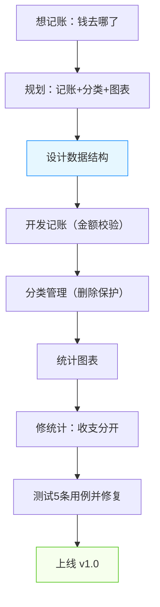

# 第27章 实战二——开发个人记账软件

> 钱花到哪儿去了？这是几乎每个人都问过自己的问题。这一章我们做一个能回答它的软件：随手记一笔收入和支出，自动分好类，再用图表告诉你钱都去了哪儿。记账软件看着简单，却最考验"数据准不准"——这正是我们要练的功夫。

## 本章你会学到

- 怎么规划一个记账软件，把"钱"这件事说清楚
- 怎么设计数据结构，让每一笔账都记得下、算得对
- 怎么开发记账、分类、统计图表这三大块
- 怎么发现并修正统计逻辑的错误
- 怎么系统测试数据的准确性

### 引子：小周的"钱去哪了"

小周工作一年了，工资不算低，可每个月月底一看余额都吓一跳："钱呢？我也没买什么大件啊。"她试过记账 App，要么广告太多，要么分类不合她意——她想知道"这个月外卖花了多少""买书花了多少"，可那些 App 把外卖归到"餐饮"里，和买菜混在一起，看不真切。

她的小目标是：**记一笔收入或支出，选个分类，月底能一眼看到各类花了多少。** "我不要花哨的，就要数字准、分类能按我自己的想法来。"

这一章，我们就和小周一起把它做出来。记账软件和上一个项目不一样——任务记错了顶多漏一件事，**账算错了可是会误导决定的**。所以这一章你会看到更多"纠正 AI、反复核对数字"的真实对话。这正是它最锻炼人的地方。

## 27.1 规划记账软件

还是从一句大白话开始。

**你：** 我想做个记账软件。能记收入和支出，记完能按类看花了多少钱，最好还有图表。我不懂编程，你带我做。

**AI：** 好。为了做对，我想确认几点：
1. 每笔账你要记哪些信息？（金额、日期、类型、分类……）
2. "分类"你想用固定的（餐饮、交通、购物），还是自己能定？
3. 图表想看什么——各类占比的饼图，还是每月趋势的折线图？

**你：** 金额、日期、收入还是支出、分类，这四样必须有。分类我要能自己加。图表两种都想要，先看各类占比。

**AI：** 我复述确认：一个**个人记账工具**，每笔记录有"金额、日期、收支类型、分类"；分类可由你自由增删；能新增记录、按类别统计、用饼图看各类占比、折线图看每月收支趋势。对吗？

**你：** 对。先做核心的：记账和占比图表，趋势图后面再说。

**AI：** 好。我建议的路线：①设计数据结构 → ②记账（新增一笔） → ③分类管理 → ④统计各类金额 → ⑤饼图 → ⑥折线趋势图。一步一步来。

规划这一步，你做的事和上一章一样——**把想法说全，回答 AI 的追问，砍掉暂时不做的**。小周砍掉"趋势图后置"，是很聪明的做法：先集中精力把最核心的"记账 + 占比"做扎实。

## 27.2 设计数据结构

记账软件的地基，是"一笔账到底存什么"。这一步设计错了，后面全乱。

**你：** 那每笔账具体存哪些东西？用大白话说说，顺便告诉我它们长什么样。

**AI：** 好。一笔账（我们叫它一条"记录"）存这些：

| 字段 | 说明 | 例子 |
|---|---|---|
| 金额 | 一个数字，永远存正数 | 35.5 |
| 类型 | 收入 或 支出 | 支出 |
| 分类 | 这笔属于哪一类 | 外卖 |
| 日期 | 发生在哪天 | 2026-11-03 |
| 备注 | 可选的说明 | 中午那家麻辣烫 |

**你：** 等等，金额为什么要"永远存正数"？支出不应该是负的吗？

**AI：** 好问题，这也是很多人的直觉。如果支出存负数、收入存正数，统计时都得带着正负号算，容易出错。更稳的做法是：**金额只存大小（正数），靠"类型"字段区分是收还是支**。这样算总数时一目了然：支出求和、收入求和互不干扰。

**你：** 哦，这样啊，那听你的。不过备注我希望也能按它搜，比如搜"麻辣烫"能找到那笔。

**AI：** 收到，备注加入可搜索字段。我把设计定稿：金额为正数 + 类型区分收支 + 分类 + 日期 + 备注（可搜索）。接下来按这个结构开发。

这里的"金额存正数、用类型区分"是一个很值钱的设计决定。你不必自己想出来——**AI 会提出方案并解释为什么**，你要做的是听懂、判断、确认。听不懂就像小周那样追问一句，AI 会用大白话解释。

## 27.3 开发记账功能

地基打好，开始盖第一层：记一笔账。

**你：** 做个"记一笔"的表单，能填金额、选收入还是支出、选分类、选日期、写备注，保存后进列表。

**AI：** 好。我做一个表单：金额输入框、收支类型切换（收入/支出）、分类选择、日期选择（默认今天）、备注框。保存后这条记录出现在列表里，列表显示金额、类型、分类、日期。

**你：** 我试了下，金额能填"abc"这种字，也能填负数，保存后统计肯定乱。金额框应该只让填数字吧？

**AI：** 对，是我漏了校验。我改成：金额只接受大于 0 的数字，输入文字或负数时提示"请输入正确的金额"并阻止保存。

**你：** 还有，选"收入"的时候，分类下拉里还全是"外卖、打车"这些支出类，不合理。

**AI：** 明白。我把分类按类型分开：选"收入"时只显示收入类（工资、奖金等），选"支出"时只显示支出类。切换类型时列表跟着更新。

你看，又是"第一版能用、边界要补"的节奏。小周提的两点——**金额校验**和**分类随收支切换**——都是真实使用中一定会遇到的问题。她没写代码，只是认真用了一遍，就把它们揪出来了。

## 27.4 开发分类管理

小周要能自己定义分类，这是她的硬要求。

**你：** 现在分类是你们固定的几个。我要能自己加分类、改名字、删掉不用的。

**AI：** 好。我加一个"分类管理"页：能新增分类（填名字、选它是收入类还是支出类）、重命名、删除。记账表单的分类下拉会读取这里的分类。

**你：** 删除要小心。我把"外卖"删了，可之前有 20 笔账用的是"外卖"，删了之后那些账怎么办？

**AI：** 很好的提醒。我加上两层保护：①如果某分类下已有记录，删除时提示"该分类下有 N 笔记录"，让你确认；②提供两个选项——"把这些记录移到'未分类'"或"取消删除"。这样不会悄悄丢数据。

**你：** 对，我就要这种。再补一个：删之前最好让我看一眼哪些记录会受影响。

**AI：** 收到。确认删除前，先列出受影响的记录条数和示例，你确认后再执行。只改分类管理页的删除流程。

小周问的"删了分类，旧账怎么办"，是记账软件的经典难题。AI 第一版想得简单，小周一句追问，就逼出了"删除保护"这个重要设计。这就是**用户思考的价值**：你不需要会做，但你要会问"那……会怎样？"

## 27.5 开发统计图表

账目齐了，轮到回答"钱去哪了"——统计和图表。

**你：** 做个统计：按分类把支出加起来，告诉我每类花了多少，再用饼图显示各类占比。

**AI：** 好。我做一个"统计"页：算出每个支出分类的合计金额和占总支出的百分比，用一个饼图展示，鼠标悬停显示具体金额。

**你：** 出来了，但我核对了一下：饼图显示"餐饮 45%"，可我把外卖和买菜加起来明明是 38%。数字对不上，你查查。

**AI：** 我来查。可能的原因有两个：①"餐饮"类里混进了别家的账；②百分比的分母算错了——我是按"所有记录（含收入）"算的占比，而你要的是"只按总支出"算。让我改成：分母用总支出，收入不计入。改完再核对你这两笔。

第一个图表一出来，小周就发现数字对不上。这正是记账软件最该较真的地方。**图表漂亮没用，数字对了才算数。** 她的做法值得学：拿出手算的结果和软件对比，对不上就追。

## 27.6 修改统计逻辑

统计逻辑的坑往往连成一串，这一节专门"修根"。

**你：** 分母改成总支出后，占比对了。但我又发现：我记了一笔"退款 100 元"，类型是收入、分类是购物，结果它把"购物"的支出金额也冲掉了一部分。这不对吧？

**AI：** 你说得对，这是我统计逻辑的漏洞。我现在"按分类求和"时没区分收支，把购物类的收入和支出加在一起了。修正为：统计支出时只累加"类型为支出"的记录；收入单独统计，不参与支出分类的金额。购物类只算支出的那几笔。

**你：** 好。那再确认：饼图的百分比加起来应该是 100%，对吧？改完你给我看每类金额和百分比。

**AI：** 是的，所有支出分类的百分比之和应为 100%（四舍五入可能有 0.1% 误差）。我改完会把每类的金额、百分比列成表，并把它们加总验证给你看。

"退款冲掉支出"这种问题，光看界面很难发现，得靠你**理解业务逻辑**：收入不该混进支出统计。你不需要懂代码，只要懂"我这笔账到底该怎么算"，就能当 AI 的质检员。

## 27.7 测试数据准确性

记账软件的最后一关，是系统地把数字核对一遍。

**你：** 我们来正式测数据。你列一组测试用例，把各种容易算错的情况都覆盖到。

**AI：** 好，我列一组带预期结果的用例，我们一起核对：

| 测试场景 | 输入 | 预期结果 |
|---|---|---|
| 多笔同类支出 | 外卖 30 + 外卖 20 | 外卖类合计 50 |
| 收入不进支出统计 | 工资 5000（收入） | 支出总额不变 |
| 退款冲抵 | 购物支出 200、退款收入 50 | 购物类仍算 200 支出 |
| 百分比合计 | 各类支出若干 | 百分比合计≈100% |
| 空分类 | 未分类的支出 | 单列"未分类"，不丢 |

**你：** 我照着测了。前四条都过了。第五条有问题：有个分类我叫"未分类"，结果它和系统内置的"未分类"重复了，统计里出现两行。

**AI：** 确认，是分类名冲突。我修两处：①内置"未分类"作为保留名，用户不能再新建同名分类；②如果已有重名记录，自动并入内置"未分类"。改完重跑这五条用例。

**你：** 五条全过了。那发布吧，再帮我写份项目说明，把"金额正数、收入支出分开统计、删除分类要确认"这几条规矩记下来。

**AI：** 完成，记账软件 v1.0 已上线：记一笔、分类管理（带删除保护）、按类统计、饼图占比、收支分开核算。项目说明和版本记录已写好。

从"钱去哪了"的困惑，到一个能准确回答它的工具——小周走完了完整流程。而这一章最该带走的，是一种态度：**和数字有关的软件，要拿算出来的结果和真实情况一遍遍对，对不上就追到底。**



## 常见坑

- **坑：金额字段让正负混着存。** 为什么：统计时带着符号算，极易算错。怎么做：像 27.2 那样，金额存正数、用"类型"区分收支，统计时分开算。
- **坑：只测"正常填"，不测乱填。** 为什么：金额填了文字、负数，软件会悄悄存错数据。怎么做：故意输入非法值，看软件会不会拦住并提示。
- **坑：删分类时把旧账一起删了/弄丢。** 为什么：分类被引用时直接删除会破坏历史数据。怎么做：删除前先查引用、列影响范围、给"移到未分类"等选项。
- **坑：只看图表好不好看，不核对数字。** 为什么：图表再漂亮，数字错了就是误导。怎么做：拿手算结果和软件对比，百分比合计应为 100%。
- **坑：收支混在一起统计。** 为什么：收入会冲抵支出分类金额（退款问题）。怎么做：统计支出时只累加"支出"类型，收入单独算。

## 本章小结

- 记账软件的核心不是界面，而是"数字准不准"。
- 数据结构决定一切：金额存正数、类型区分收支、分类可自定义、备注可搜索。
- 三大功能：记账（含金额校验）、分类管理（含删除保护）、统计图表。
- 统计逻辑最容易出错：分母用总支出、收支要分开算、百分比合计约 100%。
- 数据准确性靠系统测试：覆盖同类累加、收入隔离、退款冲抵、百分比合计、空分类等情况。
- 你的价值在于"懂业务"：能判断"这笔账该怎么算"，就能当好 AI 的质检员。

## 动手练习

1. 照着 27.2，让 AI 为你自己的记账软件设计数据结构，并对它提一个像小周那样的问题："支出为什么不用负数存？" 看它怎么解释。
2. 自己设计 3 条"能算错"的测试用例（比如退款、跨月、空分类），带着预期结果去测你的软件，记录哪条没通过。
3. 故意让 AI 把收入和支出混在一起统计，然后再纠正它"收支要分开"。对比两次统计结果，理解为什么必须分开。

## 可复制的指令模板

**模板一：设计一个"算得准"的数据结构**

```text
我要做一个记账软件，请先用大白话帮我设计每笔账要存哪些数据。

请特别说明：
1. 金额怎么存，才不会在统计时算错（要不要用正负号）？
2. 收入和支出怎么区分？
3. 分类、日期、备注各自怎么处理？
把每一项用表格列出来，并解释为什么这样设计，我看懂了再开工。
```

**模板二：带预期结果的数据准确性测试**

```text
针对我们做的记账统计，请你列出一组测试用例，每条都要写清楚【输入】和【预期结果】，要覆盖：
- 多笔同类支出相加
- 收入不进入支出统计
- 退款不能冲抵支出
- 各类百分比合计约等于 100%
- 分类名为空的记录

我会照着逐条测。测完我把实际结果告诉你，凡是和预期不符的，请定位原因并修复，然后重跑全部用例。
```
