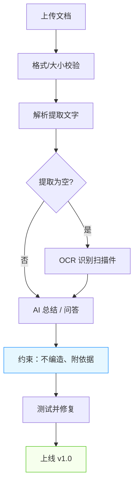

# 第28章 实战三——开发 AI 文档助手

> 前面两个项目的"智能"，都是你和我。这一章不一样：我们要让软件自己会"读"文档——上传一份合同或报告，它帮你总结要点，你还能像问人一样问它里面的内容。这是你第一次做出真正带 AI 的软件，也是全书最有趣的一个项目。

## 本章你会学到

- 怎么规划一个"会读文档"的 AI 助手
- 怎么让软件接收并解析 PDF、Word 这类文件
- 怎么让 AI 做总结、回答问题
- 怎么改掉 AI"答非所问、凭空编造"的毛病
- 怎么测试文档处理的准确性

### 引子：小陈的"文档山"

小陈是市场部的专员，工位上永远堆着文档：客户发来的合同、行业报告、几十页的招标文件。她每天要做的事，很大一部分是"读"——读完这份合同，提炼出付款条款；读完那份报告，找出和竞品有关的数据。

"最痛苦的是招标文件，"她说，"一份上百页，我得从头翻到尾找几个关键数字，眼睛都看花了。"她试过把文档丢给聊天 AI，可要么文件传不上去，要么传上去 AI 只看了个开头就乱总结，问它细节它还编——"它居然告诉我一个根本不存在的条款，差点害我填错标书。"

她想要的东西其实很清楚：**把文档扔进去，让它先给我讲清楚重点；我有具体问题，就问它，而且它得照着文档答，不能瞎编。**

这一章，我们就陪小陈把这个"会读文档、而且诚实"的助手做出来。你会第一次亲手设置 AI 的"工作方式"，也会亲眼见识它最容易犯的错——**凭空编造**，并学会怎么治它。

## 28.1 规划文档助手

先说清楚要它干什么。

**你：** 我想做个 AI 文档助手。上传文档，它能总结要点，我还能问它文档里的问题。我不懂编程，你带我做。

**AI：** 好。为了做对，我想确认几点：
1. 要支持哪些文件格式？（PDF、Word、还是也要 TXT）
2. "总结"你想要哪种——几句话的概要，还是分点列出要点？
3. 问答时，如果文档里没有答案，你希望 AI 怎么办？

**你：** PDF 和 Word 为主。总结要分点列要点，别太啰嗦。问答最重要的是：**文档里没有的，就直说没有，绝对不能编。**

**AI：** 我复述确认：一个**文档助手**，支持上传 PDF/Word；能分点总结要点；能基于文档内容问答；保有一条铁律——文档里找不到依据就明确说"文档中未提及"，不编造。对吗？

**你：** 对，尤其最后那条，最重要。

**AI：** 好。路线建议：①开发文件上传 → ②文档解析（把内容读出来） → ③AI 总结 → ④问答 → ⑤调整回答方式（治瞎编） → ⑥测试。

小陈把"不能编"放在第一条强调，非常对。**带 AI 的软件，最该先定的是"底线"**——什么能做、什么绝不能做。这条底线会在 28.6 变成具体的技术手段。

## 28.2 开发文件上传

第一步，让用户能把文档交给软件。

**你：** 先做个上传功能，能选 PDF 和 Word 文件传上来，传完告诉我文件名和大小。

**AI：** 好。我做一个上传按钮，支持选择 PDF、Word（.doc/.docx）文件，上传后显示文件名、大小，并给出状态提示。先不接受其他格式。

**你：** 我传了个 50MB 的大文件，卡了半天没反应，最后也不知道成没成。得有个进度和结果提示，而且文件太大要拦一下。

**AI：** 收到。我加：①上传时显示进度条；②成功/失败都给出明确提示；③单个文件超过 20MB 时提示"文件过大，请压缩或拆分"并拒绝。只改上传这一块。

**你：** 还要防止传错——我传了个改了后缀的假 PDF，它居然收了。

**AI：** 明白。我加一层校验：不仅看文件后缀，还检查文件开头的"标识"（真实 PDF 都有固定开头），对不上就提示"文件格式不正确"。

上传是"入口"，入口要**把好关**：格式对不对、大小合不合适、结果说清楚。小陈这三轮追问，把入口守得挺牢。

## 28.3 开发文档解析

文件进来了，但要让 AI 能读，得先把里面的文字"取出来"——这叫**解析**。

**你：** 文件传上来了，可 AI 怎么读到里面的字？PDF 和 Word 不是二进制吗？

**AI：** 好问题。文档就像"打包的行李"，解析就是"开箱把东西一样样拿出来"。我会用对应的解析器：PDF 用 PDF 解析、Word 用 Word 解析，把里面的文字提取成纯文本。这一步在你看来是自动完成的，上传完就能看到"已提取正文"。

**你：** 我试了份扫描版的 PDF——就是拍照生成的那种——提取出来是空的。怎么回事？

**AI：** 这很常见。普通 PDF 里是"文字"，能直接提取；扫描版 PDF 其实是一张张"图片"，里面没有文字，得用 OCR（把图片里的字认出来）才行。我加上：检测到提取内容为空时，提示"这是扫描件，需要 OCR 识别"，并自动走 OCR 流程。

**你：** 还有，Word 里的表格，提取出来全挤成一团，行列都乱了。

**AI：** 收到。Word 表格我会按"行 + 制表符分隔"的方式提取，保持表格结构，让 AI 读的时候还能看出这是张表。只改解析规则，不动上传。

解析这一步最容易被"特殊文档"绊倒：扫描件、表格、图片。你不用懂解析原理，只要**拿各种真实文档去试**，遇到了就告诉 AI 现象，它会补上对应的处理。

## 28.4 开发 AI 总结

文字提取出来了，现在让 AI 干活：总结要点。

**你：** 做个"总结"按钮。点了之后，让 AI 读这份文档，分点列出关键要点，别太长。

**AI：** 好。我加一个"总结"按钮：点击后把文档正文交给 AI，请它"分 5~8 点列出核心要点，每点一句话"。结果展示在一个区域里。

**你：** 我点了，结果它把整份文档几乎原文抄了一遍，还是很长。这不算总结。

**AI：** 明白，是我给 AI 的指令太松。我把给 AI 的指令写明确：要求"只保留关键结论和数字，忽略背景描述，每点不超过 30 字，总共不超过 8 点"。这样它会真的提炼，而不是搬运。

**你：** 这样好多了。但如果文档特别长，比如上百页，能行吗？

**AI：** 好问题。AI 一次能"看"的文字有上限（这叫**上下文长度**），就像人一次只能读这么多。太长的文档我会先切成几段，分别总结，再合并成一份总要点。这个过程自动进行，你只需要点一次"总结"。

这里出现了两个关键概念：**给 AI 的指令（提示词）** 和 **上下文长度**。前者决定 AI 干得好不好——指令越具体，结果越靠谱；后者决定一次能处理多少——超长文档要"先切后合"。你不用记术语，只要记住：**把要求说具体，AI 才不偷懒。**

## 28.5 开发问答功能

除了总结，小陈还想"问"文档。

**你：** 加个问答框。我输入问题，AI 根据这份文档回答我，比如"这份合同的付款方式是什么"。

**AI：** 好。我加一个问答区：你输入问题后，系统把"文档正文 + 你的问题"一起交给 AI，让它基于文档回答。先保留最近 10 轮对话，让你能追问。

**你：** 我问"付款方式"，它答得挺好。但我追问"那违约金呢"，它好像把上一份文档的内容也带进来了，混着答。

**AI：** 发现问题了。切换文档时，我清空了对话记录吗？看来没有。我改成：**每次切换文档，清空之前的问答记录**，让 AI 只基于当前文档回答，不串台。

**你：** 对，要清空。另外，我关掉页面再打开，之前问过的还在吗？

**AI：** 目前不在——对话记录存在内存里，刷新就没了。如果你希望保留，我可以把问答记录也存起来，按文档分组。需要的话告诉我。

问答功能里，"串台"（把不同文档的内容混在一起）是很典型的 bug。原因是 AI 的"上下文"里残留了旧内容。小陈一句"它把上一份也带进来了"，就点破了问题。你只要留意"它是不是只基于我这份文档答"，就能抓住这类错。

## 28.6 修改 AI 回答方式

这一节处理最重要的问题：**治 AI 瞎编。**

**你：** 我故意问一个文档里根本没有的问题——"这份合同的签署地点在火星吗？"它居然说"在火星"。这绝对不能忍。

**AI：** 这是 AI 最典型的毛病，叫"幻觉"——它会顺着你的问题编一个看起来像答案的东西。治它的办法有几层，我都加上：
1. 在指令里明确写："只根据这份文档的内容回答；文档里没有的信息，必须回答'文档中未提及'，禁止推测或编造。"
2. 回答问题后，附上它依据的原文片段，让你能核对。
3. 如果问题在文档里找不到相关段落，直接返回"未找到相关内容"。

**你：** 第 2 条特别好，能看到依据我就放心了。但我希望答案别太啰嗦——刚才它把整段原文都贴出来了。

**AI：** 收到。我把"附依据"改成只贴最相关的 1~2 句话，并且先给结论、再给依据。这样既简洁又能核对。只改回答的格式和依据展示，不改其他功能。

"幻觉"（AI 编造）是带 AI 软件的核心风险。治它的思路值得记住：**用明确的指令约束它、让它附上依据、让它允许说"不知道"**。小陈坚持"能看到依据"，正是把 AI 从"权威"变回了"可核对的助手"。

## 28.7 测试文档处理

最后，系统测试这类软件。

**你：** 我们来测。你列一组测试用例，特别要能揪出它瞎编的情况。

**AI：** 好，建议重点测这些：

| 测试场景 | 怎么测 | 期望结果 |
|---|---|---|
| 正常问答 | 问文档里明确有的信息 | 答对，并附依据 |
| 编造问题 | 问文档里根本没有的信息 | 回答"文档中未提及" |
| 超长文档 | 上传上百页 PDF 后总结 | 能完成，要点完整 |
| 扫描件 | 上传图片型 PDF | 走 OCR，能提取文字 |
| 切换文档 | A 文档提问后切到 B | 不串台，只基于 B |

**你：** 我测了。"编造问题"这次它答了"未提及"，过了；"切换文档"也不串台了。但"超长文档"出问题：总结到一半报了个错，说内容太长。

**AI：** 确认，是长文档切分合并时的一个问题：某一段切得过长，超过了单次处理上限。我改成：切分时按段落边界、每段限制字数，确保每段都在上限内；合并时如果要点太多，再做一次去重精简。改完重测这一项。

**你：** 重测通过了。发布吧，另外把"只根据文档答、没依据就说没有、附原文依据"这三条规矩记进项目说明。

**AI：** 完成。AI 文档助手 v1.0 已上线：上传（格式/大小校验）、解析（含扫描件 OCR、表格保持）、AI 总结（长文切分合并）、文档问答（可追问、不串台）、诚实回答（不编造、附依据）。项目说明和版本记录已写好。

从一个"看文档看到眼花"的烦恼，到一个会读、会总结、还不瞎编的助手——小陈走完了全程。这一章最该带走的：**AI 软件的能力来自指令，可靠性来自约束和核对。**



## 常见坑

- **坑：以为 AI 说的话都对。** 为什么：AI 会"幻觉"，顺着你的问题编答案。怎么做：像 28.6 那样，用指令约束它"没有就说没有"，并附上原文依据让你核对。
- **坑：给 AI 的指令太笼统。** 为什么："总结一下"会让它原文搬运。怎么做：写清楚"几点、每点多少字、只要结论和数字"，要求越具体越好。
- **坑：上传入口不设防。** 为什么：假文件、超大文件会卡死或出错。怎么做：校验格式（看内容标识而不只是后缀）、限制大小、给进度和结果提示。
- **坑：忽略扫描件和表格。** 为什么：扫描 PDF 没文字、Word 表格会挤乱。怎么做：空内容时走 OCR，表格按行列结构提取。
- **坑：切换文档后 AI"串台"。** 为什么：旧对话留在上下文里。怎么做：切换文档时清空问答记录，确保只基于当前文档。

## 本章小结

- 这是第一个真正带 AI 的软件：能力来自指令，可靠性来自约束和核对。
- 流程：上传（把好入口关）→ 解析（把文档文字取出来）→ AI 总结 → 问答 → 约束回答 → 测试。
- 解析要应付特殊情况：扫描件走 OCR、表格保持结构、超长文档先切后合。
- 给 AI 的指令越具体，结果越靠谱；上下文有长度上限，长文档要切分合并。
- AI 会"幻觉"瞎编，治法是：明确说"没有就说没有"、附原文依据、找不到就直说。
- 测试要专挑"编造问题、超长文档、切换串台"这些坑；发现就修、修完复测。

## 动手练习

1. 拿一份你的真实文档（合同或报告），让 AI 助手总结。然后自己核对：它的要点和文档一致吗？有没有它编出来的内容？
2. 故意问三个"文档里根本没有"的问题，看它会不会老实说"未提及"。如果它编了，照着 28.6 改它的指令，再测一次。
3. 找一份扫描版 PDF 和一份带表格的 Word 分别上传，记录解析结果。遇到了问题就把现象告诉 AI，看它怎么补。

## 可复制的指令模板

**模板一：让 AI 基于文档回答、并且不瞎编（可写进软件的核心指令）**

```text
你是一个文档助手。请只根据下面提供的【文档内容】回答问题和做总结。

铁律：
1. 只使用文档中明确出现的信息，禁止推测、联想或补充常识；
2. 文档里找不到依据时，必须回答“文档中未提及”，绝不编造；
3. 每次回答后，附上你所依据的原文片段（1~2 句），方便我核对；
4. 先给结论，再给依据，语言简洁。

【文档内容】：
[这里粘贴或由程序填入文档正文]
```

**模板二：测试一个 AI 文档助手是否可靠**

```text
请帮我把这个文档助手测一遍，重点揪出它“瞎编”和“处理不了”的情况。列出测试用例，每条写清楚【操作】和【期望结果】，至少覆盖：
- 问文档里明确有的信息（应答对并附依据）
- 问文档里根本没有的信息（应回答“未提及”，不能编）
- 上传上百页的超长文档（应能完整总结，不报错）
- 上传扫描版 PDF（应能 OCR 出文字）
- A 文档提问后切换到 B 文档（不应串台）

我会照着测，把实际结果告诉你；凡是不符合预期的，请定位原因并修复，然后重跑。
```
