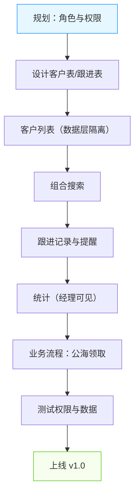

# 第29章 实战四——开发客户管理软件

> 一个人管客户，靠脑子或表格勉强够用；一旦有了同事、有了权限、有了"谁跟进了谁"的流程，事情就复杂了。这一章我们做一个真正能用在团队里的客户管理软件——它不只是记客户，还要管搜索、跟进、统计、权限。这是最接近真实企业应用的一个项目。

## 本章你会学到

- 怎么规划一个多人使用的客户管理系统
- 怎么设计客户信息和跟进记录的数据结构
- 怎么开发客户列表、搜索、跟进、统计
- 怎么根据真实业务流程修改软件
- 怎么测试权限隔离和数据安全

### 引子：小王的"表格地狱"

小王开了一家做办公设备批发的小公司，销售有五六个人。客户的资料，一直存在一个共享的 Excel 表里：公司名称、联系人、电话、报价记录……

麻烦越来越多。表里堆了几千行，找个客户要翻半天；销售小张跟进的客户，小李不知道，结果两人同时报了价，客户一头雾水；更糟的是，有人离职把客户资料一并带走，公司损失不小。

"我需要一个系统，"小王说，"能存客户、能搜、能记每次跟进、能统计谁跟了多少单。而且——**销售只能看自己的客户，经理才能看全部**。"

最后这句"权限"，是这个项目和前面三个最大的不同。前三个都是一个人用，**这个要分角色、隔离数据**。这一章你会看到，权限这种看不见的东西，怎么用对话一步步建起来、又怎么测试它是不是真的管用。

## 29.1 规划客户管理系统

从需求说起。

**你：** 我想做个客户管理软件。销售能记客户、搜客户、记跟进；经理能看全部、能统计。我没编程基础，你带我做。

**AI：** 好。为了做对，我想确认几点：
1. 有哪些角色？各自能做什么？
2. 一个客户要记哪些信息？
3. "跟进记录"记什么？是每次通话、拜访都记一条吗？
4. 统计想看什么——客户总数、每个人的客户数、成交数？

**你：** 两种角色：销售和经理。销售只能看、改自己的客户；经理看全部、能统计。客户记公司名、联系人、电话、行业、客户来源、当前状态。跟进记录每次联系的时间、方式、内容。统计我要"每个销售名下的客户数"和"各状态客户分布"。

**AI：** 我复述确认：一个**客户管理系统**，分销售/经理两种角色；客户有"公司名、联系人、电话、行业、来源、状态"六项；每次跟进记"时间、方式、内容"；销售只能操作自己的客户，经理可看全部并统计"人均客户数、状态分布"。对吗？

**你：** 对。先做核心：客户列表、搜索、跟进、统计，权限一定要从一开始就做对。

**AI：** 好。路线：①设计数据结构 → ②客户列表 → ③搜索 → ④跟进记录 → ⑤统计 → ⑥按业务流程调整 → ⑦测试权限与数据。

小王强调"权限从一开始就做对"，非常关键。权限这东西，**后补比一开始就设计难得多**——因为它渗透在每一个功能里。一开始就定好"谁看什么"，后面才不会处处打补丁。

## 29.2 设计客户信息

这一步把"客户"和"跟进"分别存什么定下来。

**你：** 客户和跟进记录，具体各存什么？用表格给我看。

**AI：** 好，分两张"表"存：

**客户表：**

| 字段 | 说明 | 例子 |
|---|---|---|
| 公司名 | 客户公司 | 宏远科技 |
| 联系人 | 对接人 | 李经理 |
| 电话 | 联系方式 | 138xxxx |
| 行业 | 所属行业 | 教育 |
| 来源 | 客户从哪来 | 展会 |
| 状态 | 跟进阶段 | 洽谈中 |
| 负责人 | 这个客户归谁 | 小张 |

**跟进表：**

| 字段 | 说明 | 例子 |
|---|---|---|
| 所属客户 | 属于哪个客户 | 宏远科技 |
| 时间 | 联系时间 | 2026-11-05 |
| 方式 | 电话/拜访/微信 | 电话 |
| 内容 | 聊了什么 | 报了报价单，等回复 |

**你：** "状态"我想固定几种：新客户、洽谈中、已成交、已流失，别让人随便乱填，不然统计会乱。

**AI：** 好主意。我把"状态"做成固定的四个选项（下拉选），不自由输入；这样统计状态分布时才干净。另外，每张表都加一个"所属负责人"字段，用来做权限隔离——销售查客户时，只能查到负责人是自己的那些。

**你：** 等等，跟进表里也要有负责人吗？

**AI：** 需要。否则销售可能通过"跟进记录"看到别人的客户信息。跟进记录的权限要跟着客户的负责人走。我会在设计里注明：**每条数据的可见性，由它所属客户的负责人决定**。

小王问的"跟进表也要负责人吗"，问到了权限设计的核心：**权限要贯穿到每一张关联的数据**。漏掉一处，就会从那个缺口泄露数据。这正是 29.8 要重点测的。

## 29.3 开发客户列表

地基打好，先做客户列表。

**你：** 做个客户列表，显示公司名、联系人、状态、负责人。销售登录只看自己的，经理看全部。

**AI：** 好。我做一个客户列表页。登录时识别身份：销售用户登录，列表自动只显示"负责人是当前用户"的客户；经理登录显示全部。列表顶部显示"共 N 位客户"。

**你：** 我分别用销售和经理账号登录试了。经理没问题，但销售账号居然能看到别人的客户！怎么回事？

**AI：** 严重问题，我查一下。列表在"显示时"做了过滤，但底层接口把全部数据都返回给浏览器了——懂技术的人绕过界面就能拿到全部数据。正确做法是**在查询数据时就按身份过滤**，让服务器只返回该用户有权看的数据。我改成从数据查询层做隔离，不只在界面上藏。

**你：** 这个改法对，光在界面上藏确实不保险。

这是一次非常重要的纠正。小王虽然不懂技术，但他**用两个账号分别登录**的测试习惯，抓出了"界面藏了、数据没藏"的致命漏洞。记住：**权限要做在数据层，不是做在显示层。**

## 29.4 开发客户搜索

客户多了，得能搜。

**你：** 加个搜索框，输入公司名或联系人能找到客户。

**AI：** 好。我加一个搜索框，按公司名、联系人做"包含匹配"——输入部分字就能搜到。搜索结果同样遵守权限：销售只搜到自己的客户。

**你：** 我搜"宏远"能搜到。但我想搜"教育行业的、状态是洽谈中的"，这种组合条件能搜吗？

**AI：** 可以。我把搜索升级为"筛选"：可以按公司名/联系人关键词，叠加行业、状态、来源下拉筛选，多个条件同时生效。结果仍按权限隔离。

**你：** 还有个小问题：我输入"宏远"前后多打了空格，就搜不到了。搜索前把空格去掉吧。

**AI：** 收到。搜索时自动去掉输入内容首尾空格（这叫 trim），再匹配。只改搜索逻辑，不动列表和权限。

搜索看着简单，但"包含匹配、组合筛选、首尾空格"这些细节，都是真实使用中的常见需求。小王一条条提，AI 一条条改，搜索就越来越顺手。

## 29.5 开发客户跟进记录

客户管理系统真正的灵魂，是"跟进"——记录每一次联系。

**你：** 每个客户详情页，加一个"跟进记录"区，能新增一条跟进（时间、方式、内容），按时间倒序列出来。

**AI：** 好。我在客户详情页加"跟进记录"区：一个新增表单（时间默认今天、方式下拉、内容框），下面按时间倒序展示历史跟进。只能给自己负责的客户加跟进。

**你：** 我想在客户列表里直接看到"上次跟进时间"，不用点进去。而且超过 7 天没跟进的客户，要标个黄色提醒我。

**AI：** 明白。我在列表加一列"上次跟进"（取该客户最近一条跟进的时间），超过 7 天未跟进的整行标浅黄。这个提醒只对经理和该客户负责人可见，符合权限。

**你：** 跟进内容我有时写错了能改吗？

**AI：** 可以，但我会做成"追加修改记录"而不是直接抹掉原文——每次改动保留历史版本，谁在什么时候改了什么都留痕。这对团队追溯很重要。

"超过 7 天未跟进标黄"把系统从"记录工具"变成了"主动提醒助手"。小王提的这个需求，正是软件从"能用"走向"好用"的那类改进。

## 29.6 开发统计功能

经理要看全局，统计功能登场。

**你：** 做个统计页。经理能看：每个销售名下多少客户，还有各状态的客户数量分布。

**AI：** 好。我做一个统计页，仅经理可见：①表格——每个销售的客户数、跟进次数；②图表——各状态客户数（新客户/洽谈中/已成交/已流失）的柱状图和占比。

**你：** 数字出来了，但我对了一下，"已成交"的个数和我数出来的不一致。查查。

**AI：** 我来查。可能有两个原因：①有客户被重复创建，状态更新时改了其中一条，另一条还留在旧状态；②统计把"已流失"也算进了"在跟客户"。我先查重复数据，再把统计口径明确为"按状态精确分类，每类单独计数，互不重叠"。

**你：** 查出来了，是有重复客户。那顺便加个功能：新增客户时，如果公司名和已有的重复，提醒我，别让我重复建。

**AI：** 收到。新增客户时按公司名做重复检查，发现重名就提示"可能已存在，是否查看已有客户"，避免重复建档。同时清理现有重复数据，并把统计口径写死为精确分类。

统计对不上，一查是"重复数据"——这是客户管理系统的老大难。小王顺手加的"查重提醒"，是从一个 bug 里长出来的好功能。这类"查着查着顺手补强"的改进，在真实开发里非常常见。

## 29.7 修改业务流程

真实的业务，会反过来要求改软件。

**你：** 我们有个新规定：客户不能一直霸在一个销售手里。超过 30 天没跟进的客户，要自动进入"公海"，其他销售可以领取。这个能做吗？

**AI：** 能做，这是对业务流程的较大改动。我的方案：①系统每天检查，超过 30 天无跟进的客户，状态标记为"公海客户"，负责人清空；②新增"公海"页面，销售可从中"领取"客户（领取后负责人变成自己）；③领取要记录日志，经理能查。涉及列表、权限、统计多处，我会分步骤改，每步给你确认。

**你：** 别一次全改。先做"标记公海"这一步，让我看看对不对。

**AI：** 好，这次只做"每天检查并把 30 天未跟进的客户标记为公海、清空负责人"，其余（公海领取页、日志）先不动。做完给你看结果。

小王"别一次全改"的要求非常老练。像"公海"这种牵一发动全身的流程改动，**拆开一步步做**，每步验证，才能防止改出一堆连锁问题——这正是前面篇章反复强调的"一次只改一件事"。

## 29.8 测试权限与数据

最后，重点测试权限和数据安全。

**你：** 这是团队用的系统，权限是命门。你列一组测试，专门测权限和数据有没有漏洞。

**AI：** 好，我列一组：

| 测试场景 | 怎么测 | 期望结果 |
|---|---|---|
| 销售越权查看 | 销售 A 搜销售 B 的客户 | 搜不到，接口也不返回 |
| 越权改数据 | 销售 A 试图改 B 的客户 | 被拒绝 |
| 跟进泄露 | 销售 A 看 B 客户的跟进记录 | 看不到 |
| 经理权限 | 经理看全部客户和统计 | 都能看 |
| 公海领取 | 领取后负责人变更 | 变更正确且有日志 |

**你：** 我让两个销售互相试。前三条都挡住了——尤其是接口那条，技术同事抓包看了，确实只返回自己的数据。但最后一条有问题：我领取公海客户后，负责人变了，可日志里没记。

**AI：** 确认，领取时漏写了日志。我补上：每次领取，记录"谁、在什么时候、领取了哪个客户"，写入日志表，经理可在日志页查看。只补日志这一处。

**你：** 补完测过了，通过。发布吧，项目说明里把"权限在数据层隔离、状态固定四选、重复客户提醒、领取留日志"这几条规矩记下来。

**AI：** 完成。客户管理系统 v1.0 已上线：客户列表、组合搜索、跟进记录（带提醒和留痕）、统计（经理可见）、公海领取流程、数据层权限隔离。项目说明和版本记录已写好。

从一张混乱的共享表格，到一个分角色、能跟进、有流程的客户系统——小王走完了全程。这一章最该带走的：**团队用的软件，权限是地基；权限要做在数据层、贯穿每张表，并且一定要用真实账号反复验证。**



## 常见坑

- **坑：权限只做在界面上。** 为什么：界面藏了，数据接口还返回全部，懂技术的人能绕过。怎么做：像 29.3 那样，在数据查询层按身份过滤，服务器只返回有权看的数据。
- **坑：关联数据漏做权限。** 为什么：客户挡住了，跟进记录没挡，仍会从跟进泄露。怎么做：每条数据的可见性都跟随其所属客户负责人，逐张表检查。
- **坑：状态、分类让人自由填写。** 为什么：填法五花八门，统计就乱。怎么做：做成固定选项（下拉），如状态的四选一。
- **坑：业务流程大改一次全上。** 为什么：牵一发动全身，出错难查。怎么做：像"公海"那样拆成小步，一步一验证，别一次全改。
- **坑：团队系统不测越权。** 为什么：权限漏洞看不见，出事就是数据泄露。怎么做：用两个真实账号互相试，抓包确认接口也隔离。

## 本章小结

- 客户管理系统是最接近真实企业应用的项目：多角色、有流程、重权限。
- 权限必须从一开始就设计，并做在数据层而非显示层，且贯穿客户表与跟进表。
- 数据结构分客户表与跟进表，状态固定四选，避免统计失真。
- 功能：客户列表、组合搜索、跟进记录（提醒 + 留痕）、经理统计、重复客户提醒。
- 真实业务会反过来改软件（如公海领取）；这类大改动要拆小步、逐步验证。
- 团队系统必须专测权限：越权查看、越权修改、跟进泄露、经理权限、操作日志。

## 动手练习

1. 照着 29.2，为你的客户管理软件设计"客户表"和"跟进表"，并回答一个问题："为什么跟进表也要有负责人字段？" 想清楚权限怎么贯穿。
2. 用两个账号（或让 AI 模拟）互相试越权：销售 A 能不能看到销售 B 的客户和跟进？把结果记下来，不通的就修。
3. 想一个你熟悉的业务里"客户/资源不能一直霸着"的场景，照着 29.7 让 AI 设计一个类似"公海"的流转规则，并要求它拆成小步实现。

## 可复制的指令模板

**模板一：把权限要求一次说清（从需求阶段就定好）**

```text
我要做一个多人使用的软件，有【角色A】和【角色B】两种角色。请你从一开始就按下面的规则设计权限，不要等做完再补：

1. 【角色A】只能查看和修改【自己负责的数据】；
2. 【角色B】可以查看全部数据并做统计；
3. 所有关联数据（比如跟进记录）的可见性，都跟随它所属主数据的负责人；
4. 权限必须在“查询数据时”就过滤，不能只在界面上隐藏。

请先用大白话复述你理解的权限规则，我确认后你再开始做。
```

**模板二：专门测试权限有没有漏洞**

```text
这是团队使用的系统，请帮我设计一组“权限与数据安全”测试，每条写清【操作】和【期望结果】，至少覆盖：
- 低权限用户能否查到高权限/他人的数据（包括直接调接口）
- 低权限用户能否修改他人的数据
- 关联数据（如跟进记录）会不会泄露他人信息
- 高权限用户是否能正常看全部和统计
- 关键操作（如客户领取）是否留下日志

我会用真实账号逐条测。凡是不符合预期的，请定位并修复，尤其是“界面藏了但数据仍返回”这类问题，然后重测。
```
