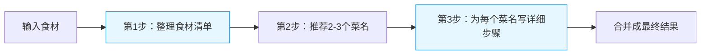
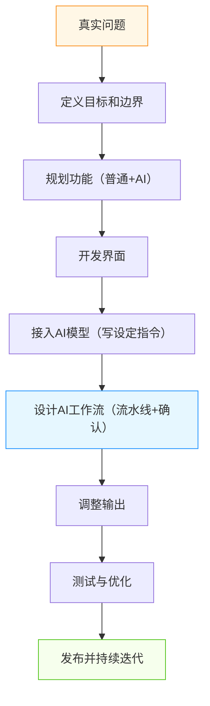

# 第30章 实战五——开发自己的 AI 应用

> 走到这里，你已经跟着做完四个软件了。这一章，我们要把主动权完全交给你：**从一个你自己的真实问题出发，亲手做一个属于你的 AI 应用。** 这是全书五个实战的收官，也是"自然语言编程"这条路走完一圈后，你真正能自己出发的地方。

## 本章你会学到

- 怎么从真实问题出发，而不是"为了做 AI 而做 AI"
- 怎么把一个问题变成清晰的应用目标和功能
- 怎么设计一个 AI 应用的界面和工作流程
- 怎么接入 AI 模型、调整它的输出
- 怎么测试、优化，并把自己的 AI 软件发布出去

### 引子：下班路上的难题

小雅每天下班都会路过菜市场，顺手买点菜。可回到家，她常对着冰箱发愁：手里就剩几样菜——两个鸡蛋、一根胡萝卜、半棵白菜——"这些能做什么？"她常常盯着想十分钟，最后还是点了外卖。

她想过找个菜谱 App，但那些 App 都是"你想做什么菜，我给你菜谱"——而她的问题是反过来的："**我有什么食材，你告诉我能做什么。**"她想要的，是一个"冰箱清道夫"：把现有食材丢进去，AI 告诉她能凑出什么家常菜、怎么做、大概多久。

这不是一个"高大上"的 AI 项目，却是一个**真实、具体、属于自己的问题**。这一章，我们就用它当例子，走一遍"从问题到 AI 应用"的完整流程。你完全可以把它换成你自己的问题——**方法是一样的**。记住：好的 AI 应用，起点从来不是"AI 能干什么"，而是"我到底要解决什么"。

## 30.1 从一个真实问题出发

做 AI 应用最容易犯的错，是先想"我要用 AI 做个酷东西"，再硬找用途。反过来才对。

**你：** 我想做个 AI 应用，但不知道从哪开始。我有个小烦恼：下班回家冰箱里剩几样菜，我总不知道能做什么，最后就点外卖了。这个能做成一个应用吗？

**AI：** 这正是一个很好的起点——真实、具体。我先确认几点：
1. 你的输入是什么？是手动输入食材名字，还是拍照让 AI 认？
2. 你想要的输出是什么——只要菜名，还是也要做法和步骤？
3. 这是你自己用，还是也想给别人用？

**你：** 先手动输入食材名字，简单。输出要菜名加做法步骤，别太复杂，家常的就行。先我自己用，做好了再说给别人。

**AI：** 好。这里有个关键提醒：我们**先确认"问题真实存在"，再谈 AI**。你这个烦恼——"有食材但不知道做什么"——很明确，而且现在没有顺手的工具解决它，所以值得做。如果换成"我想做个 AI 但没想到要解决什么"，就很容易做出来没人用。

**你：** 明白了，那我们就从这个"冰箱清道夫"开始。

从真实问题出发，有三个判断标准，帮你别做无用功：

| 判断 | 问自己 | 小雅的答案 |
|---|---|---|
| 真实吗 | 这烦恼是天天有，还是想出来的？ | 几乎天天有 |
| 具体吗 | 能说清"谁、在什么情况下、卡在哪"吗？ | 下班回家、对着剩菜、不知做啥 |
| 现有工具解决吗 | 别重复造已经很好用的轮子 | 菜谱 App 是"按菜找做法"，反过来不行 |

三条都过，就值得动手。这一步不用 AI 也能做——**它是你的判断，不是 AI 的**。

## 30.2 定义应用目标

问题定了，接下来把它变成一句话的目标和几条边界。

**你：** 帮我把"冰箱清道夫"定义清楚：目标是什么，做什么、不做什么。

**AI：** 好，我写给你看：

> **应用目标**：用户输入手里现有的食材，应用推荐 2~3 道能用这些食材做的家常菜，并给出所需步骤和大致时间，帮用户减少"对着剩菜发呆"和点外卖。

**边界（先不做）：**
- 不做拍照识别（先手动输入）
- 不做购物清单、不做营养分析
- 不追求大菜、宴客菜，只做 30 分钟内的家常菜

**你：** 很好。但"能用的食材"我得说清：做菜一般还有油盐酱醋这些调料，我不想每次都输。默认家里有基础调料，只让我填主要食材，行吗？

**AI：** 很合理。我在给 AI 的设定里写明："默认用户家中有油、盐、酱、醋、水等基础调料，只需根据用户提供的主要食材推荐。"这样你只填鸡蛋、胡萝卜就行，不用每次报调料。

一个清楚的目标 = 一句话说明白"给谁、解决什么、输出什么"，再加一份"先不做什么"的清单。**边界和目标一样重要**——它防止应用越做越散，也让你这一轮有明确的完成标准。

## 30.3 规划 AI 功能

目标有了，规划具体功能。AI 应用和普通应用最大的不同：有些功能靠传统代码（界面、存取），有些靠 AI（理解食材、生成菜谱）。

**你：** 这个应用要做哪些部分？哪些靠 AI，哪些是普通功能？

**AI：** 好，我分两类给你：

**普通功能（传统代码）：**
- 食材输入框：输入、添加、删除食材标签
- 结果展示区：显示推荐的菜名、步骤、时间
- 历史记录：保存上次输入和结果，方便再看

**AI 功能（靠模型）：**
- 理解食材：把用户输入的食材整理成清单（比如"鸡蛋两个、胡萝卜一根"）
- 推荐菜名：根据食材想出能做的家常菜
- 生成步骤：为每道菜写出做法和时间

**你：** 等等，"理解食材"这一步真的需要 AI 吗？我输入的就是食材名字，直接传给 AI 生成菜谱不就行了？

**AI：** 问得好。可以合并，但分开有好处：**先让 AI 把杂乱输入整理干净**（比如"鸡蛋 胡萝卜 还有半棵白菜"整理成清晰清单），再生成菜谱，效果更稳。这一步很像做饭前先"备菜"——把食材理清楚，后面才不乱。这就是我们后面 30.6 要讲的"工作流程"。

把功能分成"普通代码"和"AI"两类，是一个很实用的习惯。你不必懂怎么实现，但要心里有数：**哪些是确定的（输入框就是输入框），哪些是不确定的（AI 每次生成可能不同）**。不确定的部分，正是后面要重点设计和测试的地方。

## 30.4 开发应用界面

先做一个能看、能点的界面。

**你：** 先做界面：一个输入食材的框，加个"帮我做菜"按钮，下面显示结果。别太花哨。

**AI：** 好。我做一个简单页面：顶部标题"冰箱清道夫"；中间一个输入框，输完按回车或点"添加"把食材变成一个小标签；一个"帮我做菜"按钮；下面是结果区，先放示例内容让你看布局。

（AI 生成了页面）

**你：** 我加了"鸡蛋""胡萝卜"两个标签，但加错了想删掉，找不到删除的地方。标签上给个小叉子能删掉吧？

**AI：** 收到。每个食材标签右侧加一个"×"删除按钮，点一下移除该食材。只改输入区，不动结果区。

**你：** 还有，我一口气加了 10 个食材，页面挤成一团。最多让加 8 个吧，超了提示一下。

**AI：** 明白。限制最多 8 个食材标签，超过时提示"最多 8 样，先删掉一些再加"。只改输入区规则。

界面这步和前面几个项目一样：先出样子，再按真实使用微调。"删除标签""数量上限"都是小细节，但**正是这些细节决定软件好不好用**。你只要像小雅这样认真点一遍，把它们说出来就行。

## 30.5 接入 AI 模型

界面有了，现在给它装上"大脑"——接入 AI 模型。

**你：** 界面好了。怎么接 AI？要我自己准备什么吗？

**AI：** 好消息：不用你准备模型，我帮你接好一个现成的 AI 模型服务，你只管调用。你这边要做的是两件事：①确认用哪个模型（我推荐一个便宜又够用的）；②准备一段"设定指令"，告诉 AI 它是谁、要干什么。

**你：** 设定指令是什么？能给我看看吗？

**AI：** 当然。比如这段：

> 你是"冰箱清道夫"，一位家常菜大厨。用户会给你一串现有食材。请只使用这些食材（默认家里有油盐酱醋水等基础调料），推荐 2~3 道 30 分钟内能做的家常菜。每道菜给出：菜名、所需食材（从用户给的里挑）、分步骤做法、预计时间。语言口语化、步骤清楚，不要写复杂大菜。

**你：** 我试了，它真按这个来了。但它有时候会推荐需要"淀粉""料酒"的菜，我家里没有这些。这算不算它没听话？

**AI：** 算半个。你说了"基础调料"，但没列全，AI 按自己的理解把料酒、淀粉也算基础调料了。办法是：**把"基础调料"列清楚**——我会写明"默认只有油、盐、酱油、醋、水，其他一律不能用"。指令越具体，AI 越少自由发挥。

接入 AI 没你想的那么难：模型是现成的，你要做的主要是**写好那段设定指令**。而指令的核心技巧就八个字：**说清角色、说清边界**。

## 30.6 设计 AI 工作流程

这一节是本章的高潮，也是做 AI 应用最值钱的本事：**把 AI 的任务拆成一条流水线，而不是一句话让它干完所有事。**

**你：** 现在 AI 一次性给出菜名和步骤，但我觉得它经常"想得简单"——菜名还行，步骤很糊弄。能改进吗？

**AI：** 能，这是关键技巧。现在的做法是"一句话让 AI 又想菜名又写步骤"，它容易顾此失彼。我们改成一条**三步流水线**：



- **第 1 步**（给 AI）：把用户输入的杂乱食材整理成干净清单。
- **第 2 步**（给 AI）：基于清单，只推荐菜名和理由，先别写步骤。
- **第 3 步**（给 AI）：针对每个菜名，详细写食材、步骤、时间。

每步用一段专门的指令，前一步的结果交给后一步。就像工厂流水线——每个人只干一道工序，比一个人包办又快又好。

**你：** 听起来好，但做起来复杂吗？

**AI：** 多花一点点，但值得。我会把三步串起来，你还是只点一次"帮我做菜"，内部自动跑完三步。你感受不到复杂，只看到结果更细致了。

**你：** 那试试。不过第 2 步我要能干涉——它推荐出的菜名我想能换掉，再让它写步骤。

**AI：** 好主意，我留一个"中间确认"：第 2 步出菜名后先给你看，你可以删掉不想要的或自己加一个，确认后再进第 3 步写步骤。这样你把关菜名，AI 负责写细节。

"流水线 + 中间确认"是 AI 应用设计的精髓。**拆开，是为了每一步都能单独检查和纠正；留确认点，是为了把人的判断嵌进 AI 流程里。** 这比"一句话黑箱出结果"可靠得多。

## 30.7 调整 AI 输出

流水线搭好了，还要把输出调成你喜欢的样子。

**你：** 结果出来了，步骤挺详细。但语言有点"官方"，像说明书。我想要像朋友教做菜那样口语化，行吗？

**AI：** 行。我在第 3 步的指令里加："用朋友聊天的口吻写步骤，比如'先把鸡蛋打散'，不要用书面语和专业术语。"改这一段指令就行，不动流程。

**你：** 还有，我想让每道菜顶部显示"预计总时间"，现在藏在最后一行，不方便看。

**AI：** 收到。我调整结果展示：每道菜卡片顶部加一行"⏱ 约 X 分钟"，由 AI 输出里的时间字段填充。只改展示格式和对应的输出要求。

**你：** 最后一点：它有时候推荐 3 道，有时候 2 道，不固定。我要固定 3 道。

**AI：** 明白。我在第 2 步指令里把"2~3 道"改成"正好 3 道，且尽量用掉更多现有食材"，输出就稳定了。

调输出，本质是**反复修改指令和展示**，而不是改代码。你会发现：做 AI 应用，很大一部分工作是"把要求说具体，然后看结果、再调"。这和你前面五个项目练的"提需求—看结果—提修改"，其实是同一件事。

## 30.8 测试与优化

正式发布前，把它往"极端"里测。

**你：** 我们来测。你列一组场景，特别是奇怪的输入。

**AI：** 好，建议重点测：

| 测试场景 | 输入 | 期望结果 |
|---|---|---|
| 正常输入 | 鸡蛋、胡萝卜 | 3 道家常菜，步骤清楚 |
| 只有一样食材 | 只有一个鸡蛋 | 诚实说明"食材太少"，不硬凑 |
| 奇怪食材 | 输入"石头、牙膏" | 识别不是食材，提示重新输入 |
| 超多食材 | 一次 8 样 | 能处理，步骤不混乱 |
| 输出稳定性 | 同样食材输两次 | 都是正好 3 道，格式一致 |

**你：** 我测了。"只有鸡蛋"它还真硬凑了三道奇怪的菜；"石头牙膏"它也照单全收，认真写了道"石头炒鸡蛋"……太离谱了。

**AI：** 两个都确认了，我来治：①在第 1 步加校验——如果食材少于 2 样，直接提示"食材太少，再来几样"，不往下走；②在第 1 步判断输入是不是食材，遇到明显不是的（石头、牙膏），提示"这几样好像不是食材，检查一下"，并且不传给后续步骤。只改第 1 步，后面不动。

**你：** 改完都过了。"输出稳定性"也过了，两次都是 3 道、格式一样。

"石头炒鸡蛋"这种测试看着好笑，却非常必要。**AI 会一本正经地处理任何输入，所以它特别需要你在入口把好关。** 你会发现，前面每个项目强调的"测边界、防乱填"，到了 AI 应用上更重要——因为 AI 不会主动说"这不合理"，除非你让它说。

## 30.9 发布自己的 AI 软件

最后一关：让这个属于你的应用真正上线。

**你：** 都测好了。怎么发布？我想让它手机也能打开，以后好给我妈用。

**AI：** 我帮你部署上线，得到一个网址，手机电脑都能打开。发布前提醒你三件事：
1. **成本**：每次调用 AI 会产生一点点费用，用量大要知道花了多少——我帮你加个简单的用量统计；
2. **隐私**：用户输入会发给 AI 服务，别让它收集敏感信息，我加一句提示；
3. **迭代**：上线不是结束。用一段后你肯定想改——比如加"拍照识别食材"，到时候我们照前面的方法继续小步改。

**你：** 好，都考虑到了。发布吧，项目说明和版本记录也写上。

**AI：** 完成。"冰箱清道夫"v1.0 已上线：食材输入（标签增删、上限 8 样）、三步 AI 流水线（整理→推荐→步骤，带中途确认）、口语化输出、输入校验、用量统计。项目说明和版本记录已写好。

从"下班对着剩菜发呆"的一个小烦恼，到一个真正能帮上忙、还上线了的 AI 应用——小雅走完了完整的一圈。而这一圈，和前面四个项目是同一条路：



到这里，五个实战项目全部完成。回头看，你其实已经掌握了一整套本事：**把一个真实问题，说成需求；把需求，拆成功能；把功能，变成和 AI 的一轮轮对话；再靠修改、测试、发布，把它送到一个真实的人手里。** 你不需要先成为程序员——你需要的，是这一路练出来的"说清楚、拆得开、判得准"。

AI 应用会越来越强，工具会越来越顺手。但真正决定你能做出什么的，始终是那个起点：**你有没有一个值得解决的真实问题，以及你愿不愿意像这五章一样，一句一句把它做出来。** 现在，轮到你了。

## 常见坑

- **坑：为了用 AI 而做 AI，没有真实问题。** 为什么：做出来没人用。怎么做：先过"真实/具体/现有工具解决不了"三条判断，再动手。
- **坑：目标不清、边界不定。** 为什么：越做越散，没有完成标准。怎么做：写一句话目标 + 一份"先不做什么"清单。
- **坑：一句话让 AI 干完所有事。** 为什么：顾此失彼，结果糊弄。怎么做：像 30.6 那样拆成流水线，每步一段指令，并在关键点留"人工确认"。
- **坑：指令写得笼统。** 为什么：AI 自由发挥，比如乱用调料、菜品数量不稳。怎么做：把角色、边界、数量、语气写具体，看结果再调。
- **坑：不测奇怪输入。** 为什么：AI 会一本正经处理"石头牙膏"。怎么做：在入口加校验（食材太少/不是食材就拦住），并测输出稳定性。
- **坑：发布后不管成本和隐私。** 为什么：调用有费用、输入含隐私。怎么做：加用量统计和隐私提示，上线后持续小步迭代。

## 本章小结

- 做 AI 应用，从真实问题出发，而不是从"AI 能干什么"出发。
- 好问题的三个判断：真实吗、具体吗、现有工具解决不了吗。
- 清楚的目标 = 一句话说明"给谁、解决什么、输出什么" + 一份"先不做什么"清单。
- 功能分两类：传统代码（界面、存取）和 AI（理解、生成）；不确定的 AI 部分要重点设计。
- 接入 AI 其实是写一段"设定指令"：说清角色、说清边界。
- 最值钱的本事是设计 AI 工作流：拆成流水线（整理→推荐→步骤），每步一段指令，关键点留人工确认。
- 调输出就是反复改指令和展示；测试要专测奇怪输入和输出稳定性；发布要考虑成本、隐私和后续迭代。
- 五个项目走完，你已经掌握"把真实问题变成真实软件"的完整能力——现在轮到你出发。

## 动手练习

1. 找出一个你自己"如果有个 AI 小工具就好了"的真实问题，用 30.1 的三条标准（真实/具体/现有工具解决不了）判断它值不值得做，写下来。
2. 给你这个问题写一句话目标 + 一份"先不做什么"清单，再把它拆成"普通功能 / AI 功能"两类。
3. 照着 30.6，为你应用里的一个 AI 任务设计一条三步流水线，画出流程，并指出在哪一步留一个"人工确认"点。
4. 列出 3 个"奇怪输入"测试用例（像石头牙膏那样），想清楚在流水线的哪一步拦住它们。

## 可复制的指令模板

**模板一：从一个真实问题开始，规划你的 AI 应用**

```text
我有一个真实的问题：[用大白话说清楚——谁、在什么情况下、卡在哪里、现在怎么凑合]。

我想做一个 AI 小应用来解决它。请你：
1. 先用“真实吗/具体吗/现有工具能不能解决”三条帮我判断这个问题值不值得做；
2. 帮我把目标写成一句话：给谁、解决什么、输出什么；
3. 列一份“先不做什么”的边界清单；
4. 把功能分成“普通功能”和“AI 功能”两类，用大白话讲给我。
先别动手写代码，我看清楚了再继续。
```

**模板二：把 AI 任务设计成一条带确认点的流水线**

```text
我要做的这个 AI 任务，不要一步出结果。请帮我把它设计成一条分步流水线：

1. 把这个任务拆成 3 个前后衔接的步骤，每一步只干一件事；
2. 为每一步写一段专门的指令，说清楚这一步的角色、输入、输出和边界；
3. 指出应该在哪一步插入一个“人工确认”点，让我能先看结果、改一改再往下走；
4. 用 Mermaid 画出这条流水线的流程图。

设计好先给我看，我确认后再开始实现。
```
