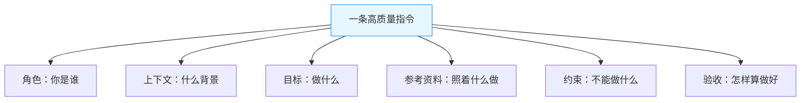
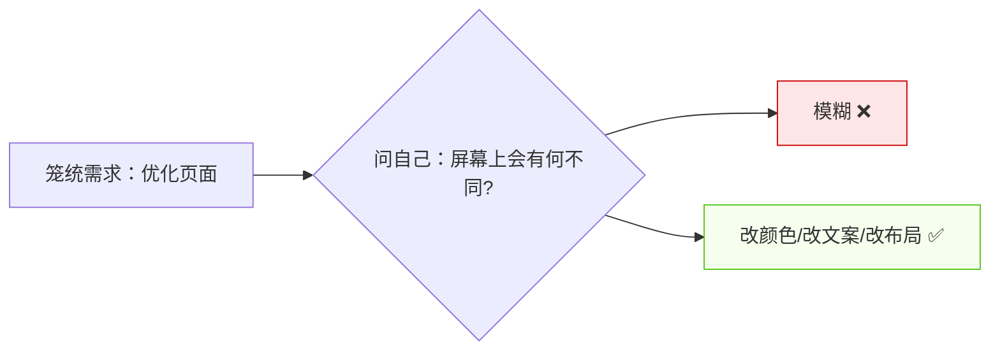

# 第31章 掌握高质量 AI 开发指令

> 这一章要解决一个问题：同样一句需求，为什么有人一次就说清、AI 立刻做对，有人来回十几轮还是跑偏？差别不在 AI，而在「指令」的质量。我们把「把话说清楚」这件事，拆成一套可以照着做的方法。

## 本章你会学到

- 一条高质量指令由哪几部分组成
- 怎么给 AI 提供上下文，让它知道前因后果
- 怎么用参考资料，让 AI 照着样子做
- 怎么设定角色、目标、约束和验收标准
- 怎么把好指令存下来，变成自己的模板库

### 引子：同样一句话，结果天差地别

林小满的花店小助手已经用了快一年。当年那个记订花的小本子，如今长成了一个像样的系统：客户档案、节日提醒、花材库存、会员积分，一样不缺。她还招了个兼职的小姑娘阿晴帮忙打理。「阿晴，」小满说，「你也学学怎么使唤 AI，以后你也能自己改点东西。」

这天，俩人各自让 AI 加一个功能——「在订单列表里显示客户的会员等级」。

小满打字很快：「在订单列表加一列，显示会员等级。」

AI 回了一堆代码，加上去了。可她打开一看：会员等级显示在最右边，字很小，而且只显示「等级 1、等级 2」这种代号，客户根本看不懂。她还得再来回好几轮。

轮到阿晴，她是这么写的：

> 「我们正在做一个花店订单系统（这是个给店主自己用的内部工具，不是给客户的）。请在『订单列表页面』增加一列『会员等级』，放在『客户姓名』这一列右边。等级请用中文友好显示：普通会员、银卡会员、金卡会员，不要用数字代号。只改订单列表页，不要动其他页面。改完后，我要能在列表里一眼看到每一行客户的等级。」

AI 一次就做对了。

小满凑过来看，愣了半天：「同样的需求，你这句话怎么就这么管用？」

阿晴不好意思地笑：「我哪懂什么技巧，就是把『我要什么、不要什么、做成什么样』都写上了。」

这就是本章要教你的东西。所谓「高质量指令」，不是什么玄学，而是**把弥散在脑子里的想法，整理成 AI 能准确执行的一份清单**。你前面几篇已经不知不觉用过不少，这一章我们把它彻底讲透、变成可复用的本事。

## 31.1 指令的基本结构

先说清楚一个词：**指令（prompt）**，就是你发给 AI 的那段话——你打字输入的全部内容。它不一定要长，但一条「好使」的指令，通常包含几个固定部分。

打个比方。你让一个刚来第一天的新人帮忙买咖啡，不能只说「去买杯咖啡」。你得说清楚：买什么（美式还是拿铁）、谁喝（老板不加糖）、去哪买（楼下那家）、多少预算（别超过 30 块）、什么时候要（十点前）。说全了，他一次就买对；说不全，他得回来问你三趟。

给 AI 下指令是同一个道理。一条完整的指令，通常有这六个部分：

| 部分 | 作用 | 小满最初缺了什么 |
|---|---|---|
| 角色 | 让 AI 用什么身份做事 | 没说，AI 按通用助手来 |
| 上下文 | 交代背景和前因后果 | 没说这是什么系统 |
| 目标 | 要做的具体事情 | 说了（加一列），但不够细 |
| 参考资料 | 让 AI 照着样子做 | 没给 |
| 约束 | 不能碰的边界 | 没说「只改这一页」 |
| 验收标准 | 怎么算做对了 | 没说「友好显示、一眼看到」 |

你不用每次都写全六个。**简单的活儿，两三样就够；复杂的活儿，写得越全，返工越少。** 关键是养成「下指令前先在脑子里过一遍这六项」的习惯。



## 31.2 如何提供上下文

**上下文（context）**，就是 AI 理解这句话所需要的「前因后果」。AI 没有你的记忆，也不认识你的软件——除非你告诉它。

新手最常犯的错，是以为 AI「应该知道」。它不知道。它每次对话就像一个失忆的聪明人：能力很强，但对你这个项目一无所知。

**你：** 帮我改一下，把客户等级显示出来。

**AI：** 好的，请告诉我：这是哪个页面？「客户等级」数据存在哪里？显示成什么样子？这是一个什么类型的项目？

**你：** 你不知道吗？我们之前不是一直在做花店系统吗？

**AI：** 抱歉，我看不到之前的对话记录。请把相关背景再说一遍，我才能准确修改。

这段对话是不是很熟悉？**提供上下文，就是把这些背景主动交代清楚。**

上下文包括什么？

- **项目是什么**：花店订单系统，店主自用的内部工具。
- **当前在做什么**：正在改订单列表页。
- **相关的前后文**：会员等级数据存在客户表里，有普通/银卡/金卡三种。
- **之前的决定**：这个页面上一轮刚加过「剩余天数」列。

一个实用的写法，是开头用两三句话做「背景铺垫」：

> 「背景：我在做一个花店订单系统（店主自用的内部工具）。目前订单列表页有客户姓名、订花内容、剩余天数三列。客户数据表里存了会员等级字段，值有 normal / silver / gold 三种。」

有了这段铺垫，AI 就不会问一堆基础问题，也不会改错地方。**记住：你觉得「不用说也知道」的东西，恰恰是最该写上去的。**

## 31.3 如何提供参考资料

有时候，光用嘴描述不容易说清「要什么样子」。这时候最省事的办法是：**给个样子，让 AI 照着做。**

这就是**参考资料**——一张截图、一段现有的代码、一个你喜欢的页面、一份字段清单。它的作用是「用实例代替千言万语」。

比如你对 AI 说「做一个订单表格」，它脑子里想的表格和你想要的可能完全不同。但如果你说「照着这个页面的表格样式做」，再贴一张截图，它就有了明确的目标。

参考资料有几种常见形式：

| 形式 | 适合场景 | 怎么用 |
|---|---|---|
| 截图 | 界面长什么样 | 发图 + 「照这个样式，但换成订单数据」 |
| 现有页面/代码 | 想保持风格一致 | 「参考登录页的配色和按钮样式」 |
| 字段清单 | 数据要存什么 | 贴出「客户表字段：姓名、电话、等级…」 |
| 文字示例 | 输出格式 | 「输出像『张三｜金卡｜还有 3 天』这样」 |

**你：** 我想做个订单详情页，但说不清要什么风格。

**AI：** 那给我一个你喜欢的参考。可以是截图，也可以是另一个页面。

**你：**（发了一张会员中心页面的截图）照这个页面的布局和配色做，但内容换成订单信息。字体、间距、卡片圆角都跟它保持一致。

**AI：** 明白了。我会参考这张图的布局（左侧信息卡 + 右侧明细表）、配色（米白底 + 绿色主色）和圆角卡片风格，做一个订单详情页。

给参考时有个关键动作：**说清「照抄什么」和「换成什么」。** 只发图不说，AI 可能把内容也照抄了。像上面那样「照布局和配色，换成订单内容」，才不会跑偏。

对零基础的你来说，提供截图往往比学会一堆术语管用得多——**一张图顶一百句话**。

## 31.4 如何设定角色

**设定角色（role）**，就是告诉 AI「你是谁、用什么身份和口吻做事」。

为什么要这个？因为同一个任务，不同身份做出来差别很大。让 AI 当「严厉的代码审查员」，它会挑刺；让它当「耐心的老师」，它会解释；让它当「资深花店运营顾问」，它会从生意角度想问题。

打个比方：你请人帮忙，得先告诉对方「我是以什么身份来找你的」。找朋友帮忙，语气随意；找律师咨询，就得正式。**角色设定，就是给 AI 戴上不同的「帽子」。**

设定角色通常一句话就够，放在指令开头：

> 「你是一位有 10 年经验的零售系统设计师，擅长为小店主设计简单好用的内部工具。」

> 「你是一位耐心的编程老师，正在教一个完全不懂代码的花店老板。」

好的角色设定有三个要素：

1. **身份**：谁（零售系统设计师 / 测试工程师 / 文案）。
2. **经验或专长**：擅长什么（10 年经验、懂小店场景）。
3. **风格倾向**：怎么做事（简单好用、耐心、严谨挑错）。

**你：** 我让 AI 检查代码，它每次都说「看起来不错」，根本不挑错。

**AI：** 那是因为你没给它一个「挑错」的角色。试试在开头加一句：「你是一位严格的代码审查员，任务是找出这段代码里所有可能出错的地方，并说明为什么。不要客套，直接列出问题。」

**你：** 加了之后它一下子找出好几个问题，还有点「毒舌」。

**AI：** 这就对了——**角色会改变 AI 的行为模式。** 你需要它严谨，就给它严谨的角色；需要它温柔，就给它温柔的角色。

小提醒：角色不用太花哨。「你是一位耐心的助手」这种也行，但越具体越稳定。给一个清楚的身份和职责，比写一大段人设更有效。

## 31.5 如何设定目标

目标，就是**这一轮到底要 AI 做成什么事**。它是指令的核心。

前面 30 章我们反复强调「一句话说清目标」——给谁、解决什么、输出什么。这里再把它变成一个可检查的公式：

> **动词 + 对象 + 具体要求**

- 「**在订单列表页**（对象）**增加**（动词）一列会员等级（具体要求）」
- 「**把**（动词）提醒颜色（对象）**改成**（动词）红色加粗（具体要求）」
- 「**写一个**（动词）函数（对象），**实现**（动词）按客户姓名搜索订单（具体要求）」

目标最容易出的问题是**太笼统**。比如「优化一下这个页面」——优化什么？变快？变好看？改布局？AI 只能猜，而它猜的往往不是你要的。

把笼统目标改成具体目标，靠的是问自己「做完之后，屏幕上会有什么不同？」：

| 笼统目标 ❌ | 具体目标 ✅ |
|---|---|
| 优化订单页 | 把订单页的「剩余天数」从数字改成「还有 3 天」这种中文提示 |
| 改进提醒 | 把提醒提前时间从 1 天改成 3 天 |
| 让表格好看点 | 给表格加隔行底色，表头改成浅蓝色 |

**目标要「可验证」——做没做完，你一眼能看出来。** 凡是改完你还得猜「它到底改没改」的目标，都不够具体。

还有一个常被忽略的点：**一次只设一个主要目标**。你前面第 7 章学过「拆解功能」，这里正好用上。一条指令塞进五个目标，AI 容易顾此失彼。宁可分成五条指令，一条一个目标，做完一个再做下一个。



## 31.6 如何设定约束

**约束（constraints）**，就是你划给 AI 的「红线」——哪些能做、哪些绝对不能碰。

如果说目标是「要做什么」，约束就是「不要做什么、只能做到哪」。它像给施工队划的施工范围：墙可以敲，但承重墙绝对不能动。

为什么约束特别重要？因为 AI 有个特点：**你没禁止的，它就可能去做。** 你说「改一下订单页」，它可能顺手把样式、数据、其他页面全改了——在它看来这都是「帮忙」。所以你得明确圈出边界。

常见的约束有这几类：

- **范围约束**：「只改订单列表页，不要动其他页面」「只改前端显示，不改数据结构」。
- **风格约束**：「用中文友好显示，不要用数字代号」「保持现有配色不变」。
- **技术约束**：「不要用新的第三方库」「兼容手机屏幕」。
- **安全约束**：「不要显示客户的完整手机号，中间用 **** 代替」。

看阿晴那条指令里的约束：「只改订单列表页，不要动其他页面」「不要用数字代号」——正是这两条，让 AI 没跑偏。

**你：** 我让 AI 加个功能，结果它把整个项目都重写了一遍，原来好的功能也坏了。

**AI：** 这就是缺约束的典型。下次在指令末尾加一句明确的红线：「只修改 [具体文件/页面]，**不要改动其他任何地方**；如果必须动别处，先告诉我、等我同意。」

**你：** 加上这句后，它果然只动了指定的地方。

一个特别好用的约束句式是：**「只改 A，不要动 B，如果必须动 B 先问我。」** 这句话几乎是所有修改类指令的护身符，第 15、16 章讲「不破坏原有功能」时我们用过，这里再强调一次。

## 31.7 如何设定验收标准

最后一块拼图：**验收标准（acceptance criteria）**——怎样才算做对了。

这是最容易被跳过、却最能减少返工的一项。你想想，装修时如果只说「帮我装个柜子」，装完你可能会说「不是这个颜色」「位置不对」。但如果你一开始就写清「白色、靠墙、两米宽、带三层隔板」，装完基本不用返工。

验收标准，就是把「我满意的样子」提前写出来。它可以是：

- **可观察的结果**：「打开订单页，每一行都能看到客户的中文等级」。
- **可操作 checks**：「我输入一个金卡客户，列表显示『金卡会员』而不是『gold』」。
- **边界情况**：「客户没有等级时，显示『普通会员』，不要显示空白」。
- **不破坏原有**：「原来的『剩余天数』列要保留，不能消失」。

把它写进指令，AI 就有了自检的依据，你也有了验收的清单。

**你：** 每次 AI 做完，我都要花很久检查，还老发现漏这漏那。

**AI：** 试试把「验收标准」写进指令里。比如：「完成后，请按以下标准自检并逐条告诉我是否满足：1）订单页每行显示中文会员等级；2）金卡显示为『金卡会员』；3）无等级显示『普通会员』；4）原有的『剩余天数』列还在。」

**你：** 让 AI 自己按清单对一遍，我省了好多事，漏项也少了。

验收标准和「测试」是一体两面。你前面第 20 章学过测试，这里的验收标准，其实就是**提前写好的测试用例**——只不过让 AI 在交付前先对照一遍。把标准写清楚，等于把检查工作前置，返工自然就少了。

## 31.8 如何建立自己的指令模板库

看到这里，你可能会觉得：「六项内容，每次都写，好累。」

别担心——**你不需要每次从零开始写。** 高明的人会把好用的指令存起来，下次改几个字就能用。这就是**指令模板库**。

打个比方。大厨做菜靠「菜谱」，不会每次重新发明做法。你做软件也可以有自己的「菜谱」——把常见的任务（加一列、改个颜色、加个搜索、修个报错）写成模板，用时填空。

建立模板库分三步：

**第一步：攒。** 每次写出一条效果特别好的指令，就复制保存下来。不用整理，先存在一个叫「我的指令」的文档里。

**第二步：抽出变量。** 把指令里「每次都变的部分」用方括号标出来，固定部分保留。比如：

> 「在【页面名】增加一列【列名】，显示在【参照列】右边，用【显示格式】，不要动其他页面。」

**第三步：分类。** 按任务类型分组，用的时候按图索骥：

| 模板类别 | 典型任务 | 适用场景 |
|---|---|---|
| 新增类 | 加一列、加个按钮、加个页面 | 功能扩展 |
| 修改类 | 改颜色、改文案、改位置 | 微调优化 |
| 排错类 | 描述报错、发截图、让 AI 诊断 | 修 bug |
| 新建项目类 | 说清想法、让 AI 一步步带 | 从零开始 |

有了模板库，你的指令质量就稳定了——不会因为今天累了就写得潦草。阿晴刚开始也要想半天，后来把她常用的五六条指令存成模板，现在下指令又快又准。

更进一步，你还可以让 AI 帮你维护模板库：

**你：** 我把最近用得最顺手的三条指令发给你，请帮我把它们整理成可复用的模板，把每次会变的部分标成 [变量]，并给每个模板起个名字、写一句适用场景说明。

**AI：** 好的。我整理成了三个模板：【新增列表列】、【修改配色】、【描述报错】，每个都标好了变量和适用场景，你以后填空即可。

**指令质量，是可以「攒」出来的。** 每做一次项目，你的模板库就丰富一分——这是你真正的、谁也拿不走的本事。

## 常见坑

- **坑：觉得「不用说 AI 也懂」，省掉上下文。** 为什么：AI 每次对话都像失忆，看不到你之前的背景。怎么做：开头用两三句话交代「这是什么项目、现在在改哪、相关的前后文」。
- **坑：目标写得笼统，比如「优化一下」。** 为什么：AI 只能猜，猜的往往不是你要的。怎么做：用「动词+对象+具体要求」，并问自己「做完屏幕上有什么不同」。
- **坑：只说「做什么」，不说「不要做什么」。** 为什么：你没禁止的，AI 都可能去做，容易误伤其他功能。怎么做：加一句「只改 A，不要动 B，必须动 B 先问我」。
- **坑：给参考资料只发图、不说照抄什么。** 为什么：AI 可能连内容一起照抄。怎么做：说清「照布局和配色，换成 XX 内容」。
- **坑：每次都从零写指令，不沉淀。** 为什么：累，而且质量不稳定。怎么做：把好指令存成模板，抽出变量分类，让 AI 帮你维护模板库。

## 本章小结

- 一条高质量指令通常含六部分：角色、上下文、目标、参考资料、约束、验收标准；简单任务可省，复杂任务写全。
- 上下文＝前因后果，主动交代背景，别指望 AI「应该知道」。
- 参考资料用「照抄什么、换成什么」说清，一张截图往往顶一百句话。
- 角色决定 AI 的行为模式，给清楚身份和职责，比堆人设更有效。
- 目标要具体、可验证、一次一个：「动词+对象+具体要求」。
- 约束是红线：「只改 A，不要动 B，必须动先问我」是修改类指令的护身符。
- 验收标准＝提前写好的检查清单，让 AI 交付前自检，返工更少。
- 把好指令攒成模板库，填空即用——指令质量是可以「攒」出来的。

## 动手练习

1. 找出你最近一次「AI 没做对」的指令，用本章的六部分逐项对照，看看你漏了哪几项，把它们补上再发一次，比较结果。
2. 把你最常做的一类任务（比如「给表格加一列」）写成一个带 [变量] 的模板，然后换一组变量，看它是不是真能直接套用。
3. 挑一条你之前写得比较笼统的指令（比如「优化一下」），用「动词+对象+具体要求」改写成具体目标，并补上 2 条验收标准。
4. 建立你的第一个「我的指令」文档，把本章的模板一存进去，并从你过往的对话里再翻出两条好指令补充进去。

## 可复制的指令模板

**模板一：一条完整的「六要素」指令（适合重要的修改任务）**

```text
【角色】你是一位耐心的开发助手，擅长为小店主做简单好用的工具。

【上下文】我在做一个花店订单系统（店主自用的内部工具）。订单列表页现在有客户姓名、订花内容、剩余天数三列。客户数据表里存了会员等级，值有 normal / silver / gold 三种。

【目标】在订单列表页增加一列「会员等级」，放在「客户姓名」右边。

【参考资料】参考现有列表页的列宽和样式，保持一致。

【约束】只改订单列表页，不要动其他任何页面；等级用中文显示，不要用数字代号；如果必须改别处，先问我。

【验收标准】完成后逐条自检并告诉我：1）每行都显示中文会员等级；2）gold 显示为「金卡会员」；3）无等级显示「普通会员」；4）原有「剩余天数」列仍在。
```

**模板二：让 AI 帮你把好指令变成模板库**

```text
我把最近用得最顺手的三条指令发在下面。请你：
1. 把每条整理成可复用的模板，把每次会变化的部分标成 [变量]；
2. 给每个模板起一个简短的名字；
3. 写一句「适用场景」说明，告诉我什么时候该用哪个；
4. 最后用一张表格汇总所有模板（模板名 / 变量 / 适用场景）。

三条指令如下：
[在此粘贴你的三条指令]
```
