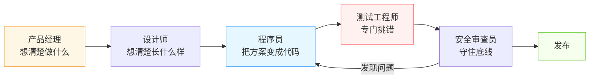
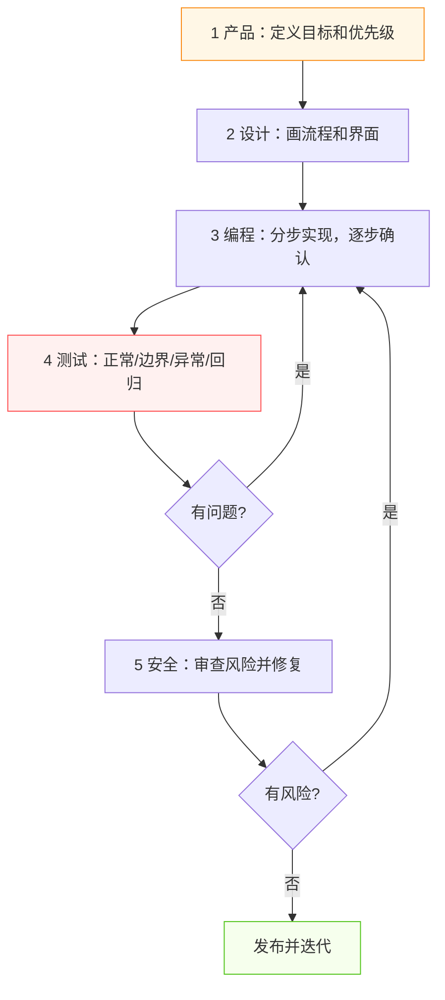

# 第32章 如何让 AI 成为你的软件开发团队

> 这一章要解决一个问题：一个人的精力有限，怎么既想需求、又管设计、又盯代码、又做测试？答案是——别什么都自己扛，把 AI 当成一个团队来用。它一个人，就能扮演一整支队伍。

## 本章你会学到

- AI 可以扮演的五个角色：产品经理、设计师、程序员、测试工程师、安全审查员
- 每个角色负责什么、怎么给它下指令
- 怎么让这些角色分工协作
- 怎么协调「多个 AI」或者 AI 的多个身份
- 怎么把整个流程固定下来，变成你的开发流水线


*图：把 AI 变成你的开发团队*

### 引子：小满的一人团队

花店小助手做了一年多，功能越堆越多。最近小满想加个「会员积分商城」，客户能用积分换花。她坐下来梳理，越想越头大：

- 这个商城到底解决什么问题？客户真的会换吗？——这是**产品经理**要想的。
- 页面长什么样、积分怎么展示、换购流程顺不顺——这是**设计师**要想的。
- 代码怎么写、数据怎么存——这是**程序员**要干的。
- 换购会不会算错积分、会不会被重复兑换——这是**测试工程师**要查的。
- 客户手机号会不会泄露、积分能不能被伪造——这是**安全审查员**要盯的。

五个角色，全压在她一个人身上。「我又要想生意，又要盯细节，脑子不够用啊。」她叹气。

其实，她不需要自己会这五件事。她只需要**会指挥**——像一位导演，把每个角色交给 AI 去演。AI 可以一会儿当产品经理帮她捋需求，一会儿当设计师画方案，一会儿当程序员写代码，一会儿又切换成挑刺的测试员和安全员。

「原来我不是缺人手，」小满恍然大悟，「我是没把活儿分出去。」

这一章，我们就教你如何把 AI 当成一个完整的软件开发团队来用。你不用真的雇五个人——**你只要会用五个「角色提示」，就能拥有一支队伍。**

## 32.1 AI 产品经理：帮你想清楚「做什么」

产品经理（Product Manager）的核心职责，是回答「**到底该做什么、为什么做、先做哪个**」。它是团队的「方向盘点星」。

很多新手跳过这一步，直接让 AI 写代码，结果做出的东西没人用、或者做了一堆没用的功能。产品经理角色就是用来堵住这个漏洞的。

怎么让 AI 当产品经理？给它这个身份，让它问你问题、帮你梳理优先级：

**你：** 从现在起，你是一位经验丰富的产品经理。我想给花店系统加一个「会员积分商城」，客户能用消费积分换花。请帮我理清需求。

**AI：** 好的。作为产品经理，我先不谈怎么做，先问你几个问题：
1. 积分怎么获得——消费多少钱算 1 分？
2. 积分能换什么——具体哪几种花、各需要多少分？
3. 积分会不会过期？
4. 你最想先验证什么——是「客户到底愿不愿意换」，还是「流程能不能跑通」？

**你：** 嗯……我还真没想这么多。消费 1 元算 1 分，能换几种小盆栽。先验证客户愿不愿意换吧。

**AI：** 那我建议第一版只做一个最小功能：客户能看到自己积分、能兑换 2~3 种花。复杂的积分规则、过期机制先不做。先做出来让几个老客户试试，看他们换不换，再决定要不要投入更多。

看到没？产品经理角色的价值，不是写代码，而是**逼你把「想做」变成「想清楚了该做哪一小块」**。它帮你砍掉贪多求全的冲动，先做能验证价值的最小版本。

产品经理角色还该做的事：

- 帮你把模糊想法写成一句话目标。
- 帮你排优先级：哪些先做、哪些往后放。
- 帮你从用户角度挑刺：「客户真的需要这个功能吗？」
- 帮你定义「这个功能的成功标准是什么」。

**给 AI 的产品经理角色提示（可复制）：**

> 「你是一位经验丰富的产品经理，擅长帮小店主把模糊想法变成清楚、可执行的最小需求。请先向我提问来理解目标，然后帮我：1）写成一句话目标；2）排优先级，指出第一版只做什么；3）定义成功标准。先别谈技术实现。」

## 32.2 AI 设计师：帮你想清楚「长什么样、怎么用」

设计师（Designer）负责**界面长什么样、流程顺不顺、用户体验好不好**。它管的是「好不好用、好不好看」，不是「代码怎么写」。

零基础的你往往说不清「好看」是什么样。设计师角色会引导你从使用流程出发，而不是空谈审美。

**你：** 你现在是设计师。帮我设计积分商城的页面和兑换流程。

**AI：** 好。我先从使用流程入手。一个客户兑换积分，理想路径应该是：
1. 在商城页看到自己有多少积分 →
2. 看到能换哪几种花和所需积分 →
3. 点「兑换」→ 确认 → 成功 →
4. 收到一条「兑换成功」的提示。

这里有个关键设计问题：客户积分不够时，页面该显示什么？我建议按钮置灰并提示「还差 X 分」，而不是点了才报错。你觉得呢？

**你：** 对，别让人点了才知道换不了。还有，我想让能换的花配张图。

**AI：** 好。我会在每个可兑换的花上放一张小图、名称、所需积分；积分不够时按钮置灰并提示差额。整体沿用现有系统的绿色主色调，保持风格一致。

设计师角色关心的几件事：

| 关注点 | 它会问你什么 | 为什么重要 |
|---|---|---|
| 使用流程 | 用户第一步点哪、最后到哪 | 流程顺，客户才用得下去 |
| 状态提示 | 积分不够、成功、失败时显示什么 | 好界面会「提前告诉」用户 |
| 风格一致 | 和现有页面配色、按钮是否统一 | 一致才显得专业 |
| 异常路径 | 网络错了、库存没了怎么办 | 别只在「理想情况」下好用 |

**给 AI 的设计师角色提示（可复制）：**

> 「你是一位资深 UI/UX 设计师，擅长为小店设计简单好用的界面。请从用户使用流程出发，帮我设计页面和流程：先画出用户一步步操作的路径，指出每一步页面显示什么、状态提示是什么，并说明如何与现有系统风格保持一致。不要写实现代码。」

## 32.3 AI 程序员：把方案变成代码

程序员（Programmer / Developer）是把需求和设计**真正变成能运行代码**的角色。这是你前面几篇最熟悉的——你一直在让 AI「干活」。

但作为「团队里的程序员」，它和之前的差别是：**它拿到的应该是前面两个角色的产出**——清楚的目标、设计好的流程，而不是一句含糊的话。

**你：** 你是程序员。产品经理和设计师已经定好了：商城页显示积分和可兑换的花（带图、名称、所需积分），积分不够按钮置灰提示差额，兑换流程是「点兑换→确认→成功提示」。请开始实现。

**AI：** 收到。我按三步来做，每步做完给你看：
1. 先做商城页面（积分展示 + 可兑换花列表 + 按钮状态）；
2. 再做兑换逻辑（扣分、记录、防止重复兑换）；
3. 最后接上成功提示。
先从第一步开始，可以吗？

**你：** 可以。不过积分展示我想放在页面顶部最显眼的地方。

**AI：** 好，积分放在页面顶部横幅，大字显示。我做完第一步给你看效果，确认后再做第二步。

程序员角色发挥得好的关键：

- **给它清楚的「设计输入」**，别让它自己猜需求。
- **让它分步做、做完一步确认一次**（第 17 章学过的「逐步修改」）。
- **明确约束**：只改哪些文件、不动哪里（第 31 章的约束）。
- **让它解释**：关键地方让它用大白话说「我做了什么、为什么」，方便你把关。

**你：** 你能用大白话说说，刚才这段代码做了什么吗？

**AI：** 当然。简单说，它做了三件事：①从客户资料里读出当前积分；②你点兑换时，检查积分够不够，够就扣掉对应分数并记录一笔兑换；③把结果显示在页面上。就好比柜台：先看你有多少钱，够了就收钱、记账、给你花。

让程序员「说人话」，是零基础你把关的重要手段——**你不必懂代码，但要听懂它在干什么。**

## 32.4 AI 测试工程师：专门挑错

测试工程师（Test Engineer / QA）的职责是**在上线前把问题找出来**。它和程序员是天然的「对头」——程序员负责「做出来」，测试员负责「找出哪里不对」。

为什么要单独设这个角色？因为让写代码的那个人（或那个身份）自己测，往往会「手下留情」——下意识只测能通过的路径。而一个专门的「挑刺者」，会主动往沟里开。

**你：** 现在换你当测试工程师。积分商城做完了，请你专门找问题，别客气。

**AI：** 好，我以挑错为目的，列几类测试：

| 场景 | 你怎么操作 | 期望结果 |
|---|---|---|
| 正常兑换 | 积分够，点兑换 | 扣分成功、有记录、有提示 |
| 积分不够 | 积分不足时看按钮 | 按钮置灰、提示还差多少分 |
| 重复兑换 | 同一次兑换连点两次 | 只扣一次分，不能重复换 |
| 边界值 | 积分刚好等于所需 | 可以兑换，兑换后变 0 |
| 异常 | 兑换时断网 | 不扣分，提示失败可重试 |

**你：** 我按你说的测了，「重复兑换」真出了问题——连点两下扣了两次分！

**AI：** 抓到了。这是典型的「重复提交」漏洞。我来修：点兑换后立刻禁用按钮，并处理后台的重复请求，确保一次兑换只扣一次分。只改兑换逻辑，不动页面其他部分。

一个好的测试工程师角色，会主动覆盖：

- **正常路径**：理想情况下能用吗？
- **边界情况**：刚好够、刚好不够、0 分、超多分。
- **异常情况**：断网、重复点、乱输入。
- **回归测试**：新功能有没有把老功能弄坏？

**给 AI 的测试工程师角色提示（可复制）：**

> 「你是一位严格、爱挑刺的测试工程师。刚才完成的功能是 [功能描述]。请站在『一定要找出问题』的立场，列出测试场景（正常、边界、异常、回归四类），指出每个场景怎么操作、期望什么结果。发现风险就直接说，不要客套。」

## 32.5 AI 安全审查员：守住底线

安全审查员（Security Reviewer）负责**数据和系统的安全**：客户信息会不会泄露、积分能不能被伪造、有没有被人钻空子。

这是最容易被忽略、却出事最严重的角色。第 24 章讲过安全与数据保护，这里我们从「团队分工」的角度再把它固定成一个角色。

对林小满的花店系统来说，安全不是「黑客攻击」那么遥远，而是很实在的问题：客户的电话和地址会不会被别人看到？积分能不能被客户自己改成 99999 分？

**你：** 你现在是安全审查员。帮我检查积分商城有没有安全漏洞。

**AI：** 好，我从几个角度审：
1. **数据隐私**：兑换记录会显示客户电话吗？如果只是内部用，不用对外展示完整电话，应打码。
2. **积分防伪造**：积分是存在服务器端的，客户在自己手机上改不了——这点要确保。不能在页面上放一个「我可以改积分」的口子。
3. **兑换凭证**：兑换成功后生成的凭证，不能被人随便猜出来、冒领。
4. **权限**：这个商城是客户自己用，还是只有店员能操作？权限要分清。

这里第 2 点最要紧：**千万别让积分变成客户能自己改的数字**。我会检查扣分逻辑是不是放在服务端，而不是只在页面上做样子。

安全审查员角色常查的几类问题：

| 审查维度 | 典型问题 | 为什么要查 |
|---|---|---|
| 隐私 | 手机、地址是否对外暴露 | 客户信息要保护 |
| 防篡改 | 关键数据能不能被用户自己改 | 防止伪造积分、绕规则 |
| 权限 | 谁能看、谁能改是否分清 | 防止越权操作 |
| 凭证 | 兑换码、链接是否可被猜出 | 防止冒领 |

**给 AI 的安全审查员角色提示（可复制）：**

> 「你是一位严格的安全审查员。请审查这个功能 [功能描述] 的安全风险，重点看：客户隐私数据是否暴露、关键数据能否被用户篡改、权限是否清晰、凭证是否可被伪造。用大白话说明每个风险『可能被怎么利用』，并给出修复建议，按严重程度排序。」

## 32.6 如何分工协作

五个角色都认识了，关键问题来了：**怎么让它们配合起来，而不是各干各的？**

答案是像真实团队一样，按流程推进，每个角色的产出交给下一个角色当输入。这其实就是一条流水线：



注意图里那条从「安全审查员」回到「程序员」的箭头——**发现问题就打回重做**，这是真实团队的常态，不是失败。测试和安全角色挑出的问题，要回到程序员那里修，修完再测。

分工协作有三个原则：

1. **顺序推进，不越级**。先想清楚「做什么」（产品），再想「长什么样」（设计），最后才「怎么做」（编程）。跳过前面直接写代码，是返工的根源。
2. **产出要交接**。产品经理定下的目标、设计师画的流程，要明确写给程序员，不能让程序员自己猜。上一章的「上下文」和「参考资料」，就是交接的载体。
3. **挑错要闭环**。测试和安全发现的问题，必须回到程序员那里修掉，再复测，直到通过。不能「发现了就算了」。

**你：** 我一个人用 AI，怎么体现「分工」？不都是我在打字吗？

**AI：** 分工不一定是不同的 AI，也可以是**同一个 AI 在不同阶段切换不同角色**。关键是每次切换时，明确告诉它「现在你是谁、上一阶段的产出是什么」。就像你一个人分饰五角，只要每次换帽子时把前因后果交代清楚，效果就和在团队里一样。

## 32.7 如何协调多个 AI

上一节说「同一个 AI 切换角色」，那如果你真的在用多个 AI 工具，或者想同时开几个对话窗口呢？这就涉及**协调多个 AI**。

常见有三种做法：

| 做法 | 怎么操作 | 适合谁 |
|---|---|---|
| 单窗口切换角色 | 一个对话里，依次让它扮演不同角色 | 大多数人，最省事 |
| 多窗口并行 | 开几个对话，一个跑产品、一个跑测试 | 想同时推进多项任务 |
| 多 AI 交叉验证 | 同一问题问两个 AI，对比答案 | 重要决策、怕一个 AI 出错 |

**单窗口切换角色**最推荐给零基础读者。做法是每次切换时，用一句「角色切换 + 交接」开头：

> 「现在请你暂停程序员的身份，切换成严格的测试工程师。刚才你做了积分商城，这是你的产出：[贴出功能描述]。请站在挑刺立场找问题。」

这句话里同时做了三件事：切换角色、交接产出、说明立场。缺一不可。

**多 AI 交叉验证**很适合关键环节。比如安全审查，你可以让两个 AI 独立检查同一段逻辑：

**你：**（在 AI-A 里）请审查这个兑换逻辑的安全风险。

**你：**（在 AI-B 里）请审查这个兑换逻辑的安全风险，列出可能被钻的空子。

**AI-A：** 主要风险是重复提交和积分篡改……

**AI-B：** 我发现一个 A 没提到的：兑换记录如果按顺序编号，别人可以猜出别人的兑换码……

**你：** 哦？两个 AI 说法不完全一样，那我两个都防。

你看，**交叉验证的价值，在于「两个 AI 的盲区不同」**。一个没想到的，另一个可能想到。重要环节多问一个 AI，成本很低，收益很大。

协调多个 AI 的核心，还是第 31 章的本事：**把上下文、目标、约束、产出交接写清楚。** 角色再多，底层的「把话说清楚」是不变的。

## 32.8 如何建立 AI 开发流程

把前面所有内容串起来，就得到了一套可以反复使用的 **AI 开发流程**。把它固定下来，你每做一个功能，都照着走，质量就稳定了。

完整流程长这样：



怎么落地这套流程？三个建议：

**第一，做成清单贴在手边。** 把五个角色和每步的「角色提示」抄进你的「我的指令」文档，做一个功能前扫一眼，按顺序切换。不用背，照着做即可。

**第二，每步留产出。** 产品经理的一句话目标、设计师的流程图、程序员的实现说明、测试的用例表、安全的风险清单——每一步都留下文字。这些产出既是下一步的输入，也是第 33 章要讲的「项目文档」。

**第三，小步快跑。** 一个功能走完这五步，再开始下一个。别攒一堆功能一起做——那样角色之间容易串味，问题也难定位。

小满用了这套流程后，感慨道：「以前我是一个人手忙脚乱，现在像带着一个五人小队。我不懂每行代码，但我知道每一步该让谁上、该问什么、该检查什么。**我成了队长。**」

这正是本章想给你的东西：你不需要变成五个专家，你只需要**会当那个指挥五个专家的队长**。

## 常见坑

- **坑：跳过产品角色，直接让 AI 写代码。** 为什么：做出来的东西没想清楚该不该做、先做哪块，容易白做。怎么做：先让产品经理角色帮你定目标、排优先级、定义成功标准。
- **坑：让写代码的身份自己测试。** 为什么：「自己查自己」会手下留情，只测能过的路径。怎么做：明确切换成「爱挑刺的测试工程师」角色，专测边界和异常。
- **坑：角色切换时不交接产出。** 为什么：新角色不知道前面做了什么，又得从头问。怎么做：切换时用「现在你是谁 + 上一阶段产出是什么 + 你的立场」三件套开头。
- **坑：安全角色走到最后才想起来。** 为什么：隐私、篡改问题越晚发现越难改。怎么做：把安全审查固定进流程，重要功能发布前必过一遍。
- **坑：发现问题不闭环，发现了就算了。** 为什么：问题还留在软件里。怎么做：测试和安全挑出的问题必须打回程序员修掉，再复测直到通过。

## 本章小结

- 你不必什么都自己扛——把 AI 当成一个团队，用不同角色分工。
- 五个角色：产品经理定「做什么」、设计师定「长什么样」、程序员「写代码」、测试工程师「挑错」、安全审查员「守底线」。
- 分工协作的顺序：产品 → 设计 → 编程 → 测试 → 安全；发现问题打回程序员，形成闭环。
- 角色切换有诀窍：一句「现在你是谁 + 交接产出 + 说明立场」，同一个 AI 也能分饰五角。
- 多 AI 协调有三种做法：单窗口切换、多窗口并行、多 AI 交叉验证；后者能互补盲区。
- 把流程做成清单、每步留产出、小步快跑，质量就稳定。
- 你的新身份是「队长」：不必是五个专家，但要会指挥五个专家。

## 动手练习

1. 想一个你最近想加的功能，先让 AI 扮演产品经理，向它提需求，看它追问你哪几个问题——把这些问题回答完，你就有了清楚的目标。
2. 接着让同一个 AI 依次切换成设计师、程序员、测试工程师，每切换一次都用「角色 + 交接产出 + 立场」开头，体会一下交接的作用。
3. 找一个你已经做好的功能，让 AI 扮演安全审查员，从隐私、防篡改、权限、凭证四个角度各找一条风险。
4. 把五个角色的提示词抄进你的「我的指令」文档，整理成一张「开发流程清单」，下次做功能时照着走一遍。

## 可复制的指令模板

**模板一：角色切换 + 交接（在同一对话里换角色时用）**

```text
现在请你暂停当前的身份，切换成【角色名，如：严格的测试工程师】。

背景交接：我们正在做的项目是【项目简述】。刚才上一个角色完成了【产出描述，可贴出关键内容】。

你现在的目标是【这个角色这一轮要做什么】。
你的立场是【如：一定要找出问题，不要客套 / 从用户好不好用出发 / 守住安全底线】。

请按这个角色的方式开始工作，先告诉我你打算怎么做。
```

**模板二：一键跑完整流程（适合小功能，让 AI 带你逐步切换）**

```text
我想做一个功能：【用大白话描述功能】。

请你作为我的「AI 开发团队」，按下面五步带我走，每一步都先问我确认再进入下一步：
1. 【产品经理】帮我理清目标、排优先级、定义成功标准；
2. 【设计师】画出用户使用流程和页面要显示的内容；
3. 【程序员】分步实现，每步做完给我看并等我确认；
4. 【测试工程师】列出正常/边界/异常/回归四类测试场景，带我逐个测；
5. 【安全审查员】从隐私、防篡改、权限、凭证四个角度审查风险。

每一步都要用通俗的话解释，不要堆技术术语。发现的问题要回到第 3 步修掉再复测。准备好了就从第 1 步开始。
```
