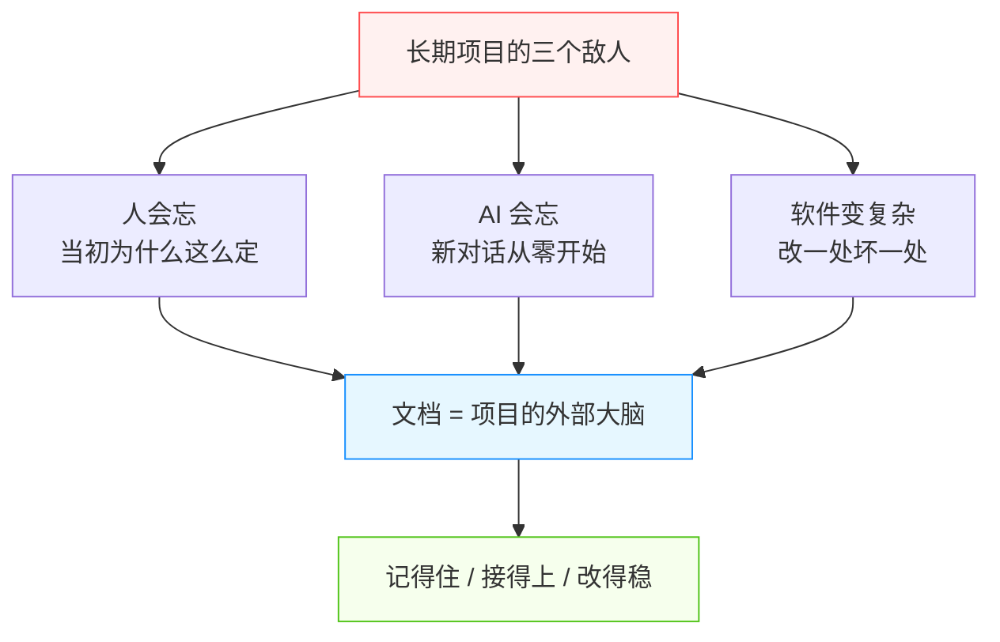
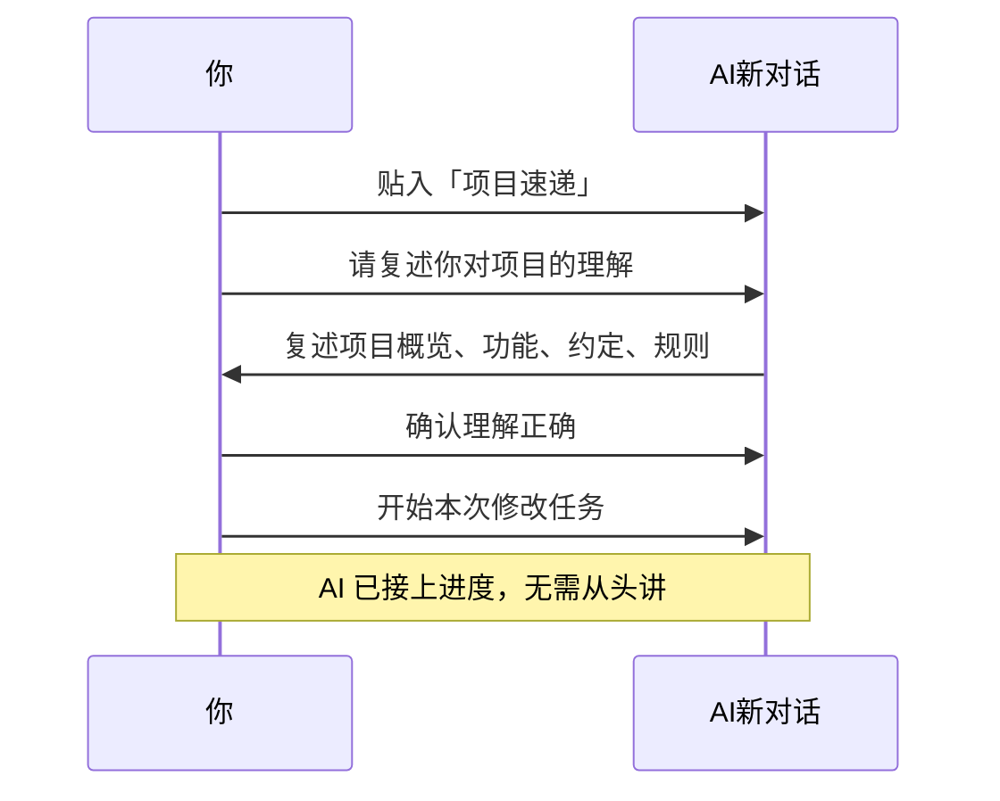

# 第33章 如何管理一个长期的软件项目

> 这一章要解决一个问题：短期做个小工具很简单，可一个软件用上一年、两年，功能越堆越多、改过无数次，你和 AI 都会「记不住」。怎么让一个长期项目始终清清楚楚、不乱套？答案是——给它建立文档和记忆。

## 本章你会学到

- 为什么长期项目离不开文档
- 怎么建立项目说明书、功能清单、技术说明
- 怎么定下开发规则，让每次修改都守规矩
- 怎么建立「项目记忆」，让 AI 接着上次的进度干活
- 怎么让新对话里的 AI 快速读懂整个项目
- 怎么规划长期的迭代节奏

### 引子：记不住的烦恼

花店小助手上线快两年了。这两年里，它长成了小满生意的好帮手：客户档案、节日提醒、会员积分、积分商城、花材库存……功能一大堆。

可小满最近越来越头疼。

有一天她想改个积分规则，打开和 AI 的对话，发现几百条消息翻不到头。她想不起来「积分有效期」当初是怎么定的，也想不起来「手机号打码」是哪次加的、为什么加。更糟的是，她换了台电脑、重开了一个对话，AI 完全不认识她的项目了：

**你：** 帮我把积分商城的兑换规则改一下。

**AI：** 好的。请告诉我：你的项目是什么？积分商城有哪些功能？数据存在哪里？之前有哪些约定？

**你：** 我……我之前跟你说过啊。

**AI：** 抱歉，这是一个新对话，我看到不到之前的任何记录。

小满这才意识到：**她把项目的全部记忆，都寄托在一段会翻不到头的聊天记录里。** 一旦对话丢了、换了工具、或者想换个 AI 帮忙，一切都得从头讲。

「就像开店，」她后来跟阿晴说，「刚开始货少，脑子里都记得。现在货多了，不记账、不做台账，就乱了。软件也得有个台账。」

这一章，我们就教你给软件建「台账」——文档和记忆。它让一个长期项目，无论做多久、换多少次对话、换几个 AI，都始终清清楚楚。

## 33.1 为什么长期项目需要文档

先说清楚「文档」是什么。**文档（documentation）**，就是把项目的关键信息写下来、存成文件——项目是干什么的、有哪些功能、怎么实现的、有哪些规矩。

短期项目（比如做个一次性小工具）不写文档也能做。但长期项目不一样，因为它有三个「敌人」：

**敌人一：你会忘。** 人的记忆靠不住。三个月前为什么把提醒改成提前三天？当时踩了什么坑？不上心记，过段时间就一片空白。

**敌人二：AI 会忘。** 每个新对话，AI 都是从零开始。它没有跨对话的记忆（除非你把资料喂给它）。对话越长，它越容易「顾头不顾尾」，漏掉前面的约定。

**敌人三：软件会变复杂。** 功能越多、改得越多，牵一发而动全身。没有文档，你根本不敢改——怕改了 A 坏了 B。

文档就是对抗这三个敌人的武器。它像一个「项目的外部大脑」：你忘了，查它；AI 不认识项目，读它；怕改坏，看它的规则。



小满听完，恍然大悟：「所以我该把要紧的事都写下来，而不是指望记在聊天记录里。」

对。文档不用写得多正式，哪怕是一个朴素的文本文件，只要把关键信息记下来，就比全靠记忆强百倍。

## 33.2 如何建立项目说明书

第一份文档，叫**项目说明书（project brief / README）**。它是一份「一页纸」，让任何人在几分钟内明白：这个项目是什么、给谁用、为什么要做。

它回答几个最基本的问题：

- **项目叫什么**？
- **给谁用、解决什么问题**？
- **核心功能有哪些**（粗线条列一下）？
- **现在做到哪一步了**（当前状态）？
- **谁在维护、怎么联系**（如果是团队）？

小满的项目说明书是这样写的：

> **项目名称**：花店小助手
> **用途**：给社区花店店主（我）用的内部工具，管理客户订花、节日提醒、会员积分和兑换。
> **要解决的问题**：过去用本子记订单，翻查慢、容易漏掉节日送花。
> **核心功能**：客户档案、节日提醒、订单管理、会员积分、积分商城、花材库存。
> **当前状态**：v2.3 已上线，手机电脑都能用。积分商城刚加，正在观察客户使用情况。
> **使用者**：主要是店主本人，偶尔店员帮忙录入。

就这么一页，任何人拿到都能立刻明白个大概。

写项目说明书有个小技巧：**假设半年后你完全忘了这个项目，这份说明能不能让你五分钟内回忆起来？** 能，就够了。

**你：** 项目说明书要不要写得很详细？

**AI：** 不用。它是「概览」，不是「百科全书」。详细的留到功能清单和技术说明里。说明书贵在短、准、一眼看懂。太长反而没人看。

## 33.3 如何建立功能清单

第二份文档，叫**功能清单（feature list）**。它把项目「有哪些功能」一条条列清楚，是项目的「目录」。

功能清单不只是列名字，最好每条带上**状态**，这样你一眼就知道做到哪了：

| 功能 | 说明 | 状态 |
|---|---|---|
| 客户档案 | 记录客户姓名、电话、订花历史 | ✅ 已完成 |
| 节日提醒 | 节日前 3 天提醒送花 | ✅ 已完成 |
| 订单管理 | 新增、查询、修改订单 | ✅ 已完成 |
| 会员积分 | 消费 1 元得 1 分，显示余额 | ✅ 已完成 |
| 积分商城 | 用积分兑换 3 种花，防重复兑换 | ✅ 已完成 v2.3 |
| 花材库存 | 记录花材剩余量，低库存提醒 | 🟡 开发中 |
| 数据导出 | 导出客户名单给供应商 | ⬜ 计划中 |

这张表价值很大：

- **看进度**：哪些做完、哪些在做、哪些没开始，一目了然。
- **防止重复**：不会「明明做了还让 AI 再做一遍」。
- **规划下一步**：没做的就是待办清单。
- **交接**：新对话的 AI 一看就知道项目全貌。

功能清单要**持续更新**——每做完一个功能，就把状态从 🟡 改成 ✅。它是一份「活文档」，不是写完就锁进抽屉的死文件。

**让 AI 帮你维护功能清单：**

**你：** 这是我们现在的功能清单 [贴出表格]。我刚做完了「花材库存」，请把它的状态改成已完成，并帮我检查有没有遗漏的功能。

**AI：** 好。已把「花材库存」改为 ✅。另外我注意到，你之前提过「节日前批量提醒」但清单里没有，要不要补上？

你看，AI 不只会改表，还能帮你**查漏补缺**。

## 33.4 如何建立技术说明

第三份文档，叫**技术说明（technical notes）**。它记录「这个项目是怎么搭起来的」——用了什么技术、数据怎么存、有哪些关键约定。

零基础的你可能会想：「我又不懂技术，怎么写技术说明？」别怕，你不需要写出多高深的东西，只要让 AI 帮你把「要紧的技术事实」记下来就行。它的作用是：**下次改东西时，AI 知道该在哪改、按什么规矩改。**

技术说明里值得记的东西：

- **技术选型**：用的是什么开发方式、什么数据库（让 AI 写，你不用懂细节，但记下来）。
- **数据存什么**：客户表有哪些字段（姓名、电话、积分、等级……）。
- **关键约定**：比如「手机号对外显示要打码」「积分存在服务端，客户改不了」「日期统一用 年-月-日 格式」。
- **重要历史决定**：比如「提醒提前 3 天，因为 1 天来不及」「兑换后立刻禁用按钮，防重复提交」。

最后这一类尤其宝贵。它们是「踩过的坑」，不记下来，下次很可能再踩一遍。

小满的技术说明里有一条：

> **约定**：客户手机号在任何页面显示时，中间四位用 **** 代替（第 6 次修改时定的，因为有一次截图发群里，泄露了客户电话）。

就这一行，保证以后所有涉及手机号的地方都守规矩。

**你：** 这些技术细节我都不懂，让 AI 写、我看都看不明白，有用吗？

**AI：** 太有用。你不用懂每一行，但要懂「有哪些约定」。打个比方：你不用懂汽车的发动机原理，但得知道「这车加 92 号油、别加柴油」。技术说明就是软件的「加油须知」——让 AI 每次都按同样的规矩来，不跑偏。

## 33.5 如何建立开发规则

第四份文档，叫**开发规则（development rules）**。它规定「以后每次改东西，都要遵守什么规矩」。

如果说技术说明记的是「事实」，开发规则记的就是「纪律」。它是你给 AI（也给自己）定下的行为准则，避免「这次改得好，下次又乱来」。

开发规则可以包含：

- **改动的规矩**：「每次只改一个功能」「改之前先说清要改哪、会影响哪」「改完必须测一遍」。
- **安全的规矩**：「涉及客户数据的改动，必须先打码」「发布前必须过一遍安全审查」。
- **留痕的规矩**：「每次修改都要更新版本记录」「改完要写一句这次改了什么」。
- **沟通的规矩**：「用大白话解释改动」「不确定就先问我，别自己拍板」。

把这些写成一张清单，每次开工前让 AI 先读一遍：

**你：** 在开始修改之前，请先阅读我们的开发规则 [贴出规则]，确认你理解并会遵守，然后再动手。

**AI：** 已阅读。我确认以下规则：1）每次只改一个功能；2）改动前先说明影响范围；3）改完做回归测试；4）涉及客户数据要打码；5）更新版本记录；6）用大白话解释。我会严格遵守，现在可以开始了吗？

开发规则的最大价值，是**把「好的工作习惯」固定下来**。第 32 章的五角色流程、第 31 章的「只改 A 不动 B」，都可以写进规则，让它们从「偶尔想起来」变成「每次都执行」。

## 33.6 如何建立项目记忆

前面几份文档是「静态档案」，这一节的**项目记忆（project memory）**是「动态日记」——记录项目一路走来的过程：做过什么、改过什么、为什么改、踩过什么坑。

为什么需要它？因为文档告诉你「现在是什么样」，但记忆告诉你「为什么变成这样」。而「为什么」，往往才是最宝贵的。

比如功能清单告诉你「提醒是提前 3 天」，但项目记忆告诉你「最初是 1 天，后来有个客户抱怨来不及，才改成 3 天」。知道这个「为什么」，你以后就不会手贱把它改回 1 天。

项目记忆可以很简单，就是一个按时间记的日志文件：

> **2026-09-12** 上线 v2.0，加入会员积分。
> **2026-10-03** 改：提醒从提前 1 天改为 3 天。原因：客户反馈 1 天来不及准备。
> **2026-10-20** 修：手机号显示打码。原因：截图发群泄露客户电话，加了中间四位打码。
> **2026-11-05** 上线 v2.3，加入积分商城。踩坑：连点两次会重复扣分，已加按钮禁用 + 服务端防重。
> **2026-11-18** 发现：花材库存和订单没联动，卖出一束花库存没减。待办：下版修。

这份日记，就是项目的「病历」——每次改了什么、为什么、结果如何，都记得清清楚楚。

建立记忆有个非常实用的习惯：**每次改完东西，花一分钟写三行**——改了什么、为什么、有没有遗留问题。日积月累，它就是一笔巨大的财富。

**让 AI 帮你写记忆：**

**你：** 我们刚才完成了积分商城的修复。请帮我写一条项目记忆，包含：做了什么、为什么、踩了什么坑、有什么遗留问题。

**AI：** 好的：
> **2026-11-05** 积分商城：实现积分展示、兑换、防重复兑换。踩坑：连点两次重复扣分，已用「按钮禁用 + 服务端防重」修复。遗留：兑换记录暂未打码手机号，下版处理。

让 AI 写记忆，既省事又规范——**它会把「为什么」和「遗留问题」都替你想到了。**

## 33.7 如何让 AI 快速理解项目

有了前面这些文档和记忆，最后一步是：**让一个新对话里的 AI，快速读懂整个项目。**

方法很简单：把关键文档打包成一份「项目速递」，开新对话时先喂给 AI。

这份「项目速递」可以包括：

1. **项目说明书**（一句话概览）
2. **功能清单**（有哪些功能、状态如何）
3. **技术说明里的关键约定**（必须遵守的规矩）
4. **开发规则**（怎么改的纪律）
5. **项目记忆最近几条**（最近发生了什么）

小满把它存成了一个固定文本，每次开新对话，第一件事就是贴进去：

**你：** 我要开始一个新的修改任务。先请你阅读这份「项目速递」，读懂后简要复述你对项目的理解，确认无误后我们再开始。[贴出项目速递]

**AI：** 已阅读。我的理解是：这是「花店小助手」，一个店主自用的花店内部工具，v2.3 已上线。已有客户档案、节日提醒、积分商城等功能，花材库存开发中。关键约定有：手机号打码、积分存服务端不可篡改。开发规则是每次只改一个功能、改前说明影响、改后测试。最近在做积分商城，刚修了重复兑换的 bug。对吗？

**你：** 完全正确。现在我们来改……

看到了吗？**一段「项目速递」+「让 AI 复述确认」，几句话就让 AI 接上了进度。** 再也不用从头讲一遍。

这里有个关键动作：**让 AI 复述确认**。别贴完就直接开始——先让它用自己的话讲一遍，你确认它理解对了，再往下走。就像带新人，先让他复述一遍任务，确保没理解错。



## 33.8 如何管理长期迭代

最后，把视角拉高：**怎么规划一个软件的长期生命？**

软件上线不是终点，而是起点。长期项目要「一代一代」往前走，这就是**迭代（iteration）**——反复改进、持续更新。第 25 章讲过迭代的思路，这里我们讲怎么管理。

管理长期迭代，有几个抓手：

**第一，版本有号。** 每次发布一个版本，标上版本号（v1.0、v2.0、v2.3…），并写一句「这个版本改了什么」。这样出问题能追溯，进步也看得见。

**第二，待办有池。** 维护一个「待办清单」，把想做但没做的事都丢进去（功能清单里 ⬜ 的那些）。不急着全做，但别让它丢——想到就记下来。

**第三，节奏要稳。** 不要想到什么改什么，隔一阵集中做一轮迭代。比如小满现在「每月看一次待办，挑一两个最值得的做」。稳定的节奏，比三天打鱼两天晒网强。

**第四，每轮要收尾。** 一轮迭代结束，要做四件事：更新版本号、更新功能清单、写一条项目记忆、备份当前版本。这叫「收尾四件套」，做完这四件，这一轮才算真正结束。

**你：** 备份为什么要单独强调？

**AI：** 因为长期项目最怕「改坏了回不去」。每次稳定版本都备份一份，万一新改的功能出问题，你能立刻退回上一个好版本。就像玩游戏存档——过了关先存个档，万一后面死得好重置。

给长期项目做迭代管理，本质是**让软件「可追踪、可回退、可持续」**：知道走到哪了（版本和清单）、知道走过什么路（记忆）、出问题能退回（备份）、下一步该干嘛（待办池）。

**让 AI 帮你做迭代收尾：**

**你：** 这一轮的修改都完成了。请帮我做迭代收尾：1）把版本号从 v2.3 更新到 v2.4；2）更新功能清单的状态；3）写一条项目记忆，总结这轮改了什么；4）提醒我备份当前版本。

**AI：** 好的，收尾完成：版本已更新为 v2.4，功能清单已同步，项目记忆已追加一条「v2.4 完成花材库存与订单联动」。请记得备份当前版本——这一步需要你操作，我无法替你完成。

小满坚持这套方法半年后，项目依然井井有条。她笑着说：「以前我以为做软件是『写代码』，现在才懂，长期做软件其实是『管理』——管文档、管记忆、管节奏。代码 AI 会写，但这些台账，得我自己撑起来。」

## 常见坑

- **坑：把项目记忆全寄托在聊天记录里。** 为什么：对话会翻不到头、会丢、换 AI 就断。怎么做：把关键信息写成文档存成文件，不依赖某段对话。
- **坑：功能清单建了不更新。** 为什么：变成过期信息，反而误导。怎么做：每做完一个功能就改状态，让它始终反映现状。
- **坑：只记「是什么」，不记「为什么」。** 为什么：过段时间你会忘记当初的决定，又踩同一个坑。怎么做：项目记忆里每次都写清「为什么改」，尤其是踩过的坑。
- **坑：新对话直接开干，不让 AI 复述确认。** 为什么：AI 可能理解错了，白做一轮。怎么做：先贴「项目速递」，让 AI 复述，确认无误再开始。
- **坑：长期迭代不备份、不收尾。** 为什么：改坏了回不去，问题也说不清。怎么做：每轮结束做「收尾四件套」——更新版本、更新清单、写记忆、备份。

## 本章小结

- 长期项目的三个敌人：人会忘、AI 会忘、软件会变复杂；文档是对抗它们的「外部大脑」。
- 五份文档各司其职：项目说明书讲「是什么」，功能清单讲「有哪些、做到哪」，技术说明讲「怎么搭、什么约定」，开发规则讲「怎么改的纪律」，项目记忆讲「走过什么路、为什么」。
- 功能清单带状态、持续更新，是项目的活目录。
- 技术说明里最宝贵的是「关键约定」和「踩过的坑」，让 AI 每次按同样的规矩来。
- 开发规则把好习惯固定下来，每次开工前让 AI 先读一遍。
- 项目记忆记「为什么」，每次改完花一分钟写三行：改了什么、为什么、遗留问题。
- 新对话用「项目速递 + AI 复述确认」几句话接上进度。
- 长期迭代抓四件事：版本有号、待办有池、节奏要稳、每轮做「收尾四件套」（更新版本、清单、记忆、备份）。

## 动手练习

1. 为你的项目写一份「一页纸」项目说明书，包含：叫什么、给谁用、解决什么问题、核心功能、当前状态。
2. 建一张功能清单表，列出你项目已有的功能，给每条标上状态（✅ 已完成 / 🟡 开发中 / ⬜ 计划中）。
3. 从你过往的修改里，翻出两条「踩过的坑」，写成项目记忆（写清改了什么、为什么、结果如何）。
4. 把你的说明书、功能清单、关键约定、开发规则打包成一份「项目速递」，开一个新对话贴上，让 AI 复述确认它理解对了。

## 可复制的指令模板

**模板一：让 AI 帮你建立整套项目文档**

```text
我要给一个长期项目建立文档，让它以后不管换多少次对话都不乱套。请你当我的「项目文档管理员」，帮我一步步建好：

1. 根据我下面提供的项目信息，写一份一页纸「项目说明书」（项目是什么、给谁用、解决什么问题、核心功能、当前状态）；
2. 列一张「功能清单表」，包含功能名、说明、状态三列；
3. 写一份「技术说明」，重点记录关键约定和踩过的坑；
4. 起草一份「开发规则」清单（每次只改一个功能、改前说明影响、改后测试、数据打码、更新版本记录、用大白话解释）。

我的项目信息是：[用大白话描述你的项目、现有功能、已知的重要约定和踩过的坑]
先生成草稿给我看，我确认后再定稿。
```

**模板二：新对话快速接上进度 + 迭代收尾**

```text
【开始新任务时】我要开始一个新的修改任务。先请你阅读这份「项目速递」，读懂后用自己的话复述你对项目的理解（概览、功能、关键约定、开发规则、最近进展），确认无误后我们再开始。[贴出项目速递]

【一轮迭代结束时】这一轮的修改都完成了。请帮我做迭代收尾：
1. 给出下一个版本号建议，并写一句「这个版本改了什么」；
2. 更新功能清单的状态；
3. 写一条项目记忆（改了什么、为什么、遗留问题）；
4. 列出我接下来需要手动做的事（如备份当前版本）。
```
