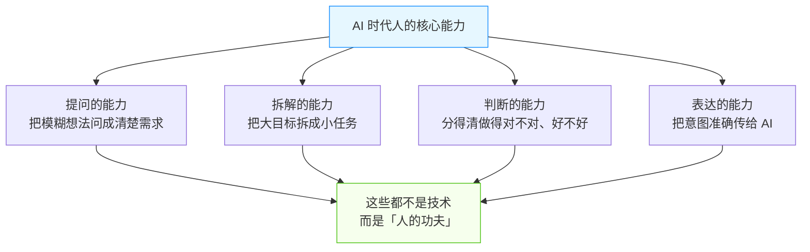
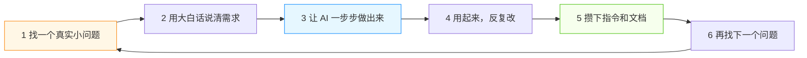

# 第34章 自然语言编程的未来

> 这是全书的最后一章。前面三十三章，我们手把手做软件、改软件、排错、发布、迭代，还学会了写指令、带团队、管项目。这一章，我们要抬头看远方：当软件开发的门槛一降再降，当 AI 越来越强，普通人该往哪里走？答案不在技术里，而在你自己身上。

## 本章你会学到

- 软件开发的门槛正在怎样改变，它意味着什么
- 「不会代码」会不会成为问题——一个诚实的回答
- 自然语言会不会成为新的编程语言
- AI 开发时代，人真正的核心能力是什么
- 创意、判断力、表达能力为什么比以往更重要
- 一个普通人，怎么一步步建立属于自己的软件能力

### 引子：两年后的那台电脑

两年前，林小满坐在小区门口花店的电脑前，对着 AI 打下第一句话：

> 「我想做一个花店用的小工具，能记下每个客户订了什么花、电话、要送到哪天，并在日子快到的时候提醒我。我不懂编程，你一步一步带我做。」

那时候，她连「代码」是什么都不知道，紧张得像第一次去面试。

两年后的今天，还是那台电脑，还是那家花店。小满的软件已经长成了生意的好帮手：客户档案、节日提醒、会员积分、积分商城、花材库存，手机电脑都能用。她早就不怕改东西了——遇到问题，她会先写清需求、切换角色让 AI 分工、改完做测试、再记一笔项目记忆。

阿晴在旁边看着，惊叹：「小满姐，你现在比很多程序员还厉害。」

小满笑着摇头：「我哪会编程。我只是……学会把话说清楚了。」

她顿了顿，望着窗外来来往往买花的人，轻声说：「两年前我以为，做软件是程序员的事，跟我没关系。现在才明白，有想法的人，本来就该能把想法做出来。」

这句话，其实就是这本书从头到尾想告诉你的事。在这最后一章，我们把目光从「怎么做」移到「走向哪」，看看自然语言编程的未来，以及——你在其中的位置。

## 34.1 软件开发的门槛正在改变

回望历史，软件开发的门槛一直在降，只是这一次降得格外猛。

最初，计算机是庞然大物，只有少数科学家能操作。后来有了编程语言，从机器语言到汇编，再到 Python、JavaScript 这些「高级语言」——每一步，都让编程离普通人近一点。但即便到了高级语言，你仍得学语法、记规则、练逻辑，门槛依然不低。

AI 带来的这一次，不一样。它降的不是「一点点」门槛，而是**换掉了门槛的种类**。

| 时代 | 门槛在哪 | 你要先学会什么 |
|---|---|---|
| 早期计算机 | 操作机器本身 | 硬件、机器语言 |
| 编程语言时代 | 与计算机对话的语法 | 一门编程语言 |
| 自然语言编程时代 | 把想法说清楚 | 描述需求、拆解问题、判断结果 |

看懂这张表了吗？门槛没有消失，而是**从「技术门槛」变成了「表达与思考的门槛」**。

过去你要问：「我会写代码吗？」现在你要问：「我能把想要的东西说清楚吗？我能判断做出来的对不对吗？」

这对林小满这样的人是巨大利好。她不懂代码，但她懂花、懂客户、懂生意——这些「领域知识」，过去做软件时排不上用场，现在却成了最宝贵的输入。**AI 能把代码写出来，但「要做什么、做成什么样」得靠你这个懂行的人。**

打个比方：过去盖房子，你得自己会砌砖；现在施工队有了，你只要当「懂房子的甲方」。门槛从「手上会不会干活」，变成了「脑子里清不清楚要什么」。

## 34.2 不会代码是否会成为问题

这是很多人心里最大的问号，也是本书必须诚实回答的问题。

**短答案：对绝大多数人来说，不会代码，不会成为问题。**

但我要把话说完整，给你一个分场景的答案：

| 你想做的事 | 不会代码是问题吗 | 说明 |
|---|---|---|
| 做个人工具、内部系统、小应用 | 基本不是 | 本书全程教的，就是这类 |
| 做中小型产品、原型、验证想法 | 通常不是 | 能说清需求、会迭代就够 |
| 做大型复杂系统、底层架构 | 会，但这本来就是专业程序员的活 | 自然语言编程不是来取代他们的 |
| 需要极致性能、极高安全的核心系统 | 会 | 这类仍需要传统工程的严谨 |

所以诚实的结论是：**自然语言编程不是让所有人都去写飞机控制系统，而是让千千万万有想法的人，能做出自己需要的软件。** 这恰恰是过去被挡在门外的那群人——小店主、老师、会计、医生、退休老人、家庭主妇——第一次有了亲手做工具的机会。

**你：** 可是，完全不懂代码，出了错我怎么知道错在哪？

**AI：** 这是个好问题，也是很多人不敢开始的真正原因。但你回想一下，前面几十章我们处理过多少「出错」的场景？你从没写过一行代码，却能靠「描述现象、发截图、让 AI 诊断」把问题修好。因为你不需要懂代码，你需要懂的是：**「它现在不对，我想要的是对的样子」——你知道对的样子，就能驱动 AI 去修。**

**你：** 那我还要不要学一点代码？

**AI：** 不急着学。先把「说清楚需求、拆解问题、判断结果」这套本事练扎实——这是 1，代码是后面的 0。有了前面的 1，你想深入了解时再学，会学得快、学得懂；没有前面的 1，学再多代码也是散的。我的建议是：**先做出来，再按需深入。** 兴趣是最好的老师，而你做出来的软件，就是最好的兴趣起点。

一句话总结：**不会代码，不再是「能不能做软件」的门槛；但它是一道「要不要深入」的分水岭。** 而大多数人，根本不需要跨过这道分水岭——你只需要做出那个解决你问题的软件。

## 34.3 自然语言是否会成为新的编程语言

既然我们用人说话的语言就能做软件，那自然语言会不会变成「新的编程语言」？

这是个有趣的问题。我的判断是：**它正在成为一种新的「编程方式」，但严格说，它不是传统意义上的「编程语言」。**

区别在哪？

**编程语言**（比如 Python）是给人写给机器看的东西，它有严格的语法，机器照着执行。**自然语言**是你说给 AI 听的东西，它没有严格语法，靠 AI 去理解、去翻译、去生成代码。

也就是说，中间多了 AI 这个「翻译官」。你说的中文不是直接变成程序运行，而是先被 AI 理解成意图，再由 AI 写出代码。

| 对比 | 传统编程语言 | 自然语言作为编程方式 |
|---|---|---|
| 谁执行 | 机器按语法严格执行 | AI 理解意图后生成代码 |
| 语法 | 严格、不容错 | 灵活、可模糊 |
| 出错原因 | 语法错、逻辑错 | 表达不清、AI 理解偏差 |
| 你的核心动作 | 写得正确 | 说得清楚、判得准确 |

所以更准确的说法是：**自然语言正在成为「人与 AI 协作编程的语言」**。它不是要取代 Python、Java，而是给千千万万不写代码的人，打开了一扇门。

这里有个很重要的提醒。既然自然语言灵活、可以模糊，那是不是就不用追求说清楚了？恰恰相反。**正因为它允许模糊，你的「说清楚」才更值钱。** 在传统编程里，语法错了机器会报错提醒你；在自然语言编程里，你说模糊了，AI 可能一声不吭地做出个错东西——它不会报错，只会「看起来做完了」。所以第 31 章教的「把话说清楚」，在自然语言时代不是过时了，而是更重要了。

未来的软件行业，很可能出现「双轨」：专业程序员用编程语言打造底层和高精尖系统，而千千万万普通人用自然语言，把自己的想法变成身边的小工具。两条轨不冲突，反而互相补充。

## 34.4 AI 开发时代人的核心能力

如果写代码这件事越来越多地交给 AI，那人还剩下什么？什么能力会变得更重要？

这一节，我要给你一个可能有点意外、但非常确定的答案：**技术不是核心，人本身才是。**

具体来说，有四项能力在 AI 时代变得前所未有地重要：



**第一，提问的能力。** 过去，会答题的人厉害；现在，会提问的人厉害。因为 AI 什么都能答，关键是你问得对不对。一个好的问题，能把模糊的想法逼成清楚的需求。你会发现，前面每一章我们都在练这个——让 AI 追问你、把想法问清楚。

**第二，拆解的能力。** AI 不擅长一次做完庞大的系统，但你擅长把大问题拆成小步骤。第 7 章讲过，第 30、32 章又反复用到。这种「化整为零」的本事，是驾驭 AI 的关键。

**第三，判断的能力。** AI 会犯错、会跑偏、会一本正经地胡说。谁来把关？你。你得知道「做出来的对不对、好不好、是不是我想要的」。你越懂你的领域，判断力越强。这是 AI 永远替不了你的——因为它不懂你的生意、你的客户、你的生活。

**第四，表达的能力。** 就是前面说的「把话说清楚」。同样的想法，说得清楚的人，AI 一次做对；说不清的人，来回十轮。这项能力，直接决定你和 AI 合作的效率。

注意，这四项能力没有一项是「会写代码」。它们都是「人的功夫」——思考、判断、沟通。这也解释了为什么第 31、32、33 章我们花了整整一篇的篇幅，讲指令、团队、文档，却没讲一行代码。因为**在 AI 时代，这些才是真本事。**

## 34.5 创意、判断力与表达能力

在四项核心能力里，我想特别拎出三样东西，因为它们是最「人」、也最不会被 AI 取代的：**创意、判断力、表达能力。**

**创意：AI 能生成，但不知道「该生成什么」。**

你可以让 AI 写一百个功能点子，但「哪个点子值得做、哪个能解决真实问题」——这个选择是你的。AI 像一个想象力无限的助手，但它没有「想做点什么」的欲望。念头从哪里来？从你的生活、你的烦恼、你的观察里来。

小满的积分商城，不是 AI 想出来的，是她看到老客户反复来买花、想「能不能让常来的客人有点回报」才想到的。**创意的源头，永远是活生生的人和真实的问题。**

**判断力：AI 能给答案，但不知道「哪个答案对」。**

AI 会给你一堆方案，但取舍靠你。它不知道你的客户更在乎价格还是新鲜度，不知道你的店这个月现金流紧不紧，不知道那个功能会不会让老客户困惑。这些「分寸」，只有你懂。

**表达能力：把脑子里的东西，变成 AI 能执行的话。**

这是把创意和判断力「落地」的最后一环。你有再好的点子、再准的判断，如果表达不出来，AI 也帮不了你。反过来，表达清楚的人，能把这些能力放大好多倍。

这三样，是 AI 时代的「新读写算」。过去，读写算是基础能力；现在，**提需求（表达）、做取舍（判断）、想点子（创意）**，成了人和 AI 协作的基础能力。

好消息是：这三样都不是天生的，都能练。而这本书，从头到尾其实就是一场练习——每一次你向 AI 描述需求，是在练表达；每一次你判断「这个结果对不对」，是在练判断；每一次你想到「如果有个小工具就好了」，是在练创意。

## 34.6 普通人如何建立自己的软件能力

听到这里，你可能会想：「道理我都懂，但我一个普通人，怎么真正建立起这些能力？」

给你一条可以马上开始的路。它不要求你辞职、不要求你报班、不要求你先学三年编程——只要求你**从自己身边的一个小问题开始，动手做**。



这条路，就是你前面读过的所有章节的浓缩：

1. **找一个真实的小问题。** 从你每天皱眉的事开始——记不住、算不清、找不到、老重复。「如果有个小工具就好了」，这句话就是起点。
2. **用大白话说清需求。** 不用术语，就说给谁用、解决什么、要什么样子。说不清就问 AI，让它帮你问清楚。
3. **让 AI 一步步做出来。** 一次一步，做完确认，别贪多。
4. **用起来，反复改。** 软件是「长」出来的，不是一次做完美的。真用起来，你才知道哪里不对。
5. **攒下指令和文档。** 把好用的指令存成模板，把项目的关键信息记成文档。这些是你的积累，越攒越值钱。
6. **再找下一个问题。** 做完一个，你信心就来了，能力就长了一截。再来一个，滚雪球一样。

走完一圈，你就不再是「普通人」了——你成了一个「能把自己的想法变成软件的人」。这个身份，一旦有了，就再也丢不掉。

**你：** 可我怕自己做不好。万一做出来没人用、或者半途而废呢？

**AI：** 我想跟你说句真心话：**做坏了、做废了，都不亏。** 因为你在这个过程中练出的「说清楚、拆得开、判得准」，是长在你身上的本事，软件没了本事还在。更何况，你第一个软件不需要完美——它需要的是「存在」。哪怕它很丑、很笨、只有你一个人用，它也是你亲手把想法变成现实的证据。

小满的第一个花店小助手，也很简陋：一个列表、一个表单、一个提醒。可就是那个简陋的东西，让她迈出了第一步，然后一路走到今天。

## 尾声：回到那家花店

让我们回到开头，回到那个场景。

两年前，一个不懂编程的花店老板，坐在电脑前，紧张地打下那句「我想做个小工具」。她不知道那句话会带她走到哪里。

两年后，她的软件帮她记着几百个客户的订花习惯，在母亲节前准点提醒她送花，让老客户用积分换回一束束惊喜。她没写过一行代码，却做出了一整个系统。

有天打烊后，小满又坐在那台电脑前。阿晴已经能独立改功能了，店里的生意因为这套软件清爽了不少。她打开软件，看着满屏的客户名字和订单，忽然想起两年前那个紧张的自己。

她在心里对那个自己说：

> 你看，你没有去学编程，也没有花几万块请人。你只是学会了把想要的东西，一句一句说清楚。然后，它就长成了你需要的样子。

窗外，晚风吹过花店门口的风铃，轻轻响了一声。明天又是新的一天，客户会来，花会开，而她想做的下一个小功能，已经在心里冒芽了。

**故事到这里就结束了，但你的故事，才刚刚开始。**

这本书能给你的，不是「一句话变出完美软件」的魔法——那样东西不存在。它能给你的，是一条被无数人走过、也被验证过的路：**从真实的问题出发，把想法说清楚，拆成小步骤，和 AI 一轮轮做出来，用起来，改下去，攒下来。**

工具会变，AI 会变，但这条路的核心不会变——**因为你，那个有想法、懂生活、愿意动手的人，才是这一切的起点和主角。**

现在，轮到你了。去找到那个「如果有个小工具就好了」的瞬间，打开 AI，打下你的第一句话。

就像两年前的林小满那样。

就像这本书第一页的你自己。

## 常见坑

- **坑：觉得「不会代码就没资格做软件」，迟迟不敢开始。** 为什么：把门槛想错了——现在门槛是「说清楚」，不是「会写代码」。怎么做：直接从一个真实小问题开始动手，先做出来，信心自然来。
- **坑：把 AI 当万能，以为它会替你判断、替你想创意。** 为什么：AI 能生成、能执行，但「做什么、选哪个」是你的活。怎么做：主动练提问、拆解、判断、表达，别把脑子交出去。
- **坑：追求一步到位的完美软件。** 为什么：软件是长出来的，第一个版本注定简陋。怎么做：接受「先做个能用的」，用起来再反复改。
- **坑：学了很多技巧，却从没动手做一个完整的东西。** 为什么：能力是做出来的，不是看出来的。怎么做：哪怕做个很小的工具，也要走完「说需求—做出来—用起来—改下去」一整圈。
- **坑：不积累，每次从零开始。** 为什么：指令和文档是复利，不攒就流失了。怎么做：把好指令存成模板，把项目记成文档，让能力越攒越厚。

## 本章小结

- 软件开发的门槛正在从「技术门槛」变成「表达与思考的门槛」——这对有想法但不懂代码的普通人是大利好。
- 不会代码，对绝大多数你想做的应用不是问题；自然语言编程要做的，是让有想法的人都能做出自己的软件。
- 自然语言不是传统意义上的编程语言，而是「人与 AI 协作编程的语言」；正因为它允许模糊，「说清楚」更值钱。
- AI 时代人的核心能力是四项「人的功夫」：提问、拆解、判断、表达——没有一项是「会写代码」。
- 最不会被 AI 取代的三样：创意（想点子）、判断力（做取舍）、表达能力（落地）——这是新时代的「读写算」。
- 普通人建立软件能力，是一条六步的路：找问题→说需求→做出来→用起来反复改→攒指令文档→下一个问题。
- 做坏了、做废了都不亏——练出的本事长在你身上；第一个软件不需要完美，只需要存在。
- 全书的终点也是起点：从真实问题出发，把想法说清楚，和 AI 一轮轮做出来——工具会变，但你是起点和主角。

## 动手练习

1. 写下三个你生活或工作中「如果有个小工具就好了」的真实瞬间。挑一个最小的，用大白话把需求说清楚——这就是你下一个项目的起点。
2. 回顾你在这本书里最常做的一件事（提需求 / 拆解 / 判断结果 / 改东西），想一想：这件事对应的四项核心能力里哪一项？你打算怎么继续练它？
3. 找一个你以前觉得「太难、不敢碰」的软件想法，现在用本章的眼光重新看一遍：如果不用写代码，你会怎么把它说清楚、拆开、一步步做出来？把它写成三句话。
4. 合上书，打开一个 AI 工具，为你练习1里选的那个小问题，打出你的第一句指令。不用完美——先发出去，看看 AI 怎么回应你。

## 可复制的指令模板

**模板一：把你的一个真实想法，变成可开始的第一步**

```text
我有一个真实的小烦恼：[用大白话说清楚——谁、在什么情况下、卡在哪里、现在怎么凑合]。

我不想先学编程，我想直接在做的过程中练「把话说清楚」。请你：
1. 先问我几个问题，帮我把这个想法变成清楚的需求；
2. 帮我把它拆成 2~3 个最小的步骤，告诉我第一步做什么；
3. 用大白话解释每一步要做什么、做完是什么样。

先别急着一次性做完，我们一步一步来。开始吧。
```

**模板二：请 AI 当你的「未来教练」，帮你练核心能力**

```text
从现在起，你是我学「自然语言编程」的教练。我的目标是练好四项能力：提问、拆解、判断、表达。

在我接下来描述一个软件想法的过程中，请你：
1. 当我说得模糊时，用提问逼我说清楚（练我的表达和提问）；
2. 当我一次想做太多时，提醒我把它拆成小步骤（练我的拆解）；
3. 每次做出结果后，先问我「你觉得对不对、哪里可以更好」，再给建议（练我的判断）；
4. 全程用大白话，不用术语。

现在开始：我的第一个想法是 [写下你的想法]。
```
